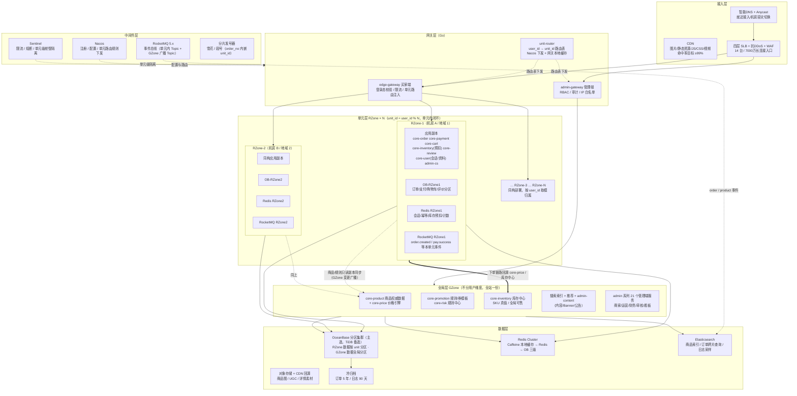
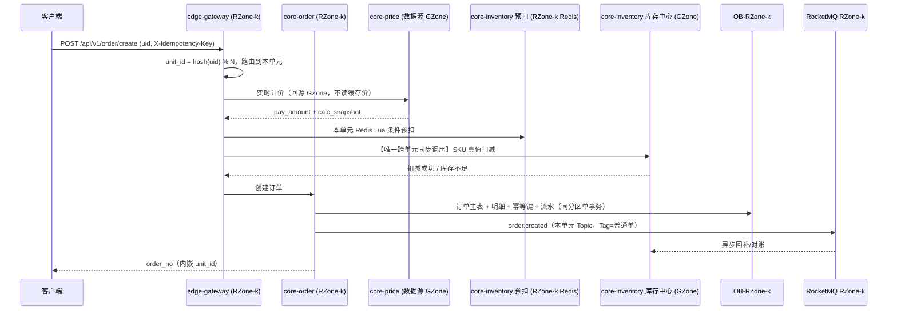

# 01 全局架构总纲与单元化部署模型

> **文档定位**：`architecture/` 系列的总纲，定义目标规模、容量口径、分层架构、单元化（RZone/GZone）部署模型，并与 `plans/` 下 10 份业务计划文件的服务命名严格对齐。
> **文档版本**：v1.0（2026-10-11）
> **上游依据**：`plans/admin-backend.md` 1.1/1.2/1.5、`plans/ios-backend.md` 1.1/1.3、`plans/miniprogram-backend.md` 1.1 命名对齐说明、`plans/pc-client-backend.md` 1.2.1

---

## 0. 统一口径与命名确认

### 0.1 规模口径（全文档唯一真值）

| 指标 | 取值 | 说明 |
|------|------|------|
| 峰值同时在线 | **1 亿** | 大促零点瞬时并发在线，不是日均值 |
| MAU | **5 亿** | 月活 |
| DAU | **3 亿** | 日活 |
| 读 QPS（进入应用层） | **300 万 ~ 500 万** | CDN + 本地缓存 + Redis 命中之后，真正打到服务的请求 |
| 写 QPS（进入应用层） | **50 万 ~ 100 万** | 请求级，非 DB 语句级 |
| 订单创建峰值 | **50 万笔/秒** | 对应写 QPS 取上限 100 万时的下单占比（见 1.3） |

口径自检（**已知偏乐观项，诚实标注**）：

- `DAU / MAU = 3/5 = 0.6`。成熟电商常态在 0.3~0.5，0.6 只在大促当月成立。**按 0.6 做容量是"按最坏情况设计"，不是常态预测**。
- `峰值同时在线 / DAU = 1亿 / 3亿 = 33%`。即假设三分之一日活在同一秒在线，这是双 11 零点级别的假设，日常应按 **3000 万 ~ 4500 万（DAU 的 10%~15%）** 运行，日常资源按峰值的 35% 缩容。
- 订单量：`5 亿 MAU × 10 单/年 = 50 亿单/年`。这是全站（含低客单）口径，用于存储测算，不等于 GMV 口径订单。

### 0.2 服务命名确认（以仓库现有文件为准）

任务书里提到的 `core-item` / `core-pay` **在仓库中不存在**，全仓 grep 结果只有一套命名。本总纲及后续所有文档一律使用下表的**实际命名**，不引入别名：

| 任务书说法 | 仓库实际命名 | 出处 |
|-----------|-------------|------|
| `core-item` | **`core-product`** | `admin-backend.md` 1.1.3、`miniprogram-backend.md` 1.1 命名对齐 |
| `core-pay` | **`core-payment`** | `miniprogram-backend.md` 1.1 命名对齐 |
| `core-user` / `core-order` | 一致，沿用 | 同上 |

**买家端共享服务（`core-*`，共 10 个已命名）**：

| 服务名 | 职责 | 语言（按现有计划） |
|--------|------|------------------|
| `core-product` | 商品/类目/品牌/SKU，商品中心 | Java |
| `core-order` | 订单生命周期、状态机、拆单 | Java |
| `core-payment` | 支付路由、渠道回调、退款、对账 | Java |
| `core-user` | 用户注册、资料、地址、积分、等级 | Java |
| `core-promotion` | 优惠券/满减/秒杀/拼团的领取与核销 | Java |
| `core-inventory` | 库存预扣、回补、流水 | Go |
| `core-price` | 价格计算引擎（**全站唯一算价实现**） | Java |
| `core-cart` | 购物车 | Java |
| `core-review` | 评价/晒单 | Java |
| `core-risk` | 登录/下单/支付/营销风控 | Java |

> 尚未在计划文件中取得 `core-*` 前缀、但必须参与单元化的共享能力：**搜索服务**、**推荐服务**、**内容服务**（对应 `admin-content`）、**物流服务**（对应 `admin-logistics`）、**客服服务**（对应 `admin-cs`）、**消息通知服务**（对应 `admin-message`）、**文件服务**（对应 `admin-file`）。本总纲在第 4 节按其 `admin-*` 归属方命名，**不擅自发明新的 `core-*` 名字**；若后续要给它们正式的 `core-*` 名，须在 10 份计划文件中同步登记后再回改本文件。

**管理端服务（`admin-*`，21 个，出自 `admin-backend.md` 1.1.1）**：`admin-gateway`(Go)、`admin-auth`、`admin-user`、`admin-product`、`admin-category`、`admin-order`、`admin-inventory`、`admin-member`、`admin-marketing`、`admin-finance`、`admin-content`、`admin-data`(Node.js)、`admin-system`、`admin-store`、`admin-message`、`admin-cs`、`admin-audit`、`admin-search`、`admin-file`(Go)、`admin-warehouse`、`admin-logistics`。
合并候选（沿用 1.1.1 备注）：`admin-product-warehouse`、`admin-audit-center`、`admin-data-query`。

### 0.3 技术基线（本总纲口径）与既有计划的差异

| 维度 | 本总纲基线 | `plans/` 现有写法 | 处置 |
|------|-----------|------------------|------|
| 微服务框架 | Spring Cloud Alibaba（Nacos/Sentinel/RocketMQ） | 已用 Nacos + Sentinel + Seata，MQ 写 RabbitMQ | **框架一致，MQ 需迁移**，见 §7 风险 R1 |
| 消息队列 | **RocketMQ 5.x** | RabbitMQ 3.x（`admin-backend.md` 1.4 交换机/队列表） | 需 Topic/Tag/ConsumerGroup 映射表 |
| 数据库 | **OceanBase 主选，TiDB 备选** | MySQL 8.0 + ShardingSphere 分库分表 | DDL 基本兼容，**分片控制权从 ShardingSphere 移到 OB 原生分区 + 单元路由** |
| 缓存 | **Caffeine 本地 + Redis Cluster** | Redis 单实例/主从（`admin-backend.md` 1.3） | 需集群化，缓存实例与数据实例隔离要求沿用 1.3.1 |
| 网关 | Go | `admin-gateway`(Go) + 买家端 API Gateway(Kong/APISIX，未定名) | 买家端网关在本总纲定名 `edge-gateway`，**新增命名，需回写 ios-backend 1.1** |
| 单元化 | RZone + GZone | 无 | 本文档首次定义 |

---

## 1. 容量测算总表

> 每一行都给出计算式，可逐条复核。**系数凡属假设的，单独标注 [假设]**，压测后必须回填。

### 1.1 长连接与连接数

| 项 | 计算过程 | 结果 |
|----|---------|------|
| 长连接用户数 [假设 70%] | 1 亿在线 × 0.7（App 心跳/推送/消息保持连接，30% 短连接纯轮询） | **7000 万** |
| 客服 WSS 并发会话 [假设 0.5%] | 1 亿 × 0.005 | **50 万会话** |
| 心跳 QPS（接入层终结） | 7000 万 ÷ 30s 周期 | **233 万次/s**，其中 [假设 10% 上报应用层] → 23 万 QPS，占读 QPS 的 5.7% |
| 单接入节点承载 [假设] | Go/Netty 8C16G，行业实测 50 万~100 万，**取保守 30 万** | 30 万/台 |
| 接入节点数（按 70% 利用率） | 7000 万 ÷ 30 万 ÷ 0.7 | **335 台 → 取 340 台** |
| 接入层内存总量 | 7000 万 × 16 KB（读写缓冲 + 连接对象，[假设]） | **1.12 TB**（340×16G = 5.4 TB 机内存，余量足） |
| 4 层 SLB | 单机 ~1000 万并发连接，7000 万 ÷ 1000 万 = 7 台，+双机热备 | **14 台**（或云 SLB 集群） |
| 长连接出口带宽（推送扇出）[假设] | 峰值 5000 万条/s 推送 × 200 B | **80 Gbps** |

### 1.2 读 QPS 分解（CDN + 缓存命中后进入应用层）

占比按电商典型浏览路径分配 [假设，需 A/B 与压测回填]：

| 业务域 | 对应服务 | 占比 | 下限 300 万 | 上限 500 万 |
|--------|---------|------|-----------|-----------|
| 商品详情 | `core-product` | 30% | 90 万 | 150 万 |
| 搜索 | 搜索服务（`admin-search` 索引） | 15% | 45 万 | 75 万 |
| 首页/推荐/内容 | 推荐服务 + `admin-content` 数据源 | 12% | 36 万 | 60 万 |
| 订单/购物车/地址查询 | `core-order`、`core-cart`、`core-user` 地址 | 12% | 36 万 | 60 万 |
| 会员/登录态/个人中心 | `core-user` | 8% | 24 万 | 40 万 |
| 营销/券/活动页 | `core-promotion`、`core-price` 试算 | 7% | 21 万 | 35 万 |
| 库存查询/可售校验 | `core-inventory` | 5% | 15 万 | 25 万 |
| 支付/账单/资产查询 | `core-payment` | 3% | 9 万 | 15 万 |
| 客服/消息/其他 | `admin-cs`、`admin-message`、埋点上报 | 8% | 24 万 | 40 万 |
| **合计** | | **100%** | **300 万** | **500 万** |

**缓存命中率要求（反推）**：若"裸 DB+RPC"可承受 5 万 QPS，要支撑 400 万读 QPS，需要综合命中率 `1 - 5/400 = 98.75%`。
即 **Caffeine 本地 60% + Redis 35% + DB/回源 5%** 必须达成，否则读链路先于写链路崩。这是本架构的第一硬约束。

> **跨文档口径收敛（00-conflict-register C10-c/d）**：
> ① **命中率口径统一**：本文"Caffeine 60% + Redis 35%"为反推要求的**示意拆分**；正式口径以 `03-cache.md` §0.1 三层定义为准 —— **L1 Caffeine 35% + L2 Redis 55%（占总读）+ 下穿 10%**，下穿经布隆/singleflight/热点回填/ES 五级收敛后 **DB 实际承接仅 2.4%（500 万读下 12 万 QPS）**，满足本文"进入 DB ≤5%"的硬约束；`08` 号口径（命中 96%、DB 读 26 万@617 万读）与之同量级互为印证。
> ② **域占比需按 06 号复核**：本文表中"搜索 45~75 万"与 `06-search-recommend.md` 的"搜索应用层峰值 150 万（含联想/筛选/facets）"、"首页/推荐 36~60 万"与 06 号"推荐应用层峰值 300 万"存在同口径矛盾，**裁决：搜索/推荐域的容量以 06 号为准（150 万 + 300 万 = 450 万）**，本表的域占比为 [假设] 项，压测回填时必须按 06 号口径重新分配剩余 150 万~250 万给其他域，或整体上修读 QPS 上限（上限口径见 08 号 617 万）。

### 1.3 写 QPS 分解与 DB 层展开

| 业务域 | 对应服务 | 占比 | 下限 50 万 | 上限 100 万 |
|--------|---------|------|-----------|-----------|
| **下单创建** | `core-order` | **50%** | 25 万/s | **50 万/s** ← 与"订单创建峰值 50 万笔/秒"对齐 |
| 库存预扣/回补 | `core-inventory` | 15% | 7.5 万/s | 15 万/s |
| 支付回调/状态回写 | `core-payment` | 12% | 6 万/s | 12 万/s |
| 购物车写 | `core-cart` | 6% | 3 万/s | 6 万/s |
| 会员/地址/评价/收藏 | `core-user`、`core-review` | 8% | 4 万/s | 8 万/s |
| 券领取/核销 | `core-promotion` | 4% | 2 万/s | 4 万/s |
| 客服/消息/其他 | `admin-cs`、`admin-message` | 5% | 2.5 万/s | 5 万/s |
| **合计** | | **100%** | **50 万** | **100 万** |

> **重要口径澄清**：50 万~100 万是**请求级写 QPS**。一个下单请求在 DB 层展开为多条写语句：

```
1 次下单请求 = 订单主表 1 + 订单明细 2.2(均摊件数) + 库存流水 1 + 幂等键 1 + 状态流水 1 ≈ 6.2 次 DB 写
```

| 展开层级 | 计算 | 结果（写 QPS=100 万时） |
|---------|------|------------------------|
| 应用层写请求 | 给定 | **100 万/s** |
| DB 层写 TPS | 50万×6.2 + 12万×3 + 15万×2 + 其余 ≈ 310万 + 36万 + 30万 + 15万 | **≈ 390 万 TPS（全站合计）** |
| **单表最大项：订单主表** | 50 万下单/s × 1（主表每单 1 行） | **50 万 TPS** |

**这是本方案最尖锐的单点**，必须由单元化摊平：

```
50 万订单/秒 ÷ N 个 RZone = 每单元订单主表写 TPS
N = 16 时 → 3.125 万 TPS/单元
单元内订单表按 user_id 再分 64 分区 + 按月分区 → 31250 ÷ 64 ≈ 488 TPS/分区
OceanBase 单分区点写实测 5 万 TPS 量级 → 余量 100 倍 ✓
```

> 结论：**"50 万笔/秒"在单库单表下不可行，在 16 单元 + 分区下每分区负载 <500 TPS，属于安全区间**。这也解释了为什么单元化是本项目的前置条件而不是优化项。

### 1.4 存储量

| 类别 | 计算过程 | 1 年 | 3 年裸存（含副本） |
|------|---------|------|------------------|
| **订单主表** | 50 亿单/年 × 1.2 KB（含收货快照/备注） | 60 TB | — |
| **订单明细** | 50 亿 × 2.2 行 × 0.6 KB | 66 TB | — |
| 订单小计（含索引/undo ×1.6） | (60+66) × 1.6 | **200 TB/年** | 600 TB 逻辑 → **1.8 PB（3 副本）** |
| 订单状态流水/审计 | 50 亿 × 5 条 × 400 B × 1.6 | 16 TB | 48 TB × 3 = **144 TB** |
| 支付流水 | 50 亿 × 800 B × 1.6 | 6.4 TB | 19 TB × 3 = **58 TB** |
| **埋点/行为日志** | 3 亿 DAU × 300 条/日 = 900 亿条 × 600 B = 54 TB/日原始，压缩 6:1 | 9 TB/日 | 热 7 天 = **63 TB**；30 天 = 270 TB（对象存储） |
| **网关/应用访问日志** | 480 万 QPS × 86400 = 4.15 万亿条/日 × 400 B = **1.66 PB/日原始** | — | 100% 进 Kafka 分层（压缩 10:1 = 166 TB/日）仅留 3 天 = **500 TB**；ES 只留 1% 采样 + 全量错误日志 |
| **商品图片（SPU）** | 500 万 SPU × 10 图 × 3 尺寸 × 150 KB | 22.5 TB | — |
| SKU 图 | 3000 万 SKU × 80 KB | 2.4 TB | — |
| 详情页长尾素材 | — | 5 TB | — |
| **UGC（评价图/头像/客服附件/海报）**[假设 年发图用户 5000 万] | 5000 万 × 20 张 × 500 KB | 50 TB | — |
| 对象存储小计（含转码副本 ×1.5） | (30 + 50) × 1.5 | **120 TB/年** | **5 年 ≈ 450 TB** |
| **Elasticsearch**（商品/订单跨片查询/客服/日志采样） | 商品 3500 万 × 1.5 KB × 3 ≈ 17 GB；订单索引 150 GB/年 × 3 年；客服消息 30 亿条/日 × 500 B × 3 留 3 天；日志采样 10 TB | — | 热数据 **50~80 TB 逻辑 → 裸存 150~250 TB** |
| **Redis Cluster**（缓存不落盘，看内存） | 商品 1500 万 key × 5 KB = 75 GB + 首页推荐 10 GB + 库存热 key 6 GB + 登录态 1 亿 × 2 KB = 20 GB + 幂等/锁/计数 50 GB | — | **全局 ≈ 200 GB → 按 60% 水位 340 GB → 14 主 14 从（25 GB/分片）**；每 RZone 会话/幂等/预扣另需 80 GB → 6 主 6 从 |

**存储总量结论**：

| 介质 | 3 年规模 | 5 年规模 |
|------|---------|---------|
| OceanBase（订单/流水/支付/业务表） | **≈ 0.9~1.8 PB 裸存** | 归档压缩后另加 ~0.1 PB |
| 对象存储 + CDN | 250 TB | **≈ 450 TB** |
| Elasticsearch | 150~250 TB | 不建议保留 >3 年 |
| 日志分层（Kafka → 冷存） | **500 TB~1 PB（最大项）** | 必须设保留期上限 |
| Redis 内存（全局 + 16 单元） | 200 GB + 16×80 GB ≈ **1.5 TB 内存** | — |

> **最大存储项不是订单，是日志**（1.66 PB/日原始）。不设采样与保留期上限，日志成本会超过业务数据本身。这条必须写进运维基线。

### 1.5 带宽

| 项 | 计算过程 | 结果 |
|----|---------|------|
| **CDN 边缘峰值** [假设 平均 150 Kbps/在线用户] | 1 亿 × 150 Kbps | **15 Tbps**（由 CDN 厂商承担，采购口径） |
| **CDN 回源（目标命中率 99%）** | 15 Tbps × (1 − 0.99) | **150 Gbps** |
| CDN 回源（命中率仅 95% 的恶化情形） | 15 Tbps × 0.05 | **750 Gbps** ← 命中率每降 1 个百分点，回源多 150 Gbps |
| **源站 API 出口（读）** | 400 万 QPS × 8 KB 平均响应 | 32 GB/s = **256 Gbps** |
| 源站 API 出口（写） | 80 万 QPS × 1.2 KB | 0.96 GB/s ≈ **8 Gbps** |
| 源站 API 出口（含 P99 突发 ×1.5） | (256 + 8) × 1.5 | **≈ 400 Gbps** |
| 长连接出口（推送扇出） | 见 1.1 | **80 Gbps** |
| **同城双活数据同步**（DB 层写 390 万 TPS × 1 KB，Paxos 跨机房） | 3.9 GB/s = 31 Gbps，按 2 倍突发 + 冗余 | **专线 2 × 40 Gbps** |
| **异地单元间：GZone 变更广播** | 5000 变更/s × 5 KB × 16 单元 | 400 MB/s ≈ **3.2 Gbps** |
| 异地单元间：日志/埋点回流集中 | 9 TB/日 ÷ 86400 s | 1.04 GB/s ≈ **8.3 Gbps** 持续 |
| 跨地域骨干 | 上两项 + 峰值余量 | **20 Gbps** |

**带宽结论**：源站 400 Gbps 出口 + CDN 15 Tbps 边缘 + 同城专线 80 Gbps + 跨地域 20 Gbps。**CDN 命中率是成本放大器**：99% → 95% 意味着回源带宽翻 5 倍。

> **跨文档口径收敛（00-conflict-register C10-i/j）**：① CDN 边缘带宽本文 15 Tbps 与 `05` 号 12 Tbps、`09` 号 6~19 Tbps 为不同假设（人均 150 Kbps vs 0.2 图/s×80KB），**采购按 12~15 Tbps 常态、19 Tbps 上限（09 号）预留**。② 回源带宽本文 150 Gbps 建立在"边缘命中率 99%"假设上，是乐观下限；`05` 号按分层命中率实算为 **回源 485 Gbps / 四层 LB 双向 545 Gbps**，**源站回源带宽规划以 05 号为准**（本文 95% 命中率恶化情形 750 Gbps 作为压力上限）。③ 源站 API 出口本文按 8 KB/响应推出 400 Gbps，`09` 号按 gzip 后 3 KB 推出 100~150 Gbps，**矛盾按最保守取 400 Gbps（本文）规划**，压测回填实际响应体积后校准。

---

## 2. 全局架构图



分层职责（与图一一对应）：

1. **接入层**：只做流量工程（DNS/Anycast/SLB/WAF）与静态资源卸载，**不做业务路由**。
2. **网关层**：Go 实现。`edge-gateway` 承担买家端登录态、限流、**单元路由注入**；`admin-gateway` 承担管理端 RBAC 与审计（管理端不参与单元化）。`unit-router` 是逻辑组件，产出路由表给两个网关。
3. **单元层 RZone × N**：用户侧读写全链路闭环，**每个 RZone 是一套完整的 `core-*` 服务副本 + 独立 OB 分区 + 独立 Redis + 独立 RocketMQ Topic**。
4. **全局层 GZone**：商品、价格、促销规则、库存真值、搜索/推荐/内容、风控规则，以及全部 `admin-*` 管理端服务。**GZone 只有读广播，RZone 不回写 GZone 的商品/类目数据**（回写走管理端）。
5. **数据层**：OB 主选（TiDB 备选）承载结构化；Redis Cluster + Caffeine 承载缓存；ES 承载检索与跨片点查；对象存储承载非结构化；冷归档独立。
6. **中间件层**：Nacos/Sentinel/RocketMQ/发号器，**跨单元横切**，独立于业务单元部署。

---

## 3. 单元化模型

### 3.1 单元划分维度

```
unit_id = hash(user_id) % N        （N 取 2 的幂：2 / 4 / 8 / 16 / 32）
```

- **分片键 = `user_id`**，与 `admin-backend.md` 1.2.1 既有约束（订单按 `user_id` 分库、`order_no` 查询必须携带 `user_id`）**完全同源**，单元化不是新增一套分片规则，而是把已有 `user_id` 分片提升为部署边界。
- **N 取 2 的幂**：扩容翻倍时，`N → 2N` 只有一半用户的归属变化，可用"单元搬家 + 数据搬迁"分批迁移；若 N 不是 2 的幂，扩容会全量 rehash。
- **`hash` 用 Murmur3 取低位**，不用 `user_id % N` 裸取模（裸取模在用户 ID 分段发放时会出现热点单元），但**对外表述仍统一写作"按 user_id 取模"**。
- **发号器必须把 `unit_id` 编进 `order_no`**：`order_no = yyyyMMddHHmmss + unit_id + 雪花尾段`。这样**任何以 `order_no` 发起的查询（支付回调、客服查单、管理端查单）都能本地算出路由，无需查路由表**——这是 `admin-backend.md` 1.2.1 第 2 条约束在单元化下的自然延伸。**编码细则以 `02-data-storage.md` §3.2 为唯一真值**：`order_no = yyyyMMddHHmmss（14 位）+ 槽位（4 位，0000~8191）+ 序列（6 位）`，槽位→物理分区/单元映射表可反解；本文早期"unit_id（2 位）"写法作废（00-conflict-register C13）。内部雪花 ID 的单元位（4 位单元 + 6 位节点，单元上限 16）见 `08-ha-multiactive.md` §8.2 R5，与 order_no 槽位分属两层，互不冲突。

### 3.2 单元内闭环原则

**判定准则：凡是"以 user_id 为主键或主要查询维度"的链路，必须在单元内闭环，一个请求从进网关到返回不跨单元。**

| 链路 | 是否单元内闭环 | 说明 |
|------|--------------|------|
| 登录态/会话/资料读写 | ✅ 闭环 | `core-user` 会话侧在 RZone，账号主数据在 GZone（见 3.4） |
| 商品浏览 | ✅ 读闭环 | RZone 内有 `core-product` **只读副本**，不回源 GZone（下单时才回源） |
| 加购/改购物车 | ✅ 闭环 | `core-cart` 按 `user_id` 分片，天然单元内 |
| **下单** | ✅ **强闭环** | `core-price` 计价 → `core-inventory` 本单元预扣 → `core-order` 写本单元 OB → 本单元 RocketMQ `order.created` |
| **支付** | ✅ **强闭环** | 支付下单、渠道回调、退款全部路由回 `order_no` 所属单元 |
| **查单/售后** | ✅ **强闭环** | 按 `user_id` / `order_no` 直接命中本单元 |
| 券领取/核销 | ✅ 闭环 | 券**账本**按 `user_id` 在 RZone；券**模板/规则**在 GZone |
| 搜索/推荐 | ✅ 读闭环 | 索引在 GZone 建，**每个 RZone 部署只读检索副本**，查询不跨地域 |
| 库存预扣 | ⚠️ 半闭环 | 预扣在 RZone Redis，**SKU 真值在 GZone 库存中心**（见 3.4 风险点） |
| 客服会话 | ✅ 闭环 | 会话按 `user_id` 归属单元，`admin-cs` 在 GZone 侧接收坐席侧 |

**下单链路时序（闭环 + 唯一一次跨单元回源）**：



**闭环带来的三个硬收益**（也是本方案的立论基础）：

1. 50 万订单/秒被拆成 N 份，单库不再需要承载全站写。
2. 下单链路的跨机房往返从"多点散布"收敛为**单元内 3 次 + 唯一一次跨单元回源（库存中心）**，下单 P99 目标 300 ms（含该回源，需压测验证）。
3. 单元可作为**故障舱壁**：一个单元故障只影响 1/N 用户，`Sentinel` 按 `unit_id` 做隔离，避免全站雪崩。

**闭环的代价**：`order_no` 查询必须带 `user_id` 或内嵌 `unit_id`（既有约束已覆盖）；管理端跨片列表查询全部走 ES（既有 1.2.1 约束 2 已覆盖）。

### 3.3 GZone 全局数据与跨单元场景

| 数据/能力 | 归属 | RZone 如何使用 | 更新方式 |
|----------|------|--------------|---------|
| 商品 SPU/SKU、类目、品牌 | **GZone `core-product` 权威** | RZone 只读副本，TTL 5 s + 事件失效 | 管理端写 GZone → RocketMQ 广播 → 各 RZone 刷副本 |
| 价格规则 / 计价引擎 | **GZone `core-price`** | **下单时实时回源**，不读副本价格 | 无状态服务，RZone 本地起无状态实例，但**数据源是 GZone** |
| 促销/券模板/秒杀配置 | **GZone `core-promotion`** | RZone 缓存规则副本 | 管理端配置 → 广播 |
| 券领取记录 / 核销流水 | **RZone**（跟随 `user_id`） | 本单元读写 | — |
| 库存 SKU 真值 | **GZone `core-inventory` 库存中心** | RZone 本地预扣 Redis | 见 3.4 |
| 搜索索引 / 推荐模型 | **GZone 建索引，RZone 只读副本** | 单元内查询 | 增量同步 < 5 s |
| 商家 / 店铺 / 店铺商品关系 | **GZone** | 只读 | 商家后台走管理端，不分单元 |
| 风控规则 / 黑白名单 | **GZone `core-risk` 规则** | RZone 执行 | 规则热更新广播 |
| **风控实时计数**（滑动窗口） | **全局共享 Redis**（不属于任何单元） | 跨单元必须共享，否则换 IP/设备即可绕过 | 中心化计数器 |
| 内容 Banner / 公告 / 专题 | **GZone `admin-content`** | RZone 缓存 | 管理端配置 |
| 全部 `admin-*` 管理端 | **GZone 单测部署** | 不进单元 | 商家/运营/财务访问无用户维度 |

### 3.4 跨单元与边界场景（含已知难点）

**场景 1：下单读 GZone 商品**
`core-order` 在 RZone 内完成，商品信息来自 RZone 只读副本；`core-price` 与库存真值实时回源 GZone。
**一致性口径**：副本允许 5 s 内读延迟（与 `admin-frontend.md` 176 行"最终一致、最长 N 分钟生效"口径一致），**但金额与库存一律以回源实时结果为准**（与 `android-backend.md` 962 行"下单计价一律实时回源 core-price，不读缓存价格"一致）。

**场景 2：库存——本方案最难的一点**
- 方案：**预扣在 RZone，真值在 GZone**。RZone 下单时在本地 Redis 做 Lua 条件预扣（沿用 `admin-backend.md` 5.3.1 "Redis 预扣 + DB 乐观锁 + 库存流水 + MQ 事件"），同时向 GZone 库存中心提交扣减，由库存中心保证全局可售不超卖。
- **代价**：下单链路存在**一次跨单元同步调用**（回源 GZone），这与"单元内闭环"冲突。
- **诚实结论**：**单元化无法消除全局共享库存的跨单元调用**。要彻底闭环，只能按仓/按区域把 SKU 库存拆到单元（区域库存），但这要求商家侧有区域仓模型，现有 10 份计划中**没有区域仓定义**（`admin-warehouse` 只有仓库管理，无"SKU→区域"路由）。因此 v1.0 采用中心化库存 + 跨单元同步调用，**并把库存中心列为技术上限的首要约束**（见 §5）。

**场景 3：跨店铺拆单**
一个订单可含多店铺子单（`android-backend.md` 966 行），但**店铺与买家同属一个单元的读路径**：子单仍写在同一个 RZone（分片键是买家 `user_id`，不是 `shop_id`）。管理端按 `shop_id` 查订单走 ES（既有约束）。

**场景 4：全站秒杀**
1 亿人抢 1 万件，热点在**单个 SKU**，单元化不能摊平热点。必须走独立链路：GZone 秒杀集群 + 单元内本地库存配额 + 令牌桶预分配，**不经过 `core-order` 常规下单链路**（`admin-marketing` 秒杀配置在 GZone，配额按 `unit_id` 预切分下发到各 RZone）。

**场景 5：用户搬家（扩容 / 负载不均）**
1. 路由表先在 `unit-router` 生成新映射，Nacos 全量下发。
2. 目标单元拉取源单元该 `user_id` 段的数据（OB 在线导出 + 校验）。
3. 过渡期双写：网关标记 `user_id` 段为 `migrating`，读写同时打新旧两单元，以新单元为准。
4. 迁移完成，旧单元清理，Nacos 摘除迁移标记。
**风险点**：过渡期双写窗口内的订单状态冲突，需要按 `order_no` 时间戳仲裁（见 §7 R5）。

### 3.5 单元路由：用户 → 单元映射与规则下发

```
[登录时] core-user(GZone) 签发 token，claim 中写入 unit_id
   ↓
[请求进入] edge-gateway 读取 token.claim.unit_id（本地命中，0 次查询）
   ↓
[未登录/匿名] 按设备指纹 hash 落到"匿名单元"（只读商品/搜索，不产生写）
   ↓
[claim 缺失/过期] 网关查本地路由缓存（unit-router 下发的 user_id 段 → unit 表）
   ↓
[本地缓存 miss] 回源 unit-router（Nacos 配置 + 本地文件兜底）
   ↓
[注入] 网关加 header X-Unit-Id，按 unit_id 转发到对应 RZone 的服务网格/K8s Service
```

**规则下发四层保障**：

| 层 | 载体 | 时效 | 降级行为 |
|----|------|------|---------|
| L1 | JWT claim `unit_id` | 登录时固化，token 有效期内不变 | 过期走 L2 |
| L2 | 网关本地路由表（内存） | Nacos 推送 < 1 s | 表旧但可用，最多路由到旧单元（旧单元需保留 24 h 反向代理） |
| L3 | `unit-router` 服务查询 | 兜底 | 服务不可用走 L4 |
| L4 | **客户端/本地文件兜底表**（静态 JSON，随版本/配置更新） | 小时级 | 保证网关全挂时仍能定位单元 |

**路由表结构**（示例，N=16）：

```
{ "version": 2026101101, "unitCount": 16,
  "segments": [ {"start": 0, "end": 134217727, "unit": 1}, ... ],
  "migrating": [ {"start": 67108864, "end": 80530635, "from": 5, "to": 13} ] }
```

---

## 4. 全局架构 vs 现有业务计划的对接

### 4.1 10 份计划文件与服务的 RZone/GZone 归属

| # | 计划文件 | 涉及服务 | 归属 | 单元化改造量 |
|---|---------|---------|------|------------|
| 1 | `plans/admin-backend.md` | `admin-*` 共 21 个服务 | **GZone 全量**（管理端不分用户维度） | 中：多单元事件汇聚 |
| 2 | `plans/admin-frontend.md` | 无后端服务（依赖共享 `core-*`） | 无 | 无：仅需 UI 提示"跨单元最终一致" |
| 3 | `plans/ios-backend.md` | 共享 `core-*` + 移动端特有（设备/推送/更新/分享/深度链接/App Clip/合规/埋点） | 共享服务见 4.2；**移动端特有服务中：设备/推送/版本/分享/深度链接/App Clip/合规 → GZone，客服会话/埋点 → GZone 聚合 + RZone 会话** | 中 |
| 4 | `plans/ios-frontend.md` | 无后端服务 | 无 | 无（App SDK 需缓存 `unit_id`） |
| 5 | `plans/android-backend.md` | 同 ios-backend | 同上 | 中 |
| 6 | `plans/android-frontend.md` | 无后端服务（`core-*` 是 Android 模块名，**与后端 `core-*` 服务无关，禁止混淆**） | 无 | 无 |
| 7 | `plans/pc-client-backend.md` | 共享 `core-*` + 桌面特有（推送/更新/数据同步/设备/崩溃上报/配置下发） | 共享见 4.2；桌面特有 → **GZone** | 中 |
| 8 | `plans/pc-client-frontend.md` | 无后端服务 | 无 | 无 |
| 9 | `plans/miniprogram-backend.md` | 渠道适配层 + 共享 `core-*` | 渠道适配层（BFF）→ **每 RZone 各一套**；共享见 4.2 | 中 |
| 10 | `plans/miniprogram-frontend.md` | 无后端服务 | 无 | 无 |

> **Android 前端的 `core-*` 是客户端模块名**（`modules/core/core-network` 等），与后端 `core-*` 微服务**同名不同物**。单元化文档中出现 `core-*` 一律指后端服务；客户端模块在本文档中只以"App SDK"称呼，避免歧义。

### 4.2 服务级映射表（RZone / GZone / 双部署）

| 服务 | 归属 | 理由 | 是否需要改造 |
|------|------|------|------------|
| `core-order` | **RZone ×N** | 分片键 `user_id`，单元内闭环 | ✅ **必须改造**（见 4.3） |
| `core-payment` | **RZone ×N** | 支付跟随订单 | ✅ **必须改造** |
| `core-cart` | **RZone ×N** | 购物车按 `user_id` | ✅ 需声明分片与单元归属 |
| `core-review` | **RZone ×N**（写）+ GZone（读索引） | 买家写、全局展示 | ✅ 需改造读写路径 |
| `core-user` | **拆分**：账号主数据/注册/注销 → **GZone**；会话/资料/地址/积分读写 → **RZone ×N** | 注册与登录态必须全局唯一 | ✅ **必须拆分** |
| `core-inventory` | **拆分**：预扣/流水 → **RZone ×N**；SKU 真值 → **GZone 库存中心** | 全局可售必须中心化 | ✅ **必须拆分**（最大难点） |
| `core-promotion` | **拆分**：券模板/规则 → **GZone**；领取记录/核销账本 → **RZone ×N** | 规则全局、账本跟人 | ✅ **必须拆分** |
| `core-product` | **GZone 权威 + RZone 只读副本** | 商品全站一份 | ✅ 需加副本同步与事件失效 |
| `core-price` | **GZone 数据源**（服务本身无状态，RZone 可本地起实例） | 全站唯一算价 | ⚠️ 小改：数据源指向 GZone |
| `core-risk` | **拆分**：规则 → **GZone**；实时计数 → **全局共享 Redis**；执行 → RZone | 计数跨单元必须共享 | ✅ **必须改造** |
| 搜索服务（索引属 `admin-search`） | **GZone 建索引 + RZone 只读副本** | 查询量最大，必须本地化 | ✅ 需副本与增量同步 |
| 推荐服务 | **GZone**（模型/召回全局），RZone 只做实时特征 | 模型全局 | ⚠️ 小改 |
| 内容服务 `admin-content` | **GZone** + RZone 缓存 | 全局配置 | ⚠️ 小改（缓存副本） |
| 客服服务 `admin-cs` | **会话 RZone + 坐席/工单 GZone** | 会话跟用户、坐席是员工 | ✅ 需拆分会话路由 |
| 消息服务 `admin-message` | **GZone 聚合 + RZone 投递** | 推送通道全局、触达按用户 | ✅ 需按 `unit_id` 路由投递 |
| 文件服务 `admin-file` | **GZone**（Go，直传凭证 + 审核） | 对象存储全局 | ⚠️ 小改（上传分区不影响） |
| 物流服务 `admin-logistics` | **GZone**（运费模板/轨迹聚合）+ RZone（地址解析缓存） | 轨迹按订单聚合 | ⚠️ 小改 |
| `admin-*` 其余 16 个 | **GZone 全量** | 管理端不分单元 | ⚠️ 见 4.3 事件汇聚 |
| `admin-gateway` | **GZone** | 管理端入口 | ⚠️ 不参与单元路由 |
| `edge-gateway`（新定名） | **RZone ×N 各一套 + 全局入口** | 需按 `unit_id` 分发 | ✅ **新增/改造** |
| `unit-router`（新） | **GZone** | 路由表是全局资源 | ✅ **新增组件** |

### 4.3 需要改造的服务（具体名单）

**A 级：必须改造，否则无法单元化上线（7 个）**

| # | 服务名 | 改造点 | 关联现有计划章节 |
|---|--------|-------|----------------|
| 1 | **`core-order`** | ① `order_no` 内嵌 `unit_id`；② 分区键固定 `user_id` + 单元内 64 分区 + 按月；③ 下单链路禁止跨单元 RPC（除库存回源）；④ `order_item`/`order_log` 与主表同分区 | `admin-backend.md` 1.2.1、4.4；`ios-backend.md` 1.2.2 第 4 条 |
| 2 | **`core-payment`** | ① 渠道回调按 `order_no` 中 `unit_id` 路由回原单元；② 回调幂等表按单元分片；③ 退款跨单元禁令（退款必须回原单元） | `admin-backend.md` 4.4.4；`ios-backend.md` 第七章 |
| 3 | **`core-user`** | 拆为 `core-user`（GZone 账号主数据：注册/注销/三方绑定）+ 各 RZone 的会话/资料/地址/积分实例；`user.deleted` 事件需按单元广播 | `admin-backend.md` 1.4.1 `user.deleted` 行；`ios-backend.md` 12.1.2 |
| 4 | **`core-inventory`** | 拆为 RZone 预扣（Redis Lua + 流水）+ GZone 库存中心（SKU 真值）；预扣与真值提交的两阶段一致性 | `admin-backend.md` 5.3.1 |
| 5 | **`core-promotion`** | 拆为 GZone 规则/券模板 + RZone 券账本；券核销幂等按单元；秒杀配额按 `unit_id` 预切分 | `admin-backend.md` 第七章、7.3 |
| 6 | **`core-risk`** | 实时计数迁到全局共享 Redis（脱离单元），规则留 GZone，执行在 RZone | `pc-client-backend.md` 1.2.1 |
| 7 | **`edge-gateway`** | 单元路由注入（`X-Unit-Id`）、按 `unit_id` 的舱壁限流、`unit-router` 表的四层读取与降级 | `ios-backend.md` 1.1（原 API Gateway，需回写定名） |

**B 级：必须改造，但属部署/副本问题（6 个）**

| # | 服务名 | 改造点 |
|---|--------|-------|
| 8 | **`core-product`** | 加 GZone→RZone 只读副本同步链路 + RocketMQ 变更事件失效（现有 `product.updated` 事件复用） |
| 9 | **搜索服务**（索引 `admin-search`） | 索引在 GZone 集中构建，按 `unit_id` 分发只读副本到各 RZone |
| 10 | **`core-review`** | 写路径进 RZone，展示读走全局索引；`review` 事件广播刷 RZone 缓存 |
| 11 | **`admin-cs`** | 客服会话按 `user_id` 路由到 RZone，坐席侧在 GZone；会话消息跨侧经 RocketMQ |
| 12 | **`admin-message`** | 触达投递按 `unit_id` 分组，避免全单元广播风暴 |
| 13 | **`admin-data`** + `admin-data-query` | 消费侧要从"1 份事件"变成"N 个单元的事件汇聚"，看板/报表需标注数据源单元 |

**C 级：管理端（`admin-*`）事件汇聚改造（3 个，复用 14.1 既有机制）**

`admin-order`、`admin-inventory`、`admin-finance` 的读模型（`admin_order_*` / `admin_inventory_*` / `admin_settlement_*`）**已经是 MQ 事件同步 + 定时对账的读模型**（`admin-backend.md` 1.1.3、14.1），单元化后仅需：**消费者从"1 个生产者"变为"N 个 RZone 生产者"**，事件结构不变。改造量小，但**对账任务必须按单元分组**，否则跨单元统计会漏。

**不需要改造（仅配置/部署层面）**：`core-price`、`core-gateway` 外的 `admin-gateway`、`admin-auth`、`admin-user`、`admin-system`、`admin-category`、`admin-store`、`admin-audit`、`admin-warehouse`、`admin-logistics`、`admin-file`、`admin-content`、`admin-marketing`（配置侧在 GZone，不改逻辑）、`admin-member`、`admin-product`。

**非服务项的改造（必须同步，否则架构自相矛盾）**：

| 项 | 现状 | 改造 |
|----|------|------|
| MQ | RabbitMQ 3.x，`admin.order.exchange` 等 topic 交换机（`admin-backend.md` 1.4.1） | 映射到 RocketMQ 5.x：`exchange → Topic`，`routingKey → Tag`，`queue → ConsumerGroup`，DLX → RocketMQ 延迟消息 + 死信 Topic。**17 条既有事件一条都不能丢**（含 `order.refunded`、`user.deleted`） |
| DB 分片 | MySQL + ShardingSphere（`admin-backend.md` 1.2.1） | 迁 OceanBase 原生分区；`order_no` 内嵌路由的逻辑保留但改为解析 `unit_id`；DDL 由 ShardingSphere 迁 Flyway/OB schema 管理 |
| 缓存 | Redis 单实例 + 二级实例（`admin-backend.md` 1.3.1） | 升 Redis Cluster，**保留"缓存实例与数据实例隔离"的既有要求**；新增 Caffeine 本地一级 |
| 部署 | 单 K8s 集群 + docker-compose（`admin-backend.md` 1.5） | 变为"每 RZone 一套 K8s 集群 + GZone 一套 K8s 集群"，Nacos 变多集群（按单元 Namespace + 分组） |
| 网关 | `admin-gateway`(Go) 已有；买家端未定名 | 定名 `edge-gateway` 并回写 `ios-backend.md` 1.1 |

---

## 5. 技术上限

### 5.1 单元能力基线（本方案的计算单位）

| 单元内资源 | 规格 [假设] |
|-----------|-----------|
| 应用 Pod | 1500~2000（含 `core-*` 各服务副本） |
| OceanBase 集群 | 12 节点（3 副本 × 4） |
| Redis Cluster | 12 分片（6 主 6 从，各 25 GB） |
| RocketMQ | 8 Broker |
| K8s 计算核数 | ≈ 6000 核 |

**单单元稳态承接能力 [假设，必须压测回填]**：

| 指标 | 单单元上限 | 校验 |
|------|-----------|------|
| 读 QPS | **40 万** | 40 万 × 命中率 95% 落 OB ≈ 2 万 QPS，12 节点 OB 余量充足 |
| 订单创建 | **5 万/秒** | 5 万 ÷ 64 分区 = 780 TPS/分区 << OB 单分区 5 万 TPS |
| 写 QPS（请求级） | **10 万** | 展开 ~39 万 DB TPS ÷ 16 单元 ≈ 2.4 万 TPS/单元 |
| 长连接 | **440 万** | 340 台 ÷ 16 单元 ≈ 21 台 × 30 万 × 0.7 |

### 5.2 达到"1 亿在线"所需单元数

```
读 QPS：  400 万 ÷ 40 万/单元 = 10 单元
订单：     50 万/秒 ÷ 5 万/秒/单元 = 10 单元
长连接：  7000 万 ÷ 440 万/单元 = 16 单元
写 QPS：  100 万 ÷ 10 万/单元 = 10 单元
                       ↑ 取最大值 →  N = 16（含 2 个单元的容灾空置则 N = 14 在用 + 2 待命）
```

**结论：1 亿同时在线需要 14~16 个 RZone**，另配 1 套 GZone。

### 5.3 本方案的物理上限

| 约束项 | 上限 | 判定 |
|--------|------|------|
| **GZone 库存中心（SKU 真值）** | 单集群 20 节点点写 ≈ **60~80 万扣减/秒** | **首要瓶颈**，对应 60~80 万订单/秒 |
| 长连接接入层 | 340 台 × 30 万 = **1.02 亿连接** | 次要瓶颈（线性加机器可解） |
| GZone 商品变更广播 | RocketMQ 单 Topic 百万级 msg/s，5000 变更/s × 16 = 8 万/s | 非瓶颈 |
| GZone `core-product` 读（下单回源） | 50 万/s 计价回源 × 2（价格+库存）= 100 万 QPS，GZone 商品集群需 100 万 QPS | 第三瓶颈，需 `core-price`/`core-product` 全局缓存 + 只读副本 |
| 分片发号器 | 改进型雪花（16 bit 机器位 + 12 bit 序列）单机 4096/s，1000 实例 = 409 万/s | 非瓶颈 |
| 源站带宽 | 400 Gbps 出口 | 采购可解 |
| GZone 单测部署（管理端） | 全站一份，运营报表类查询 | 与 C 端无争抢，非瓶颈 |

**物理上限结论（诚实口径）**：

> **RZone × N + 单 GZone 的架构，物理上限约为 1.2 亿~1.5 亿同时在线、60~80 万订单/秒。**
> 达到 1 亿需要 14~16 单元；**1.5 亿之后再加单元无法继续提升，因为 GZone 自身（尤其库存中心与商品回源读）不再是分区问题**。
> 任务目标"1 亿"落在本方案的 80% 水位，属于**可达但没有大量冗余**的区间——1.2 亿以上必须先做 §5.4 的 GZone 分片化。

### 5.4 超出上限需要的技术（只列名，不展开）

1. **库存中心分片多活**：SKU 按品类/仓分片到多个 GZone 分片组，跨分片库存用调拨账本而非中心化计数（两阶段 + 消息最终一致）。
2. **GZone 自身分区化**：商品/类目按类目树分片，GZone 从"一整套"变成"GZone × M"，引入类目归属路由。
3. **全局序列分片**：从"单发号器集群"升级为段号/Leaf 分片 + 本地嵌入式序列，消除发号器的全局协调。
4. **搜索跨集群聚合**：ES Cross-Cluster Search（CCS）/ 分布式检索，索引按单元分片 + 全局聚合层。
5. **GZone 多地域多活**：商品/规则数据多主写入，依赖 Raft/Paxos 多活副本 + 冲突合并（主键归属法或 CRDT），放弃"单权威写"假设。
6. **长连接推送扇出分片**：推送通道从"每单元一套"升级为分片 pub-sub（NATS/自研），消除单单元 440 万连接上限。
7. **读链路边缘化**：商品详情/首页下推到边缘节点（边缘计算），把 150 万 QPS 的商品详情读移出源站。
8. **二级单元化（单元内再分片）**：单单元 1500 Pod 触达调度上限后，按 `unit_id` 内的 `bucket_id` 再分组。

---

## 6. 落地路径

| 阶段 | 形态 | 阶段技术上限 | 关键建设 | 退出判据 |
|------|------|------------|---------|---------|
| **P0 单机房**<br/>0~3 个月 | 1 个机房，1 套 K8s + 1 套 OB + 1 套 Redis + RabbitMQ（现有计划形态） | **在线 ≤ 500 万**<br/>订单 ≤ 5 万/秒<br/>读 ≤ 40 万 QPS | 落地 `admin-backend.md` 1.5 的 K8s/docker-compose；订单按 `user_id` 分库 + 按月分表（既有 1.2.1 约束）；`order_no` 内嵌路由信息 | 单机房压测达 500 万在线无 OOM；RTO 未定义（可接受全站不可用） |
| **P1 同城双活**<br/>3~6 个月 | 主写机房 A + 从机房 B；OB 同城三副本跨 A/B 部署（Paxos） | **在线 ≤ 2000 万**<br/>订单 ≤ 10 万/秒<br/>读 ≤ 150 万 QPS | ① OB 同城 3 副本跨机房，**RPO = 0，RTO < 30 s**；② 读流量按 DNS/LVS 分流到 B（无状态服务双机房部署）；③ MQ 双机房消费组；④ 专线 2 × 40 Gbps；⑤ 机房级演练（杀 A 机房） | 故障切换演练 RTO < 30 s；B 机房承接 40% 读 |
| **P2 单元雏形**<br/>6~12 个月 | **2 个 RZone（按 `user_id % 2` 分到 A/B 机房）+ 1 个 GZone**；MQ 迁 RocketMQ 5.x；DB 迁 OceanBase | **在线 ≤ 5000 万**<br/>订单 ≤ 25 万/秒<br/>读 ≤ 200 万 QPS | ① A 级 7 项服务改造落地；② `unit-router` + 网关单元路由；③ 商品只读副本链路；④ `order_no` 内嵌 `unit_id`；⑤ 管理端读模型改多生产者消费；⑥ **此时才迁 OceanBase / RocketMQ**（P0/P1 不迁，避免同期改两个变量） | 单元内闭环压测：下单全链路无跨单元 RPC（除库存回源）；单元故障隔离演练通过 |
| **P3 异地单元化**<br/>12~24 个月 | **4~8 个 RZone 分布 2~3 地域 + 1 个 GZone（主地域）**；异地灾备副本 | **在线 ≤ 8000 万**<br/>订单 ≤ 40 万/秒<br/>读 ≤ 320 万 QPS | ① 跨地域专线 20 Gbps；② 异地 OB 副本（RPO < 30 s）；③ GZone 变更广播跨地域；④ 用户搬家工具（§3.4 场景 5）；⑤ 秒杀独立链路 + 按单元配额 | 2 地域同时故障注入不丢订单；单地域撤离演练 |
| **P4 达成 1 亿**<br/>24~30 个月 | **14~16 个 RZone + 1 GZone**，CDN 15 Tbps，源站 400 Gbps | **在线 ≤ 1.2 亿**（本方案天花板 80% 水位） | ① 单元数扩到 16；② 长连接接入 340 台；③ GZone 库存中心扩容到 20 节点；④ 全链路压测 1 亿在线 + 50 万订单/秒 | 全链路压测达标，P99 下单 < 300 ms，错误率 < 0.01% |
| **P5 超 1.5 亿（可选）** | GZone 分片多活（§5.4 全部 8 项） | > 1.5 亿 | 见 §5.4 | — |

**阶段划分的两条硬规则**：

1. **P0/P1 不做单元化改造，也不迁 OceanBase/RocketMQ**——一次只动一个变量，否则故障无法归因。这与 `admin-backend.md` 16.1 的灰度发布、16.2 的回滚方案一致。
2. **P2 是单元化的最小可用形态，也是风险最高的一段**。P2 之前的所有容量目标用"加机器"解决；P2 之后才用"加单元"解决。

---

## 7. 风险与已知限制

| # | 风险 | 影响 | 处置 / 诚实结论 |
|---|------|------|----------------|
| **R1** | **技术栈口径冲突**：本总纲基线是 OceanBase + RocketMQ 5.x，`plans/` 10 份文件全部写 MySQL + RabbitMQ + ShardingSphere，共 17 条既有事件（`admin-backend.md` 1.4.1）与全部 DDL | 架构文档自相矛盾 | **必须在 P2 一次性迁移**，并产出《RabbitMQ→RocketMQ 映射表》与《MySQL→OB DDL 迁移清单》作为 02/03 号文档。**在迁移完成前，本总纲与 plans 文件的冲突是已知且未解决的** |
| **R2** | **口径矛盾**：任务给的"写 QPS 50 万~100 万"是请求级，但 50 万订单/秒展开后 DB 写 TPS 达 390 万 | 容量表易被误读为"DB 只需 100 万 TPS" | §1.3 已显式分层（请求级 / DB 语句级）。**任何压测报告必须标明测的是哪一层** |
| **R3** | **全局库存破坏单元内闭环**：下单必须回源 GZone 库存中心，跨单元同步 RTT 计入下单 P99 | 下单 P99 可能 > 300 ms；库存中心是首要瓶颈 | §3.4 场景 2 已承认。**彻底闭环需要区域仓模型，现有 `admin-warehouse` 没有"SKU→区域"路由定义**，属于本方案的结构性缺口，不是调参可解 |
| **R4** | **单元数 × 中间件冗余成本**：16 单元 × 全套 OB/Redis/MQ 不是 16 倍成本，GZone 共享摊薄，但仍需 **2.5~3 倍于单体的总成本** | 预算 | 需要财务侧确认；**若预算只够 8 单元，则上限降到 6000 万在线**，1 亿目标不可达 |
| **R5** | **用户搬家的双写窗口**：过渡期内新旧单元订单状态可能分叉 | 极端情况丢状态 | 必须按 `order_no` 时间戳仲裁 + 事后对账（复用 14.1 定时对账）。**搬家期间不建议做，尽量在低峰 + 账号冻结窗口内执行** |
| **R6** | **商家/管理端跨单元查询**：`shop_id` 维度天然跨单元 | 管理端列表查询 | 已由 `admin-backend.md` 1.2.1 约束 2（走 ES）覆盖，**但单元化后 ES 索引要聚合 N 个单元的数据，索引写入量 ×N**，ES 是运维风险最高的组件 |
| **R7** | **全站秒杀不被单元化解决** | 单 SKU 热点 | §3.4 场景 4：必须独立链路 + 单元配额预切分。**不要指望加单元解决秒杀** |
| **R8** | **日志成本失控**：访问日志原始量 1.66 PB/日 | 存储成本超过业务数据 | 必须强制：Kafka 分层 3 天 + ES 1% 采样 + 对象存储 90 天封顶。**无保留期上限的方案不可上线** |
| **R9** | **CDN 命中率假设 99%** | 每降 1 pp，回源 +150 Gbps | 需要预热策略与长缓存（商品图 Hash 版本化）。**95% 情形下回源 750 Gbps 是源站不可承受的** |
| **R10** | **大量关键系数是 [假设]**：长连接比例 70%、单机 30 万连接、单单元 40 万读 QPS / 5 万订单每秒、埋点 300 条/人/日、DAU/MAU=0.6 | 上限数字可能偏乐观或悲观 | **本总纲所有上限值未经压测验证**。P1 阶段必须建立基线压测，回填后重发 v1.1 |
| **R11** | **`android-frontend.md` 的 `core-*` 与后端 `core-*` 同名不同物** | 沟通歧义 | 本总纲 §4.1 已声明：文档中 `core-*` 一律指后端服务 |
| **R12** | **`edge-gateway`、`unit-router` 是本总纲新增命名**，未在 10 份计划文件中登记 | 命名漂移 | 需回写 `ios-backend.md` 1.1 与 `admin-backend.md` 1.1.2，**回写完成前视为待确认命名** |
| **R13** | **管理端 `admin-data`（Node.js）跨语言禁连业务库**的既有约束 | 单元化后数据源从 1 套变 N+1 套 | 沿用"只消费 MQ + 调查询接口"两条路，**但需要为每个单元建消费组**，连接数与消费组数 ×N，需评估 RocketMQ 消费组上限（单 Topic 建议 ≤ 2000 组） |

---

## 8. 与后续文档的关系

> **交叉引用修正（2026-10-11 收敛）**：本表最初按预想编号列出尚不存在的文档；`architecture/` 落盘后实际为 02~10 九份专题文档 + `00-index.md` / `00-conflict-register.md`，下表已按实际文件对齐（原"02-capacity-model / 03-unit-routing-design / 04-service-mapping / 05-data-migration / 06-deployment-phases"的预想划分取消，容量模型并入 09 号、单元路由并入 03/08 号、迁移并入 02/04 号）。

| 文档 | 内容 | 依赖本总纲 |
|------|------|-----------|
| `02-data-storage.md` | 存储容量、OB 选型、分片与 `order_no` 编码、归档、MySQL→OB 迁移路径 | §1.3、§1.4、§3.1、§7 R1 |
| `03-cache.md` | 三级缓存与热点治理、Key 规范 | §1.2 读 QPS、§3 |
| `04-messaging.md` | RabbitMQ→RocketMQ、削峰、事务消息、事件清单 | §7 R1、§1.3 写展开 |
| `05-traffic.md` | CDN/网关/长连接/限流防刷 | §1.1、§1.5、§3.5 |
| `06-search-recommend.md` | ES 搜索与推荐容量 | §1.2 域分解（搜索/推荐以本文 150 万/300 万为准） |
| `07-service-governance.md` | RPC/治理面/分布式事务/灰度 | §4.3 改造名单、§2 |
| `08-ha-multiactive.md` | 同城双活/异地多活/故障演练 | §3 单元化模型（本文为真值，见 08 §5.1 对齐注）、§6 |
| `09-performance-testing.md` | 容量模型可执行版（每万在线换算表、全链路压测、系数回填） | §1 全部系数 |
| `10-ops-runbook.md` | 硬件估算、日常运维、备份演练、大促 checklist | §6、§4 |

---

## 附录 A：一句话结论

**1 亿同时在线在本方案（RZone × 14~16 + 单 GZone）下可达，物理上限约 1.2~1.5 亿；能否达成取决于三件事——CDN 命中率 ≥99%、读缓存综合命中率 ≥98.75%、以及 GZone 库存中心能否扛住 60 万扣减/秒。前两件是工程问题，第三件是本方案的结构性缺口，需要区域仓模型才能根治。**

---

## 跨文档一致性修正（2026-10-11 收敛，详见 `00-conflict-register.md`）

| # | 修正 | 位置 | 依据 |
|---|------|------|------|
| 1 | 命中率示意拆分（Caffeine 60% + Redis 35%）与 `03` 号三层定义（L1 35% + L2 55% + 下穿 10% → DB 2.4%）统一，本文"DB ≤5%"硬约束仍成立 | §1.2 | C10-d |
| 2 | 搜索/推荐域读 QPS 矛盾（本文 45~75 万 / 36~60 万 vs 06 号 150 万 / 300 万）→ **以 06 号为上限口径**，本表占比压测回填时重排 | §1.2 | C10-c |
| 3 | 回源带宽以 `05` 号 485 Gbps（LB 545 Gbps）为准，本文 150 Gbps 为 99% 命中率下限；应用出口带宽矛盾（本文 400 Gbps vs 09 号 100~150 Gbps）取 400 Gbps | §1.5 | C10-i/j |
| 4 | `order_no` 编码"unit_id（2 位）"作废，统一为 `02` 号 §3.2 的「时间 14 + 槽位 4 + 序列 6」 | §3.1 | C13 |
| 5 | §8 与后续文档关系表按实际落盘文件（02~10 号）修正，原预想编号（capacity-model 等 5 份）取消 | §8 | — |
| 6 | 单元化模型与 `08` 号对齐：模型真值 = 本文 §3；08 号 1024 桶为迁移粒度、N=4 为 P2 最小形态、N=14~16 为 P4 达标形态 | §3、08 §5.1 | C8 |
