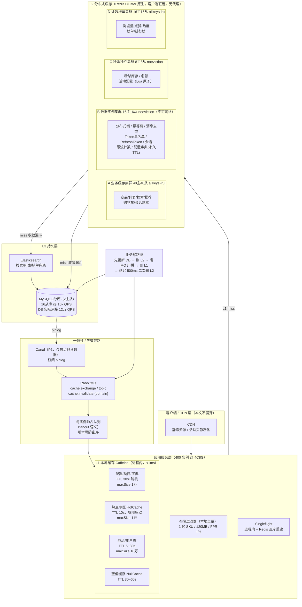
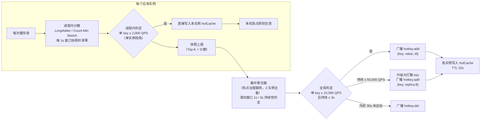

# 多级缓存与热点治理架构

> **项目**：easy-shopping 电商平台  
> **目标规模**：1 亿同时在线，读 QPS 300 万~500 万，热点商品单 key 50 万+/秒  
> **基线**：Caffeine（L1 本地）+ Redis Cluster（L2 分布式）+ MySQL/ES（L3 兜底）  
> **对齐文档**：`plans/admin-backend.md` 1.3（缓存策略，含 v1.1 审查修正）、`plans/ios-backend.md` 1.4（缓存 Key 规范、Redis 选型方案 A）  
> **文档版本**：v1.0

---

## 目录

- [〇、口径与前提](#〇口径与前提)
- [一、读 QPS 分解测算](#一读-qps-分解测算)
- [二、三级缓存架构](#二三级缓存架构)
- [三、热点治理](#三热点治理)
- [四、防穿透 / 击穿 / 雪崩](#四防穿透--击穿--雪崩)
- [五、缓存实例隔离](#五缓存实例隔离)
- [六、各业务域缓存 Key 规范](#六各业务域缓存-key-规范)
- [七、技术上限与突破路径](#七技术上限与突破路径)
- [八、秒杀 / 大促专项](#八秒杀--大促专项)
- [九、分阶段落地](#九分阶段落地)
- [十、风险与待决事项](#十风险与待决事项)

---

## 〇、口径与前提

### 0.1 统一口径

| 项 | 值 | 说明 |
|---|---|---|
| 同时在线用户 | 1 亿 | 全端合计（iOS / Android / 小程序 / PC / Web） |
| 读 QPS（应用层入口） | 300 万（中位）~ 500 万（峰值） | 已过网关与 CDN，进入应用服务的动态 API 读请求 |
| 单热点 key 读峰值 | 50 万+/秒 | 大促爆款详情页 |
| L1 Caffeine 命中率 | ≥ 30%，设计目标 35% | **占总读请求比例** |
| L2 Redis 命中率 | ≥ 60%，设计目标 55%（条件命中率 84.6%） | **占总读请求比例**；到达 L2 的条件命中率为 55%/65% ≈ 84.6% |
| L3 DB 兜底 | < 10%，设计目标 10% 下穿、DB 实际承接 ≈ 2.4% | 下穿 ≠ DB 承接，中间还有收敛漏斗（见 1.3） |

**命中率口径澄清（必须统一，否则各团队数字无法对齐）**：
本文所有"X 层命中率"均指 **占总读请求的比例**，三层相加 = 100%。
"条件命中率"指 **占到达本层请求的比例**，用于容量规划。
例：L1 命中 35% → 到达 L2 的请求 = 65%；L2 命中 55%（占总）→ L2 条件命中率 = 55/65 = **84.6%**。

### 0.2 与必读文档的一致性约束（红线）

以下三条来自 `admin-backend.md` 1.3 的 **v1.1 审查后修正**，本架构强制继承，不得回退：

1. **缓存实例与数据实例物理隔离**：
   - 缓存实例 `maxmemory-policy = allkeys-lru`，只放**可丢失**数据；
   - 数据实例 `maxmemory-policy = noeviction`（或 `volatile-lru`），存放**不可丢失**数据：分布式锁、幂等去重键、Token 黑名单 / Refresh Token、限流计数、会话、队列消费位点。
   - **原因**：`allkeys-lru` 会主动淘汰锁与黑名单 → 幂等失效、已注销 Token 复活、重复导出 / 重复扣减等资金级事故。
2. **"永久" TTL 的键必须进 `noeviction` 实例**：系统配置、数据字典、权限元数据。否则会被 LRU 淘汰，出现"配置偶发回滚到旧值"的诡异故障。
3. **缓存更新统一走「先更新 DB → 删缓存 → MQ 广播失效」**；本地 Caffeine 一律通过广播失效，**禁止本地缓存自行设长过期**。
4. **一致性三机制分工**（沿用 admin 1.3.3 v1.1，避免"三套全上"过度设计）：
   - 延迟双删 = 默认方案，覆盖 95% 写路径；
   - Canal 订阅 binlog = 只对**热点只读**数据启用（商品详情、类目树、字典），P1 阶段再引入；
   - 定时对账 = 只修 DB 级不一致，与缓存无关。

**对既有文档的一处技术澄清**（不推翻其结论，只修正措辞）：
`ios-backend.md` 1.4.3 选型说明写"均按业务划分逻辑 DB 前缀"。需注意 **Redis Cluster 原生模式下 `SELECT` 只允许 db 0**，非 0 直接返回错误。因此本文将"逻辑 DB"统一落地为 **「Key 前缀 + 客户端多集群路由」**（见第六章前缀分配表），并保持 `ios-backend.md` 方案 A（**原生 Cluster，客户端直连，不引入 Twemproxy/Codis 代理**）不变，两种方案不混用。

### 0.3 基础假设

| 假设项 | 值 | 依据 |
|---|---|---|
| SKU 总量 | 1 亿（含下架/历史） | 1 亿用户规模平台的常识量级 |
| 活跃 SKU（近 30 天有访问） | 500 万 | 长尾分布，Top 20% 商品贡献 95%+ 流量 |
| 读实例规格 | 4C8G Java（Spring Boot）/ Go | 常规微服务规格 |
| Redis 节点规格 | 16C32G，25Gbps 网卡 | 云上 r6/x6 级别 |
| MySQL 单从库点查能力 | 15,000 QPS（p99 < 20ms，覆盖索引点查） | InnoDB buffer pool 命中 99%+ 的实测经验值 |
| MQ | RabbitMQ 集群（与 admin/iOS 后端一致） | 不引入新中间件。**跨文档裁决补充（00-conflict-register C2）**：RabbitMQ 为 P0/P1 阶段口径；P2 随 `01` 号裁决一次性迁移 RocketMQ 5.x（`04` 号），届时缓存失效广播改走 RocketMQ 广播消费组或 Redis Pub/Sub（本文 §十 #10 的评估结论不变） |

---

## 一、读 QPS 分解测算

### 1.1 峰值 500 万读 QPS 的逐级分解

| 层级 | 输入 QPS | 本层条件命中率 | 本层命中 QPS | 下穿 QPS | 命中占总请求 |
|---|---:|---:|---:|---:|---:|
| 应用层总读请求 | 5,000,000 | — | — | 5,000,000 | 100% |
| **L1 Caffeine（进程内）** | 5,000,000 | 35.0% | 1,750,000 | 3,250,000 | **35.0%** |
| **L2 Redis Cluster** | 3,250,000 | 84.6% | 2,750,000 | 500,000 | **55.0%** |
| **L3 缓存未命中（miss）** | 500,000 | — | — | 见 1.2 收敛漏斗 | **10.0%** |

校验：35.0% + 55.0% + 10.0% = 100% ✓；DB 兜底 10% < 目标上限 10%（临界，见 1.4 敏感性分析）。

### 1.2 L3 miss 的 50 万 QPS 收敛漏斗（关键：下穿 ≠ DB 承接）

500 万读 QPS 下有 50 万 miss，**若直接打到 MySQL 会瞬间击穿**（16 个从库只有 24 万能力）。
因此 miss 层必须再做一轮收敛，把 50 万压到 12 万：

| 序 | 收敛手段 | 吸收 QPS | 剩余下穿 | 计算过程 |
|---|---|---:|---:|---|
| ① | 穿透拦截（布隆过滤器 + 空值缓存 60s） | 40,000 | 460,000 | miss 中 8% 是不存在的 SPU/SKU/用户 ID（恶意扫号 + 前端脏参数），全部拦截，**0 次 DB 访问** |
| ② | singleflight 跨进程互斥重建 | 55,000 | 405,000 | miss 中 11%（55,000）是同一 key 的并发重建；互斥后合并比 10:1，55,000 → 5,500，吸收约 49,500 ≈ 55,000 |
| ③ | 热点 key L1 回填吸收 | 75,000 | 330,000 | miss 中 15%（75,000）来自刚进热点榜、L1 尚未覆盖的 key；探测后写入 L1，窗口内重复读 80% 被本地吸收 |
| ④ | 列表 / 搜索 / 榜单类走 ES + 预计算 | 150,000 | 180,000 | miss 中 30% 是**集合查询**（分页、筛选、榜单），不走 MySQL 点查，由 ES / 预计算结果集兜底（ES 自身容量见 7.4） |
| ⑤ | 长尾点查合并（批量 / pipeline / 同事务重复读合并） | 60,000 | **120,000** | 剩余 180,000 为真实长尾点查；同一请求内多 key 合并为 MGET、同一事务重复读去重，合并比 1.5:1 |
| | **DB 实际承接** | | **120,000** | 占总读请求 **2.4%** |

校验：40,000 + 55,000 + 75,000 + 150,000 + 60,000 = 380,000；500,000 − 380,000 = **120,000** ✓

### 1.3 DB 承接能力校验

| 项 | 值 |
|---|---|
| DB 实际读 QPS | 120,000 |
| 从库数量 | 8 分库 × 2 从库 = **16 从库** |
| 单从库点查能力 | 15,000 QPS |
| 总读能力 | 240,000 QPS |
| **水位** | 120,000 / 240,000 = **50%** ✓ 健康（< 60% 安全线） |
| 写 QPS（订单 8,000 / 库存 5,000 / 其他 7,000） | 20,000，8 主库 × 12,000 = 96,000 能力，水位 21% ✓ |

### 1.4 中位档与敏感性分析

**中位档 300 万读 QPS**（命中率结构不变）：

| 层级 | 输入 | 命中 | 下穿 |
|---|---:|---:|---:|
| L1 | 3,000,000 | 1,050,000 (35%) | 1,950,000 |
| L2 | 1,950,000 | 1,650,000 (55%) | 300,000 (10%) |
| DB 承接 | 300,000 × 24% | **72,000** | 16 从库水位 30% ✓ |

**敏感性分析（命中率不达标的后果）**——这是本架构的**一票否决项**：

| 场景 | L1 | L2（占总） | miss | DB 承接（× 24%） | 所需从库（按水位 60%） | 结论 |
|---|---:|---:|---:|---:|---:|---|
| 设计目标 | 35% | 55% | 10% = 50 万 | 120,000 | 14 | ✅ 16 从库，水位 50% |
| 达标下限 | 30% | 60% | 10% = 50 万 | 120,000 | 14 | ✅ 刚好达标，无余量 |
| **预警** | 25% | 50% | 25% = 125 万 | 300,000 | 34 | ❌ 超容量，必须 L1 提到 30% 或网关限流 |
| 事故 | 20% | 40% | 40% = 200 万 | 480,000 | 54 | ❌ 不可行，只能降级 + 静态化 + 限流 |

> **结论**：L1 命中率每掉 1 个百分点，DB 承接 +5 万 QPS ≈ +3.3 个从库。
> **L1 不是"锦上添花"，而是整个读链路的容量地板**，因此第三章的热点治理是 P0 能力而非优化项。

### 1.5 L1 35% 命中率的来源分解（可验收，避免拍脑袋）

| 数据类别 | 占总读请求 | L1 覆盖率 | 贡献 L1 命中 | 说明 |
|---|---:|---:|---:|---|
| 配置 / 类目树 / 字典 / 开关 / AB 实验 | 6% | 98% | 5.9% | 广播预加载，几乎全命中；**必须进 L1** |
| 热点商品（Top 1 万 key，探测后入本地） | 22% | 95% | 20.9% | 热点治理（第三章）的核心产出 |
| 用户态重复读（购物车 / 地址 / 收藏 / 会员） | 16% | 45% | 7.2% | 用户在会话内反复进出，短 TTL 重复率高 |
| 首页楼层 / 列表页首屏配置 | 5% | 24% | 1.2% | 仅缓存头部楼层，翻页不进 L1 |
| 其余（订单详情、搜索、支付、强一致校验） | 51% | 0% | 0% | **禁止进 L1**（见 2.2 白名单/黑名单） |
| **合计** | 100% | | **35.2% ≈ 35%** | |

### 1.6 单实例承载校验

| 项 | 值 |
|---|---|
| 读实例数量 | 500 万 ÷ 单实例 12,500 读 QPS = **400 实例**（含 20% 余量取 400） |
| 单实例读 QPS | 12,500 |
| Caffeine 纯内存 get 能力 | 100 万~200 万次/秒（单 key 无锁读） |
| 实际单实例业务上限（含序列化 / RPC / GC） | 25,000~30,000 总 QPS |
| **水位** | 12,500 / 25,000 = **50%** ✓ 留有写请求与 RPC 空间 |

---

## 二、三级缓存架构

### 2.1 架构总图（含失效广播链路）



### 2.2 L1 Caffeine 详细设计

#### 2.2.1 分区与容量

每个读实例内按业务域拆 **4 个独立 Cache**，各自独立 `maxSize` / TTL / 统计指标（禁止用一个巨型 Cache，否则热点会挤掉配置类）：

| 分区 | maxSize | 平均 value | 内存占用 | TTL | expireAfter | 说明 |
|---|---:|---:|---:|---|---|---|
| `configCache`（配置/类目/字典/开关/AB） | 10,000 | 2 KB | 20 MB | 30s + 随机 ±10% | write | 变更走广播主动失效 |
| `hotCache`（热点专区，探测驱动写入） | 10,000 | 1.5 KB | 15 MB | **10s + 随机 ±10%** | write | 永不设长过期；探测器写入 |
| `dataCache`（商品/用户态/购物车） | 100,000 | 1 KB | 100 MB | 5~30s + 随机 | write | W-TinyLFU 淘汰 |
| `nullCache`（空值缓存） | 20,000 | 50 B | 1 MB | 30~60s + 随机 | write | 防穿透 |
| **合计** | | | **~136 MB × 1.15 开销 ≈ 156 MB** | | | 占 4G 堆的 **3.9%** ✓ |

- **淘汰策略**：统一 `W-TinyLFU`（Caffeine 默认），高频 key 自动保住、低频自动淘汰，比 LRU 更适合读偏斜分布。
- **禁止 `expireAfterAccess`**：热点 key 会被持续访问导致永不过期、与 DB 长期不一致。一律用 `expireAfterWrite`。
- **`recordStats()` 全开**：`hitRate` / `loadFailure` / `evictionCount` 按分区暴露到 Prometheus，**L1 命中率是本文档的 SLO，必须可测**。

#### 2.2.2 白名单 / 黑名单（哪些数据**禁止**进 L1）

| 类别 | 数据 | 允许进 L1 | 理由 |
|---|---|---|---|
| ✅ 白名单 | 配置、类目树、字典、开关、AB 实验、Banner、榜单、商品标题/主图/详情 | 是 | 允许秒级脏读 |
| ✅ 白名单 | 热点商品（探测后） | 是（TTL ≤ 10s） | 热点治理必需 |
| ⚠️ 灰名单 | 购物车、收藏、地址 | 是（TTL ≤ 5s，且 Key 必须含 userId） | 个人态，登出必须全量清理（对齐 `ios-frontend.md` 修订-31） |
| ❌ **黑名单** | **成交价、促销价、库存可用量、订单状态、权限、限购次数、限流阈值** | **否** | 脏读直接造成超卖 / 资损 / 越权，必须实时读 L2 或服务 |
| ❌ 黑名单 | 支付、退款、结算相关 | 否 | `admin-backend.md` 1.1.2：资金类禁止降级 |

#### 2.2.3 L1 ↔ 跨进程一致性

| 机制 | 通道 | 可靠性 | 兜底 |
|---|---|---|---|
| 广播失效（默认） | RabbitMQ `cache.exchange`（topic，路由键 `cache.invalidate.{domain}`）→ **每实例匿名独占队列**（fanout 语义，保证每个实例都收到） | 可靠，需 ACK | 消费失败重试 3 次 → DLQ + 告警 |
| **版本号防乱序** | 广播消息体带 `{key, version, ts}`；L1 每个条目记录 `cachedVersion`，收到低版本直接丢弃 | 防止"删除 → 回填 → 旧删除"乱序导致脏值残留 | — |
| **TTL 硬上限兜底** | 广播丢失时，最长脏读窗口 = 分区 TTL：配置 30s、热点 10s、商品 30s | 可接受 | 监控广播堆积（> 1000 条告警） |
| 时钟 | 全实例 NTP 校时，偏移 > 50ms 告警 | 版本比较依赖单调性 | — |

### 2.3 L2 Redis Cluster 详细设计

#### 2.3.1 分片数测算（诚实推导，不是拍脑袋）

| 项 | 计算 | 结果 |
|---|---|---|
| L2 输入（峰值档） | 读 350 万 + 业务写 40 万 | **390 万 QPS** |
| 单节点额定 QPS | 16C32G，key 64B / value 1KB，GET p99 < 1ms | **12 万 QPS**（工程经验值；7 线程 epoll + pipeline 0，无大 key） |
| 安全水位 | 故障转移时从库要接管一半流量 | **70% → 8.4 万有效 QPS/分片** |
| 所需主分片 | 390 万 ÷ 8.4 万 | **46.4 → 取 48 主**（含约 3% 扩容余量） |
| 节点数 | 48 主 + 48 从（每主 1 从，跨机架/可用区） | **96 节点** |
| slot 分配 | 16384 slot ÷ 48 ≈ 341 slot/主 | 均匀哈希 |

> **为什么必须这么多分片**：单 key 只能落在 **1 个 slot**，一个 key 的 QPS 上限 = 单分片上限。50 万/s 的单热点 key 是 4.2 个分片的能力，**无论集群多大都无法靠单 key 承载**——这是第三章热点治理存在的根本原因。

#### 2.3.2 内存水位（一个反直觉但必须说清的结论）

| 项 | 值 |
|---|---|
| 有效数据估算 | 商品详情 500 万 × 1 KB = 5 GB；列表/搜索结果 100 万 × 5 KB = 5 GB；用户态（购物车/地址/收藏，活跃 2000 万）= 10 GB；配置/类目 1 GB；膨胀与未清理 30% ≈ 7 GB → **合计 ~28 GB** |
| 48 主 × 25 GB 可用 | **1,200 GB** |
| **内存水位** | 28 / 1200 ≈ **2.3%** |

**结论**：本架构下 **QPS 是分片数的第一约束，内存远未打满**。富余内存的用途必须明确，否则就是浪费成本：
1. 副本数（提高可用性）；
2. 大 key 缓冲与压缩前的原始值；
3. 全量缓存长尾商品（500 万 → 5000 万活跃 SKU，需 50 GB，仍在容量内）；
4. 热点 key 多副本打散（×8，见 3.3）。

若业务实际是"内存先满、QPS 后满"（如海量用户态数据），应**优先按内存分片、把读压力交给 L1**，两条约束取 max。

#### 2.3.3 扩容方案

| 场景 | 手段 | 迁移成本 | 是否中断 |
|---|---|---|---|
| 读压力不足、内存充足 | **加只读副本** + 客户端开启 replica read（Lettuce `readfrom=replica` / go-redis `ReadOnly`） | 0 slot 迁移，秒级 | 否（接受异步复制延迟 < 1ms） |
| 读写都超 | **加主分片 + resharding**（slot 在线迁移） | 见下方 | 否（MOVED 重定向） |
| 单集群规模过大（> 150 节点） | **按业务域拆多集群**（如把 `product:` 前缀迁到独立集群） | 客户端路由 + key 迁移 | 灰度期双读 |

**resharding 纪律**（必须写进运维手册）：
- 迁移速率限速：每分片 ≤ 10 万 key/s 且 ≤ 500 MB/s，避免源节点 CPU 打满；
- 单分片数据 28GB ÷ 48 ≈ 0.6 GB，理论 1.2s，实际按 key 数限速约 **3~8 分钟/分片**；
- 迁移期间客户端会收到 `MOVED`/`ASK`，**必须用支持 Cluster 的客户端**（Spring Data Redis Lettuce / go-redis ClusterMode），且要验证 MOVED 重试与连接池刷新；
- 大促**冻结变更窗口**（活动前 48h 至结束后 6h 禁止扩容与配置变更）；
- 提前扩容触发线：任一分片持续 5 分钟 > 70% 水位。

#### 2.3.4 与 `ios-backend.md` 1.4.3 选型对齐

采用**方案 A：Redis Cluster 原生模式，客户端直连，无代理层**。理由：
- 代理（Twemproxy/Codis）会引入单点与额外一跳（+0.3~0.5ms p99），且不支持跨 slot Lua / MGET，与本架构的热点打散、批量合并需求冲突；
- 客户端均为成熟框架，Cluster 能力完备；
- **不混用**：后端节点一律用 Cluster 模式，不使用"Cluster 前置代理 + 后端单机"的混合形态。

### 2.4 L3 兜底层

| 数据类型 | 兜底组件 | 承接 QPS | 说明 |
|---|---|---:|---|
| 列表 / 搜索 / 榜单（集合查询） | Elasticsearch | 15 万 | ES 自身做一层缓存，聚合结果短 TTL 缓存 |
| 商品 / 用户 / 订单点查 | MySQL 读写分离 | 12 万 | 16 从库 @ 15k QPS = 24 万能力，水位 50% |
| 缓存整体不可用（Redis 全挂） | L1 降级 + 熔断限流 | — | 回源令牌桶硬限 15 万 QPS，超限直接降级返回兜底数据 + 报错（资金类不降级，见 `admin-backend.md` 1.1.2） |

---

## 三、热点治理

### 3.1 为什么必须专门做热点治理

| 事实 | 推论 |
|---|---|
| 单热点 key 50 万+ QPS | 单 Redis 分片额定 12 万 QPS → **4.2 倍超载**，单分片直接打爆，进而拖垮整个 Cluster（慢查询 → 事件循环阻塞 → 主从切换风暴） |
| 1 亿在线下 Top 1 万 key 约占 22% 读流量 | 这 22% 若全部压到 L2，需要 **110 万 QPS**，等于 13 个分片只为 1 万个 key 服务，极度浪费 |
| 结论 | **热点必须本地化（L1）**，Redis 只做 L1 未覆盖期间的缓冲与回源通道 |

### 3.2 热点探测（两级采样统计）



**设计要点**：

| 项 | 设计 | 计算依据 |
|---|---|---|
| 采样率 | 全量计数（不采样）。Caffeine 的 `stats()` 本身有开销，改用独立的 **Count-Min Sketch**（4 行 × 4096 列，~64KB/实例）在读路径上无锁累加 | 全量计数比采样准确，且 CMS 内存代价可忽略 |
| 窗口 | 1s 快照 + 3s 持续性判定 | 1s 反应快但抖动大（重试风暴会误判），3s 持续才升级为全局热点 |
| 进程内阈值 | 单实例 2,000 QPS | 400 实例 × 2,000 = 80 万，远高于全局 1 万阈值会漏判 → 所以**进程内只做"本机热点立即本地化"**，全局判定交给聚合器 |
| 全局阈值 | 单 key 10,000 QPS 且持续 3s | 10,000 = 500 万 × 0.2%；低于此值本地化收益不抵广播成本 |
| 上报开销 | 每实例每秒上报 Top 200 key → 400 × 200 = 8 万条/秒，压到 MQ 或 UDP 汇聚 | 每条 32B → 2.5 MB/s，可忽略 |
| 聚合器 | 2 实例主备，内存态计数，无持久化（探测结果可丢，1 秒内自愈） | 热点探测**不允许成为新的单点**；聚合器挂了，L1 热点最多退化为"靠 TTL 自然失效" |

### 3.3 热点本地缓存（OTCE 思路：探测后自动进入本地缓存）

> 参考阿里 OTCE（Online Traffic Control & Evacuation）思路：**探测 → 广播 → 自动本地化**，把热点流量在到达分布式缓存前就"蒸发"掉。

| 环节 | 设计 |
|---|---|
| 写入 | 聚合器广播 `hotkey.add {key, value(可选), ttl=10s}` → 每实例收到后写入 `hotCache` |
| value 是否随广播下发 | **下发**。理由：若只广播"标记"，各实例仍需回源 L2 读 value（400 实例 × 热点 key = 集中回源），反而放大 L2 压力。value 平均 1.5 KB × Top 1 万 key = 15 MB 广播量，一次广播分摊到 400 实例 = 6 GB 内网流量，1~2 秒内完成，可接受 |
| 失效 | ① TTL 10s 自然过期；② 广播 `hotkey.del`（商品变更时**必发**）；③ 商品写路径同时删 L2 与广播 L1（见 2.2.3） |
| 上限 | `hotCache` maxSize 1 万，超出按 Caffeine W-TinyLFU 淘汰 |
| 收益量化 | Top 1 万 key 贡献 22% 读流量（110 万 QPS @ 峰值），本地化后 **L2 只承担探测前 3s 窗口内的漏网流量** ≈ 1 万 QPS + 回源刷新流量，**L2 压力下降 99%** |

### 3.4 热点 key 多副本打散（L1 兜底不住时的第二道防线）

**触发条件**：全局 QPS ≥ 50 万，或单实例 `hotCache` 命中率 < 80%（如实例数暴涨导致单实例热 key 未预热）。

**方案**：将单 key 复制为 N 个副本，读时轮询/随机选择，写失效时删除全部副本。

```
原始 key：  product:detail:10018:v2        （落在 slot 12345，只能享 1 个分片 12 万 QPS）
打散 key：  product:detail:10018:v2:r0  ~  product:detail:10018:v2:r7
```

| 项 | 设计 |
|---|---|
| 副本数 | **8**。8 × 8.4 万有效 QPS = 67.2 万 > 50 万 ✓（留 34% 余量） |
| **关键约束** | **key 中禁止使用 Redis hash tag `{}`**。若写成 `product:detail:{10018}:v2:r3`，Cluster 会对 `{10018}` 做 CRC16，8 个副本全部路由到同一 slot，打散完全失效。必须让副本后缀参与 slot 计算 |
| 副本选择 | 客户端轮询（AtomicInteger 取模），避免随机的不均衡；也可按实例 ID 取模做"亲和打散" |
| 写失效 | `DEL` 8 个 key（pipeline 一次往返，~0.2ms）；或用 Lua 脚本原子删 |
| 存储代价 | ×8；单 key 1 KB → 8 KB，Top 1 万 key 从 10 MB → 80 MB，可忽略 |
| 代价 | ① 副本间可能短暂不一致（删除过程中读到部分旧值）→ 由 TTL 10s 兜底；② 批量失效复杂度上升 |

> **打散不能替代本地化**：打散后 50 万 QPS 仍会压到 Redis（只是从 1 分片摊到 8 分片），占总流量 10%，且消耗 8 倍存储与失效成本。**优先级：L1 本地化 > 打散 > 集群扩容**。

### 3.5 大促前预热

#### 3.5.1 预热清单（由运营 + 历史数据圈选）

| 来源 | 数量 | 说明 |
|---|---:|---|
| 运营圈选的活动商品 | 全量（约 5 万） | 管理端 `admin-marketing` 下发清单 |
| 历史 Top 50 万 SKU | 50 万 | 近 30 天访问 Top |
| 历史 Top 1 万（重点） | 1 万 | 全量本地化（进 hotCache） |
| 全量 SKU 存在性 | 1 亿 | 重建布隆过滤器 |

#### 3.5.2 预热步骤与耗时测算

| 步骤 | 内容 | 耗时 | 计算 |
|---|---|---:|---|
| ① 预热 L2 | DB/ES → Redis 批量 pipeline 写入 50 万 key × 1 KB = 500 MB，限速 10 万 key/s | **5 秒** | 不限速会打爆源库；限速是保护 DB |
| ② 预热 L1 | 广播 `hotkey.add` 推送 Top 5 万到 400 实例 | **~5 秒** | 5 万 × 1.5 KB = 75 MB 广播；每实例 5 万次 put @ 5 万/s = 1s，含网络抖动取 5s |
| ③ 重建布隆过滤器 | 从共享存储（OSS/内网对象存储）加载 120 MB bitmap 到 400 实例 | **~2 秒** | 120 MB × 400 = 48 GB 内网流量，每实例 100 MB/s 下载 = 1.2s；构建（1 亿元素，7 哈希）约 20s/实例，可提前离线完成 |
| ④ TTL 对齐 | 预热时把 TTL 设为 `活动开始时间 + 随机偏移`，避免大促开始瞬间集中过期 | — | 集中过期 = 自我制造雪崩 |
| ⑤ 演练验证 | 压测验证 L1 命中率 ≥ 35%、L2 水位 < 70%、DB 水位 < 60% | 1~2 小时 | 不达阈值不上线（对齐全链路压测纪律） |

#### 3.5.3 预热失败兜底

- 预热未完成时进入大促：热点探测在 3 秒内自动识别并本地化（3.2），**不依赖预热成功**；
- 布隆过滤器未重建完成：降级为"空值缓存 + 限流"，穿透风险由网关按设备限流兜底（对齐 `ios-backend.md` 1.4.6）。

---

## 四、防穿透 / 击穿 / 雪崩

### 4.1 防穿透：布隆过滤器 + 空值缓存

#### 4.1.1 布隆过滤器参数（诚实计算）

| 项 | 值 | 计算 |
|---|---|---|
| 元素数 n | 1 亿（全量 SKU/SPU，含下架） | — |
| 目标误判率 p | 1% | 更低误判率代价是内存线性上升 |
| 位数组 m | `m = −n·ln(p)/(ln2)² = 1e8 × 4.605 / 0.4805 = 9.58e8 bits` ≈ **120 MB** | — |
| 哈希函数数 k | `k = 0.693 × (m/n) = 6.6 → 7` | — |
| 每实例内存 | 120 MB | **本地全量持有** |
| 400 实例总内存 | 48 GB | 占整个集群内存极小比例，换取 **0 网络开销的穿透拦截** |

**为什么本地全量，而不是把布隆放 Redis**：
- 放 Redis：每次穿透检查 = 1 次网络往返（+0.3ms p99），且热点 ID 攻击会把布隆检查本身变成热点；
- 本地：0 网络；120 MB 在 400 实例上花费 48 GB 内存，**这个交换是划算的**。

**更新机制**：
| 时机 | 动作 |
|---|---|
| 商品上架（创建 SPU/SKU） | 写路径实时 `add()` 到本地布隆 + 广播 `bloom.add` 到所有实例 |
| 商品下架/删除 | **布隆不可删**（位数组不支持），仍会判"存在" → 由**空值缓存**兜底（下架商品查询返回 null 并缓存 60s） |
| 每日全量重建 | 离线任务从 DB 导出全量 1 亿 SKU → 构建 bitmap → 上传对象存储 → 实例启动时/凌晨低峰拉取替换（原子 swap 引用） |

**布隆的诚实局限**（必须写明，防止误用）：
1. 只能防"不存在的 ID"，防不住"存在的但已下架"和"值为空"；
2. 1% 误判率意味着 **100 万个真实存在的 ID 会被误判为不存在** → 这部分请求会被错误拦截 → 必须配合"误判白名单回源"（误判时回源 DB 确认后加入本地白名单布隆）；
3. 全量重建期间有**短暂不一致窗口**（新上架商品可能被拦），必须保证上架路径的实时 `add()` 优先。

#### 4.1.2 空值缓存

| 项 | 设计 |
|---|---|
| 存储位置 | L2 业务缓存集群 A（可淘汰，空值本身就是可丢数据）+ L1 `nullCache` |
| TTL | 30~60s + 随机 ±10% |
| 命中即返回 | 不回源 DB |
| 目的 | 布隆误判（1%）+ 已下架/已删除商品的重复查询 |

### 4.2 防击穿：singleflight（进程内 + 跨进程两级）

#### 4.2.1 进程内（同一实例并发 miss）

Caffeine `LoadingCache` 天然提供 singleflight：同一 key 的并发 `get()` 只触发一次 `load()`。
- 用 `AsyncCache` + `CompletableFuture`，未命中的请求共享同一个 future；
- **超时保护**：`load()` 限制 2s，超时后降级（返回旧值或空），避免单个慢查询拖垮整个请求线程池。

#### 4.2.2 跨进程（400 实例并发 miss 同一 key）

| 步骤 | 设计 |
|---|---|
| 抢锁 | `SET lock:rebuild:{key} {uuid} NX PX 3000`（**必须在 noeviction 数据实例 B**，见第五章） |
| 抢到 | 回源 DB → 写 L2 → 删 L1 广播（或直接广播新值）→ `DEL` 锁（Lua compare-and-del，校验 uuid 防误删他人锁） |
| 没抢到 | ① 短轮询 L2（10ms 一次，最多 3 次，共 30ms）；② 仍未命中 → 返回**旧值/逻辑过期值**；③ 无旧值 → 返回兜底数据或"请稍后重试"，**不允许**自己去回源 DB |
| 锁超时 | 3s 强制过期，防止持有者宕机导致永久阻塞 |
| 收益量化 | Top key 50 万 QPS 的并发 miss 窗口内，合并比可达 **10:1 ~ 100:1**（见 1.2 ② 项按 10:1 保守估算） |

#### 4.2.3 逻辑过期（热点 key 的免锁刷新）

| 项 | 设计 |
|---|---|
| value 结构 | `{data, logicalExpireAt}` |
| 读到逻辑过期 | **立即返回旧值** + 异步提交刷新任务（走 singleflight） |
| 物理 TTL | 设为逻辑过期时间的 2 倍（防止逻辑值丢失后永久陈旧） |
| 适用 | 热点商品详情、配置、类目树、榜单 |
| **禁用** | 价格、库存、权限、订单状态——**逻辑过期的旧值会直接造成资损** |

### 4.3 防雪崩

| 风险 | 措施 | 细节 |
|---|---|---|
| 大量 key 同时过期 | **过期时间强制加随机抖动** | 统一工具方法 `CacheTtl.of(base)` = `base × (1 + rand(−10%, +10%))`；**禁止**任何地方写裸 `expire(key, 30, MINUTES)`，用 ArchUnit 规则或 CodeReview 卡点 |
| 预热导致集中过期 | 预热时 TTL 设为 `活动开始 + 随机偏移` | 见 3.5.2 ④ |
| Redis 节点故障 | 每主 1 从，跨可用区；`cluster-node-timeout 5s`；客户端缓存 slot→node 映射，故障时快速重连 | 故障转移期间读请求由本地缓存兜底 |
| **Redis 整集群不可用** | L1 降级 + 熔断 | ① L1 有值直接返回（脏数据 > 服务不可用）；② 回源限流令牌桶硬限 15 万 QPS；③ 超限按业务降级：读类返回兜底/空，**资金与状态变更类显式报错**（对齐 `admin-backend.md` 1.1.2 "禁止降级"约定） |
| 大 key 拖垮节点 | 生产环境定期扫描 + 值压缩 | value > 4 KB 自动 gzip/protobuf 压缩；hash field > 5000 拆分；集合元素 > 1 万拆分；**大 key 扫描纳入上线 checklist** |
| 慢查询扩散 | `slowlog-log-slower-than 10ms` + 告警 | 单分片慢查询会阻塞事件循环，等同于该分片整体不可用 |

---

## 五、缓存实例隔离

> 本章是 `admin-backend.md` 1.3.1（v1.1 审查修正）的**落地细化**。核心原则：**淘汰策略 = 数据可丢性的声明**，二者必须严格对应。

### 5.1 实例划分总表

| 实例组 | 淘汰策略 | 存放数据 | 主:从 | 分片数 | 数据量 | 决策依据 |
|---|---|---|---|---|---:|---|
| **A 业务缓存集群** | `allkeys-lru` | 商品详情、列表、搜索结果、推荐、购物车、用户态、Banner、活动展示 | 48:48 | 48 主 | ~28 GB | 丢了可重建，允许脏读 |
| **B 数据实例集群** | `noeviction` | **分布式锁、幂等键、消息去重、Token 黑名单、Refresh Token、会话、限流计数、消费位点、配置/字典（永久 TTL）** | 16:16 | 16 主 | ~60 GB | **任何一条被淘汰都是事故** |
| **C 秒杀独立集群** | `noeviction` | 秒杀库存、抢购名额、限购次数、活动原子计数 | 8:8 | 8 主 | < 1 GB | 淘汰 = 超卖 = 资损 |
| **D 计数榜单集群** | `allkeys-lru` | 浏览量、点赞数、热度分、排行榜 | 16:16 | 16 主 | ~15 GB | 秒级计数可丢，落库为准 |

### 5.2 逐项判定：哪些**必须**独立实例或独立数据结构

| 数据 | 必须隔离？ | 隔离粒度 | 淘汰后果 | 决策理由 |
|---|---|---|---|---|
| **分布式锁** | ✅ 必须独立实例（B） | 独立集群 | 锁被 LRU 淘汰 → 两个请求同时拿到锁 → **重复扣减 / 重复发放 / 双重执行** | `allkeys-lru` 对**所有** key 生效，无法用前缀豁免。锁必须 `noeviction` |
| **幂等键（写接口防重）** | ✅ 必须独立实例（B） | 独立集群 | 幂等键被淘汰 → 重复提交被放行 → **重复下单 / 重复扣款** | 同上 |
| **消息去重键（`admin_message_dedup` 的 Redis 层）** | ✅ 必须独立实例（B） | 独立集群 | 去重失效 → MQ 消息重复消费 → **重复库存扣减 / 重复积分发放** | 同上；且与 `admin-backend.md` 1.4.3 去重表配套 |
| **Token 黑名单 / Refresh Token / 会话** | ✅ 必须独立实例（B） | 独立集群 | 黑名单被淘汰 → **已注销 Token 复活**、已登出用户仍可访问 → 合规事故（PIPL） | `ios-backend.md` 2.2：Refresh Token 旋转 + 旧值黑名单，黑名单丢失等于旋转机制失效 |
| **限流计数** | ✅ 必须独立实例（B） | 独立集群 | 计数被淘汰 → 限流失效 → **攻击流量放大，击穿下游** | 限流是保护机制，自身不能被削弱 |
| **队列消费位点** | ✅ 必须独立实例（B） | 独立集群 | 位点丢失 → 消息重复消费 | 同幂等键 |
| **配置 / 数据字典（TTL=永久）** | ✅ 必须独立实例（B） | 独立集群 | 被淘汰 → **配置偶发回滚到旧值** | `admin-backend.md` 1.3.3 明确要求；也可由 Nacos 配置中心本地缓存承担主责，Redis 作多语言共享兜底 |
| **秒杀库存 / 名额 / 限购次数** | ✅ 必须独立实例（C） | 独立集群（`noeviction`） | 淘汰 → **超卖**；且写密集、需 Lua 原子操作，与读缓存混放会互相影响 | 资金级数据，与 `admin-backend.md` "资金类禁止降级"一致 |
| **商品详情 / 列表 / 搜索 / 推荐** | ❌ 不需要 | 实例 A，`allkeys-lru` | 丢了重新加载 | 量大、可重建、允许脏读 |
| **购物车 / 收藏 / 地址** | ⚠️ 结构隔离 | 实例 A 内 **Hash 结构 + 强制含 userId** | 丢 = 用户体验问题，非资损 | 个人态数据必须 `userId` 隔离（对齐 `ios-frontend.md` 修订-31）；登出/注销时全量清理 |
| **浏览量 / 点赞数（秒级聚合）** | ❌ 不需要 | 实例 D，`allkeys-lru` + TTL | 丢少量计数，落库为准 | 可丢计数；但**限购次数、抢购名额不属于此类**，必须进 C |

### 5.3 实例 B（noeviction）的容量与风险控制

`noeviction` 的代价：**写满即报错**，不会淘汰任何 key。因此必须主动管理容量：

| 措施 | 设计 |
|---|---|
| maxmemory 设置 | 设为物理内存的 75%（预留 25% 给 fork / 网络缓冲） |
| **水位告警** | 50% WARN / 65% P1 / 75% P0（必须扩容或清理） |
| TTL 纪律 | **B 实例的所有 key 都必须有 TTL**（除确需永久的配置），且 TTL 由业务显式声明，禁止 `PERSIST` |
| 幂等键 TTL | 10 分钟窗口（而非 24 小时）。计算：写 QPS 20 万 × 600s = 1.2 亿 key × 150 B = **18 GB**；若用 24h 窗口 = 1.7 TB，**不可行** |
| 消息去重 TTL | 10 分钟（MQ 延迟重试最大 30s + 死信处理窗口） |
| 会话 TTL | 2 小时滑动过期（对齐 `pc-client-backend.md` 1.4）；1 亿在线 × 0.5 KB，但**活跃会话**取 3000 万 = 15 GB |
| 黑名单 TTL | 等于对应 Token 剩余有效期（`jti` 剩余 exp） |
| 容量测算合计 | 幂等 18 + 去重 18 + 会话 15 + 黑名单 2 + 配置/字典 2 + 锁 1 + 剩余 4 ≈ **60 GB** |
| 16 主 × 25 GB | 400 GB 可用 → 水位 **15%** ✓ 有充足扩容余量 |

### 5.4 逻辑隔离：Cluster 不支持逻辑 DB 的落地方式

**Redis Cluster 原生模式下 `SELECT` 只允许 db 0**。因此隔离靠三层：

1. **物理隔离**（最重要）：不同实例组，不同集群，不同 `maxmemory-policy`；
2. **Key 前缀路由**：客户端（Lettuce `ClusterTopologyRefresh` / go-redis）按前缀路由到对应集群（见第六章前缀分配表）；
3. **应用层封装**：禁止业务代码直接持有 `RedisTemplate` 裸操作，统一走 `CacheFacade`（按 key 前缀自动选集群 + 强制 TTL + 强制序列化格式 + 记录指标）。**新 key 未在前缀白名单中直接抛异常**，防止误把锁写进 LRU 集群。

### 5.5 数据结构隔离建议

| 数据 | 推荐结构 | 理由 |
|---|---|---|
| 商品详情 | `String`（压缩后的 JSON/Protobuf） | 单对象整读整写，避免 Hash 大 field |
| 购物车 | `Hash`，field = skuId，key 含 userId | 单用户购物车是整体，避免大 key；**单 Hash field ≤ 5000** |
| 库存（秒杀） | `String` + Lua 脚本原子扣减 | 简单结构保证原子性；不用 Hash（field 多则 Lua 脚本执行时间长，阻塞分片） |
| 热点榜单 | `ZSet`，score = 热度 | 天然排序；member ≤ 1 万，超限截断 |
| 分布式锁 | `String`（value = uuid） | 需要 Lua compare-and-del |
| 幂等键 | `String`，TTL 10 分钟 | 简单，读写最快 |
| 计数器 | `String` / `Hash`（按分桶） | 高并发计数用**分桶 Hash**（如 `counter:hot:{bucketId}`，16 桶，避免单 key 写热点），定期聚合 |
| 布隆过滤器 | 本地（非 Redis） | 见 4.1.1 |
| 会话 | `String`（压缩） | 整读整写，滑动过期用 `EXPIRE` 续期 |

---

## 六、各业务域缓存 Key 规范

### 6.1 命名格式（统一四段式）

沿用 `ios-backend.md` 1.4.4 的格式，作为**全端唯一规范**：

```
{业务域}:{模块}:{标识}[:{子标识}]:v{N}
```

| 规则 | 要求 |
|---|---|
| 分隔符 | 冒号 `:`，小写字母 + 数字 + 下划线，**禁止中文、空格、大写** |
| 版本段 | 一律 `v{N}`，从 `v1` 开始。**变更 key 语义必须升版本**（等同全量失效），禁止原地改 value 结构 |
| Hash tag | **禁止使用 `{}`**（除非明确需要同 slot 的多 field 原子操作，且必须在 Key 说明中注明；热点打散场景严格禁止，见 3.4） |
| 长度 | 整个 key ≤ 128 字节 |
| 用户态数据 | **必须包含 `userId`**（对齐 `ios-frontend.md` 修订-31；登出/注销时全量清理） |
| 实例归属 | 每个前缀必须在下表登记，**未登记的前缀禁止上线**（`CacheFacade` 强校验） |

### 6.2 前缀 → 实例归属分配表

| 前缀 | 实例组 | 淘汰策略 |
|---|---|---|
| `product:` `category:` `brand:` `search:` `hot:` `recommend:` `cart:` `user:favorites:` `user:browse:` `user:addresses:` | **A 业务缓存** | allkeys-lru |
| `share:` `version:` `push:token:` `banner:` `cms:` | **A 业务缓存** | allkeys-lru |
| `lock:` `idem:` `dedup:` `auth:blacklist:` `auth:refresh:` `session:` `rl:` `config:` `dict:` `offset:` | **B 数据实例** | **noeviction** |
| `seckill:` `stock:` `limit:` `groupbuy:` `bargain:` | **C 秒杀独立** | **noeviction** |
| `counter:` `rank:` `points:` `like:` | **D 计数榜单** | allkeys-lru |
| `mp:*`（小程序渠道专属） | 按内容分配（`mp:session` → B，`mp:qrcode` → A） | — |

### 6.3 各业务域 Key 设计（与既有文件对齐 + 差异修正）

> **冲突说明**：`ios-backend.md` 1.4.4 用四段式，`android-backend.md` 1.5 用三段式，两者对同一数据用了不同 key。本文以 **ios 四段式为唯一真值**，下表"既有写法"列出各文件原写法，"统一后"为最终 Key。**android-backend.md 1.5 需按本表同步修订**。

#### 6.3.1 商品域

| 数据 | 统一后 Key | 过期 | 既有写法 | 失效策略 | 进 L1 |
|---|---|---|---|---|---|
| 商品详情（SPU） | `product:detail:{spuId}:v2` | 30min + 随机 | ios `product:detail:{product_id}:v2` / android `product:spu:{spuId}` | 商品变更 → 删 L2 + 广播 L1 + 延迟 500ms 二次删 | ✅（热点进 hotCache） |
| SKU 规格 | `product:sku:{skuId}:v1` | 30min | — | 同上 | ✅ |
| 类目树 | `category:tree:{rootId}:v1` | 1h | admin 1.3.2 "类目树 1小时" | 定时刷新 + 广播 | ✅（配置类） |
| 类目列表（分页） | `product:category_list:{categoryId}:page{page}:v1` | 5min | ios 1.4.4 示例 | 标签失效 | ❌ |
| 品牌列表 | `brand:list:{categoryId}:v1` | 1h | — | 变更时删 | ✅ |
| 热门商品 | `hot:products:{categoryId}:v1` | 5min | android `hot:products:{categoryId}` | 定时刷新；误删可通过 ES 重建 | ✅ |
| 商品存在性布隆 | `bf:product:exist:v1`（**本地，非 Redis**） | 全量重建 | — | 见 4.1.1 | 本地 |

#### 6.3.2 价格域（**禁止进 L1**）

| 数据 | 统一后 Key | 过期 | 既有写法 | 失效策略 | 进 L1 |
|---|---|---|---|---|---|
| SKU 售价 | `price:sku:{skuId}:v1` | 1min | android `price:sku:{skuId}` | 秒杀/促销结束后立即删 | ❌ |
| 促销价（实时） | `price:promo:{skuId}:{activityId}:v1` | 30s | — | 活动结束删 | ❌ |
| 运费模板 | `price:freight:{templateId}:v1` | 30min | — | 变更删 | ✅ |

#### 6.3.3 库存域（**禁止进 L1，秒杀场景独立集群**）

| 数据 | 统一后 Key | 过期 | 既有写法 | 失效策略 | 实例组 |
|---|---|---|---|---|---|
| SKU 可用库存 | `stock:sku:{skuId}:v1` | 无 TTL（实时） | android `stock:sku:{skuId}` | Lua 原子增减，异步落库 | C |
| 秒杀库存 | `seckill:stock:{activityId}:r{0-7}` | 活动结束 + 1h | — | Lua 预扣；8 副本打散 | C |
| 秒杀名额/限购 | `limit:user:{activityId}:{userId}:v1` | 活动结束 + 24h | — | Lua 原子 incr | C |
| 拼团活动库存 | `groupbuy:stock:{activityId}:v1` | 活动结束 | — | Lua | C |
| 砍价活动配置 | `bargain:config:{activityId}:v1` | 活动结束 | — | 变更删 | A |

#### 6.3.4 用户域

| 数据 | 统一后 Key | 过期 | 既有写法 | 失效策略 | 实例组 |
|---|---|---|---|---|---|
| 用户资料 | `user:profile:{userId}:v3` | 30min | ios `user:profile:{userId}:v3` / android `user:{userId}` | 登录/更新时刷新 + 广播 | A |
| 收货地址 | `user:addresses:{userId}:v1` | 10min | ios `user:addresses:{userId}:v1` / android `address:user:{userId}` | 增删改时删 | A |
| 收藏列表 | `user:favorites:{userId}:v1` | 10min | android `favorite:user:{userId}` | 增删时删 | A |
| 积分余额 | `user:points:{userId}:v1` | 实时 | android `points:user:{userId}` | 变动时更新 | D |
| 浏览历史 | `user:browse:{userId}:v1` | 30min | android `browse:user:{userId}` | 登出/清空时删 | A |
| 购物车 | `cart:user:{userId}:v1` | 7 天滑动 | — | 实时更新（Hash） | A |
| 小程序用户 | `mp:user:{userId}:v1` | 30min | mp `mp:user:{userId}` | 更新时删 | A |
| 小程序 token 版本 | `mp:token:ver:{userId}:{channelCode}:v1` | 与 JWT 有效期一致 | mp `mp:token:ver:{userId}:{channelCode}` | 刷新时更新 | **B（noeviction）** |

#### 6.3.5 订单域（**禁止进 L1**）

| 数据 | 统一后 Key | 过期 | 既有写法 | 失效策略 | 实例组 |
|---|---|---|---|---|---|
| 订单详情 | `order:detail:{orderNo}:v1` | 10min | ios `order:detail:{order_no}:v1` | 状态变更时删 | A |
| 订单列表（用户维度分页） | `order:list:{userId}:s{status}:p{page}:v1` | 5min | — | 状态变更时删 | A |
| 超时关单延时标记 | `order:timeout:{orderNo}:v1` | 至付款截止 | — | MQ 延时队列驱动 | **B** |

#### 6.3.6 营销域

| 数据 | 统一后 Key | 过期 | 失效策略 | 实例组 |
|---|---|---|---|---|
| 活动配置 | `promo:activity:{activityId}:v1` | 至活动结束 | 变更时删 | A |
| 优惠券余量 | `coupon:stock:{couponId}:v1` | 活动结束 + 24h | Lua 原子扣减 | **C** |
| 用户已领券 | `coupon:user:{userId}:{couponId}:v1` | 活动结束 + 7d | 领取时写 | A |
| 秒杀活动信息 | `seckill:info:{activityId}:v1` | 活动结束 | 变更时删 | A |

#### 6.3.7 营销/推广以外的平台域

| 数据 | 统一后 Key | 过期 | 既有写法 | 实例组 |
|---|---|---|---|---|
| 推送 Token | `push:token:{deviceId}:v2` | 7 天 | ios `push:token:{device_id}:v2` / android `push:device:{deviceId}` | A |
| 版本信息 | `version:latest:{platform}:v1` | 5min | ios `version:latest:{platform}:v1` / android `version:{platform}` | A |
| 分享配置 | `share:config:{type}:v1` | 1h | android `share:config:{type}` | A |
| 分享短链映射 | `mp:share:{shareCode}:v1` | 7 天 | mp `mp:share:{shareCode}` | A |
| 小程序码 | `mp:qrcode:{scene}:v1` | 业务控制 | mp `mp:qrcode:{scene}` | A |
| 微信 AccessToken | `mp:wx:accesstoken:{appId}:v1` | 7000s（提前 200s） | mp `mp:wx:accesstoken:{appId}` | **B**（刷新加分布式锁） |
| 小程序 Session | `mp:session:{token}:v1` | 30 天滑动 | mp `mp:session:{token}` | **B** |
| 搜索热词 | `search:hot:{keyword}:v1` | 10min | ios `search:hot:{keyword}:v1` | A |
| 搜索结果 | `search:result:{hash(query)}:p{page}:v1` | 3~10min | — | A |

#### 6.3.8 基础设施类（全部在 **B 实例，noeviction**）

| 数据 | Key | TTL | 说明 |
|---|---|---|---|
| 分布式锁 | `lock:{biz}:{resource}:v1`，value = uuid | 3s（自动过期） | Lua compare-and-del |
| 写接口幂等键 | `idem:{biz}:{bizNo}:v1` | 10 分钟 | value = 响应摘要（可直接返回缓存结果） |
| 消息去重 | `dedup:{consumer}:{messageId}:v1` | 10 分钟 | 配合 `admin_message_dedup` 表 |
| Token 黑名单 | `auth:blacklist:{jti}:v1` | 等于 jti 剩余 exp | 与 `ios-backend.md` 2.2 JWT 架构配套 |
| Refresh Token | `auth:refresh:{userId}:{deviceId}:v1` | 7 天 | 旋转 + 旧值进黑名单 |
| 会话 | `session:{userId}:{deviceId}:v1` | 2h 滑动 | — |
| 限流计数 | `rl:{api}:{dimension}:{windowStart}:v1` | 窗口 + 30s | 固定窗口/滑动窗口 |
| 消费位点 | `offset:{consumerGroup}:{queue}:v1` | 永久 | noeviction 保证不丢 |
| 系统配置 | `config:{module}:{key}:v1` | 永久 | **必须 noeviction**（admin 1.3.3） |
| 数据字典 | `dict:{type}:v1` | 永久 | 同上 |

### 6.4 Key 设计的工程约束

| 约束 | 落地方式 |
|---|---|
| 前缀白名单 | `CacheFacade` 启动时加载注册表，未登记前缀 → 抛 `IllegalCacheKeyException` |
| 禁止裸 TTL | 所有 TTL 必须经 `CacheTtl.of(base)` 加随机抖动 |
| 禁止裸 RedisTemplate | 业务代码只允许注入 `CacheFacade`；CI 用 ArchUnit 规则卡点 |
| 序列化 | 统一 Protobuf（> 4KB 自动 gzip）；跨语言共享的 key（配置/字典）用 JSON，避免 Java 序列化导致 Go/Node 不兼容（对齐 `admin-backend.md` "禁止跨语言直接访问数据库"，Redis 侧同理需跨语言可读） |
| 大 key 卡点 | 单 value > 10KB 告警，> 1MB 阻断；上线 checklist 含大 key 扫描 |

---

## 七、技术上限与突破路径

### 7.1 单 Redis 节点物理上限

| 维度 | 上限 | 约束来源 |
|---|---|---|
| **读 QPS** | 8 万~15 万（小 key GET，p99 < 1ms）；本文按 **12 万**规划 | CPU（网络中断 + 协议栈 + 内存拷贝），**不是内存带宽** |
| **写 QPS** | 5 万~10 万（SET/INCR，AOF everysec） | fsync + 复制链路 |
| 单节点内存 | **32~64 GB**（超过 64GB 不推荐） | fork 时内存峰值翻倍；RDB/AOF 重写时间线性增长；故障恢复慢 |
| 单 key value | 建议 ≤ 10 KB，硬上限 512 MB | 大 key 阻塞事件循环，等同分片不可用 |
| Hash field | ≤ 5000 | Hash rehash 时间 |
| Set/ZSet 元素 | ≤ 1 万 | 同上 |
| 单分片 key 数 | 建议 ≤ 2000 万（硬上限 5000 万） | dict rehash 时间 |

### 7.2 单 Redis Cluster 物理上限

| 维度 | 上限 | 说明 |
|---|---|---|
| **官方限制** | 1000 节点（cluster bus 协议的 gossip 规模上限） | Redis 官方文档明确 |
| **工程建议** | **≤ 500 节点/集群** | 超过后故障转移时间、MOVED 重定向延迟、拓扑刷新开销显著恶化 |
| 集群读 QPS | 500 节点 × 12 万 × 50% 水位 = **3,000 万 QPS** | 理论值；实际受热点分布、客户端连接数限制 |
| 集群总内存 | 500 × 32 GB = **16 TB** | — |
| 线性扩展度 | 客户端直连模式接近线性（0.95）；**热点 key 会让扩展度骤降到接近 0** | 这是本架构把热点治理列为 P0 的技术根因 |

### 7.3 现状与安全边界

| 项 | 本架构需求 | 上限 | 余量 |
|---|---|---|---|
| 实例 A | 48 主 = 390 万 QPS | 集群 3,000 万 QPS（500 节点） | **7.7 倍** |
| 实例 A 节点数 | 96 | 500 工程建议 | **5.2 倍** |
| 实例 A 内存 | 28 GB | 1,200 GB | **43 倍** |
| 实例 B | 16 主 = 134 万 QPS | — | — |

**结论**：单 Redis Cluster 在本架构下**不是瓶颈**，真正的天花板依次是：
1. **L1 命中率**（掉 1% = DB 承接 +5 万 QPS，见 1.4）
2. **热点 key 分布**（单 key 无法靠加节点解决）
3. **DB 点查能力**（16 从库，扩容成本高）
4. Redis 集群本身（余量最大）

### 7.4 ES 的容量说明

miss 中 30%（15 万 QPS）走 ES。ES 集群容量规划：
- 15 万查询 QPS，单节点（16C64G，SSD）复杂聚合约 500~2,000 QPS、简单 query 3,000~5,000 QPS；
- 取 2,000 QPS/节点 → **75 节点**（数据节点），另加协调节点与主节点；
- 缓解：搜索结果 Redis 缓存（`search:result:*`，TTL 3~10min）能吸收 60~70% 的重复 query → ES 实际承接 5 万 QPS → **25 节点**。

### 7.5 超出上限时的突破路径（按优先级）

| 优先级 | 手段 | 收益 | 成本 |
|---|---|---|---|
| 1 | **提高 L1 命中率**（35% → 50%） | L2 输入从 350 万 → 250 万（**−28%**），DB 承接同比降 | 需要更精细的探测 + 更大 hotCache；架构零改动 |
| 2 | **热点本地化全面化**（OTCE） | 单热点 50 万 QPS 在 Redis 侧归零 | 需要稳定的聚合器 + 广播链路 |
| 3 | **热点 key 多副本打散** | 单 key 上限从 12 万 → N × 12 万 | 存储 ×N，失效复杂度上升 |
| 4 | **读写分离（客户端读副本）** | 读能力翻倍（+100%） | 接受复制延迟（异步，通常 < 1ms，但可能读到旧值）；**不可用于价格/库存/权限** |
| 5 | **按业务域拆多集群** | 各域独立扩容、故障隔离 | 需要客户端路由 + key 迁移 |
| 6 | **自研/商用缓存** | — | — |
| | — Tair（阿里） | 持久化内存、单集群千节点、强一致主备 | 商业授权，需整体迁移 |
| | — Dragonfly | 多线程，单节点 25 万+ QPS（约 2 倍） | 兼容 Redis 协议，但生态成熟度待验证，**不建议作为主方案** |
| | — KeyDB | 多线程读写 | 同上 |
| 7 | **业务侧改造**：静态化 / CDN 化 / 读写分离到独立服务 | 从源头减少应用层读 QPS | 需要产品与研发协同（见第八章） |

> **判断标准**：当任一分片持续 > 70% 水位、或 DB 水位 > 60%、或 L1 命中率 < 30% 持续 1 小时，**立即触发上表的对应手段**，不允许"先扩容再说"（扩容掩盖架构问题，且成本不可逆）。

---

## 八、秒杀 / 大促专项

### 8.1 总体策略：把流量挡在应用层之前


### 8.2 独立缓存集群（C 集群）

| 项 | 设计 |
|---|---|
| 集群 | 8 主 + 8 从，`maxmemory-policy = noeviction`，独立机房/可用区 |
| 数据 | 秒杀库存、抢购名额、限购次数、活动配置 |
| 扣减 | Lua 脚本原子操作：`if stock >= n then stock = stock - n; return 1 else return 0 end` |
| 容量 | 8 × 8.4 万 = **67.2 万 QPS** 能力；单活动 key 打散 8 副本 → 单活动可达 67.2 万 QPS，远超 8 万入口限流 |
| 数据量 | < 1 GB（活动数 × 副本数 × 64 B），**内存不是约束，QPS 是** |
| 落库 | 异步批量落库（每 100ms 或 1000 单一批），**不走同步 DB** |
| 故障 | C 集群不可用 → 秒杀**直接停止**（不降级、不放行），因为放行 = 超卖 = 资损 |

### 8.3 削峰

| 层 | 措施 | 数值 |
|---|---|---|
| 网关 | 活动维度令牌桶（Sentinel/网关限流） | 8 万 QPS 进入应用；超出直接返回"抢购太火爆" |
| 应用 | 库存服务（Go gRPC）独立部署、独立线程池，与普通业务隔离 | 单实例 2,000 QPS，8 实例 = 1.6 万 |
| MQ | RabbitMQ 缓冲下单请求 | 10 万条，消费端按 DB 承受 2,000 订单/s → 10 万件 50 秒售罄 |
| DB | 只处理真实订单，按正常写路径 | 峰值 2,000 写 QPS（8 主库水位 2%）✓ |

> **关键认知**：秒杀的本质是**把不可承受的读写洪峰，压缩成可控的写入流**。Redis 在其中是"准入闸门"，不是"存储"。

### 8.4 静态化与 CDN 化

| 内容 | 静态化方式 | CDN TTL | 刷新机制 |
|---|---|---|---|
| 活动页 HTML/JSON | 预生成静态文件，上传 CDN | 至活动开始 | 活动开始前主动刷新 CDN |
| 商品详情页 | 服务端渲染 + CDN 缓存 | 5~10min | 商品变更主动刷新（CDN API） |
| 图片 / 视频 | 图片服务 + CDN（对齐 `admin-file`） | 长期 | 内容寻址（MD5 路径），无需刷新 |
| 首页 | 预生成楼层配置 JSON | 1~5min | 运营变更主动刷新 |
| 榜单 | 预生成 JSON | 30s | 定时任务刷新 |

**收益量化**：大促期间 60~80% 的页面请求被 CDN 吸收，**应用层读 QPS 从"表面 500 万"降到"动态 API 300 万"**——这正是本文档以 300 万~500 万为口径的前提。

### 8.5 秒杀专项的缓存纪律（红线）

| 纪律 | 说明 |
|---|---|
| 库存、限购**禁止进 L1** | 本地缓存的库存会因广播延迟导致超卖；必须实时读 C 集群 Lua 判定 |
| 资金类**禁止降级** | 对齐 `admin-backend.md` 1.1.2：退款、结算、打款失败必须显式报错并留痕，不允许"失败即成功" |
| 大促冻结变更 | 活动前 48h 至结束后 6h 禁止：扩容、Redis 配置变更、缓存 TTL 调整、布隆重建、灰度发布 |
| 全链路压测 | 活动前 7 天压测，验证：L1 命中率 ≥ 35%、L2 水位 < 70%、DB 水位 < 60%、C 集群 Lua p99 < 5ms |
| 故障演练 | 演练 Redis 单分片故障、C 集群故障、布隆未重建完成的降级路径 |

---

## 九、分阶段落地

> 与 `admin-backend.md` 的"分阶段落地"口径一致，避免一次性上 176 个节点的过度设计。

| 阶段 | 在线规模 | 实例 A | 实例 B | 实例 C | 实例 D | 关键能力 |
|---|---|---|---|---|---|---|
| **P0（MVP，可上线）** | 10 万 | 3 主 3 从 | 3 主 3 从 | 1 主 1 从 | 0 | Caffeine 基础 L1（配置/类目）、布隆（本地）、空值缓存、过期随机、singleflight、**实例隔离已生效** |
| **P1（千万级）** | 1,000 万 | 12 主 12 从 | 6 主 6 从 | 2 主 2 从 | 4 主 4 从 | 热点探测（两级）、广播失效、Canal 订阅 binlog（仅热点只读数据）、热点本地化 |
| **P2（1 亿 / 大促）** | 1 亿 | 48 主 48 从 | 16 主 16 从 | 8 主 8 从 | 16 主 16 从 | 热点 key 打散、大促预热、全链路压测、静态化 + CDN |

**各阶段不变的红线**（成本极低，必须从 P0 就做）：
1. 实例隔离（A/B/C/D 分离，`maxmemory-policy` 正确设置）；
2. 禁止裸 TTL（强制随机抖动）；
3. Key 前缀白名单 + `CacheFacade` 封装；
4. 锁/幂等/黑名单进 noeviction 实例。

**P1 起才引入的能力**（避免过度设计）：
- Canal 订阅 binlog（`admin-backend.md` 1.3.3 明确"只对热点只读数据启用，P1 阶段再引入，需评估运维成本"）；
- 热点探测聚合器；
- 读写分离 replica read。

---

## 十、风险与待决事项

| # | 风险 / 待决 | 影响 | 建议 |
|---|---|---|---|
| 1 | **L1 命中率依赖热点探测稳定性**。聚合器故障 → 热点不本地化 → L2 压力暴增 | 高 | 聚合器 2 实例主备 + 进程内探测兜底（本机热点立即本地化，不依赖全局判定）；告警聚合器心跳 |
| 2 | **布隆 1% 误判** → 每秒 3,200 个真实 ID 被误拦（32 万 miss × 1%） | 中 | 误判白名单回源机制（4.1.1）；或 FPR 降到 0.1%（内存翻倍到 240 MB，需评估） |
| 3 | **广播失效的 30~60s 脏读窗口** | 中 | 白名单数据允许；黑名单数据（价格/库存/权限）**不进 L1**，从架构上消除 |
| 4 | **`noeviction` 实例写满报错** | 高 | 50%/65%/75% 三级水位告警 + 自动扩容 runbook；幂等键 TTL 严格 10 分钟 |
| 5 | **`ios-backend.md` 1.4.3 的"逻辑 DB 前缀"表述**与 Cluster 不支持 `SELECT > 0` 冲突 | 低 | 已在 0.2 澄清为"前缀 + 多集群路由"，需回写同步到 `ios-backend.md` |
| 6 | **`android-backend.md` 1.5 的 Key 三段式**与本文四段式冲突 | 低 | 需按 6.3 表同步修订 `android-backend.md` |
| 7 | **176 节点的成本** | 中 | 分阶段落地（第九章）；P2 节点数需与云厂商确认实际报价后再定稿 |
| 8 | **全链路压测未验证 L1 命中率 35% 这一前提** | 高 | **P0 必须建立 L1/L2/DB 三层命中率的 Prometheus 指标与 SLO 看板**，本文所有测算基于此前提；若实测 L1 < 30%，必须回到 1.4 敏感性表重新规划 |
| 9 | 布隆 48 GB（400 实例 × 120 MB）是否改为分片持有 | 中 | 当前内存富余，优先本地全量（0 网络）；若实例数增长到 2000+，需改为分片持有 |
| 10 | RabbitMQ 广播队列在 400 实例下的连接数与吞吐 | 中 | 评估用 Redis Pub/Sub 替代广播通道（可丢失，由 TTL 兜底）；或改为 AMQP 0-9-1 分片广播。**P2 迁 RocketMQ 后改用广播消费组（`04` 号），本项在 P2 自动关闭** |

---

## 附录 A：核心容量速查表

| 指标 | 峰值档（500 万读） | 中位档（300 万读） |
|---|---:|---:|
| L1 命中 | 1,750,000 (35%) | 1,050,000 (35%) |
| L2 命中 | 2,750,000 (55%) | 1,650,000 (55%) |
| L2 输入（含写） | 3,900,000 | 2,350,000 |
| L3 miss | 500,000 (10%) | 300,000 (10%) |
| **DB 实际承接** | **120,000 (2.4%)** | **72,000 (2.4%)** |
| 读实例数 | 400 | 400（可缩容） |
| Redis 总节点数 | 176（A48+B16+C8+D16 主，各 +从） | 同 |
| MySQL 从库 | 16 | 16 |
| 单热点 key | 50 万+ → L1 本地化 + 8 副本打散 | 同 |

## 附录 B：SLO 与监控清单

| 指标 | SLO | 告警阈值 |
|---|---|---|
| L1 命中率（分区维度） | ≥ 35% | < 30% 持续 15min → P1 |
| L2 条件命中率 | ≥ 84.6% | < 80% 持续 15min → P1 |
| DB 读 QPS | < 144,000（水位 60%） | > 144,000 → P0 |
| Redis 单分片 QPS | < 84,000（水位 70%） | > 84,000 → P1 |
| Redis 实例 B 内存 | < 65%（104 GB） | > 65% → P1；> 75% → P0 |
| 热点 key（全局 Top-K） | 可观测 | Top 100 key QPS > 10 万 → 提示本地化未生效 |
| 缓存广播堆积 | < 1000 条 | > 1000 → P1 |
| 布隆拦截量 | 观测 | 突增 10 倍 → 疑似穿透攻击 → 触发网关设备限流 |
| singleflight 等待超时率 | < 1% | > 5% → P1（互斥锁竞争过热，考虑打散） |
| Redis 慢查询（> 10ms） | 0 | 任一分片 > 10 次/min → P0 |

---

## 跨文档一致性修正（2026-10-11 收敛，详见 `00-conflict-register.md`）

| # | 修正 | 位置 | 依据 |
|---|------|------|------|
| 1 | 本文三层命中率定义（L1 35% + L2 55% + 下穿 10% → DB 承接 2.4%）确认为**全架构缓存口径唯一真值**，`01` 号"98.75%（Caffeine 60%+Redis 35%）"为其反推要求的示意拆分，已在 01 号 §1.2 加注回指 | §0.1、附录 A | C10-d |
| 2 | DB 实际承接 12 万@500 万读与 `08` 号 26 万@617 万读同量级互证；规划按 26 万上限校验（`02` 号已加注） | §1.2/§1.3 | C10-d |
| 3 | MQ 口径标注为 P0/P1 RabbitMQ、P2 迁 RocketMQ（`04` 号），失效广播届时切广播消费组 | §0.3、§十 #10 | C2 |
| 4 | 缓存 Key 四段式（ios-backend 1.4.4 为真值）、Redis Cluster 无逻辑 DB 两条裁决维持不变，plans/ 侧修订（`ios-backend.md` 1.4.3、`android-backend.md` 1.5）继续在登记表跟踪 | §6.3、§十 #5/#6 | C11 |
