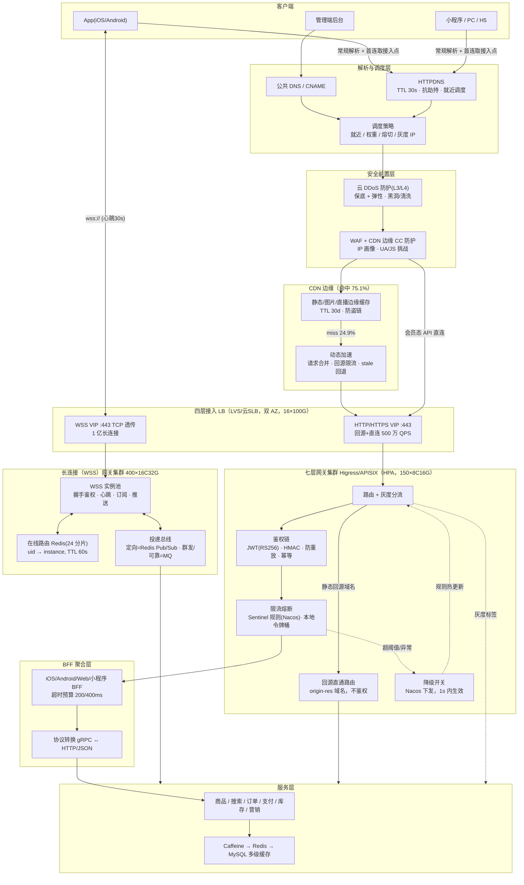

# 05 · 流量接入、CDN、网关与流量管控架构

> **项目**：easy-shopping 电商平台（淘宝级）
> **目标**：1 亿同时在线，HTTP 峰值 QPS（含 CDN 边缘）2000 万，回源到网关 500 万，长连接 5000 万~1 亿条
> **文档定位**：`architecture/` 系列第 5 篇，只覆盖**接入 → CDN → LB → 网关 → 应用入口**这一段的容量、结构、管控与防护；数据层、服务拆分、可观测性由其他篇章负责，本文只在边界处引用。
> **基线技术栈**：四层 LB（LVS / 云 SLB）+ 七层网关（Higress / APISIX，能力对齐 Kong）+ CDN（静态 / 图片 / 直播）+ Sentinel（限流熔断，规则存 Nacos）+ 独立长连接（WSS）网关集群。

---

## 0. 口径与前置约定（对齐结果）

### 0.1 引用的上游文档

| 来源 | 章节 | 本文采纳的约定 |
|------|------|----------------|
| `plans/admin-backend.md` | 1.5 部署方案 | K8s 容器化 + HPA（gateway min2/max10 为管理端口径，买家端见 §2.2）、CI/CD 灰度 5%→50%→全量；Nacos 作为注册与配置中心 |
| `plans/admin-backend.md` | 十 安全设计 | 幂等 Key（Redis 去重 + 唯一索引 + 乐观锁）、防重放三件套（时间戳 ±5min / Nonce / HMAC-SHA256）、敏感数据 AES、CSP |
| `plans/admin-backend.md` | 十一 性能优化 | Sentinel 规则走 Nacos（`dataId = {service}-flow-rules`、`rule-type: flow`）、`@SentinelResource` 熔断降级、多级缓存 Caffeine→Redis→MySQL |
| `plans/admin-backend.md` | 十七 其余模块 | 17.2/17.4：**WebSocket 握手即校验 AccessToken、心跳 30s、断线指数退避重连、重连后同步会话列表与未读消息 / 补拉最近数据**；17.5：私有桶 + 临时签名 URL；17.6：轨迹类第三方接口必须缓存 + 失败降级 |
| `plans/admin-backend.md` | 1.1.2 降级约定 | **查询类可降级返回空/缓存；资金与状态变更类（改价、退款、结算、打款）禁止降级**，本文把它提升为网关降级开关的硬约束（§5.4） |
| `plans/ios-backend.md` | 十一 性能优化 | BFF 聚合层与超时预算（单接口 P99 200ms、聚合 400ms）、CDN 架构（Edge→Mid→Origin、图片格式与质量梯度、边缘 30 天）、HTTP/2 + Brotli + 预连接、SLA 分级 P0/P1/P2 |
| `plans/ios-backend.md` | 十二 合规 | 12.3 ATS：**全站 HTTPS、TLS1.2+（推荐 1.3）、零例外域名、wss://、SSL Pinning fail-open**；12.6.1：`X-App-Key / X-Timestamp / X-Nonce / X-Sign`、Nonce Redis 短窗去重、白名单接口必须限流 |
| `plans/android-backend.md` | 13.1 接口安全 | **HMAC-SHA256 待签串 `method\npath\ntimestamp\nnonce\nsortedQuery\nbodySha256`**；`X-Timestamp` 毫秒、±5 分钟；`X-Nonce` Redis `SET NX`、TTL = 2×容差；身份取网关校验后的 AccessToken / `X-User-Id`，禁止信任 body 中的 `userId`；`X-Device-Id` 取请求头；写接口 `X-Idempotency-Key`；HTTP/业务码映射 401↔1002/1003、403↔1004、429↔1001、500↔9999 |
| 各端前端计划 | WSS 约定 | 单连接多 topic 订阅、心跳 30s（iOS 客户端 25s，服务端 60s 超时）、指数退避重连、`lastSeq`/`msg_id` 去重补偿 |

### 0.2 本文新增的统一约定

1. **签名时间窗统一为 ±5 分钟**（以 `android-backend.md` 13.1 为准，题目要求沿用），`X-Nonce` Redis TTL = 10 分钟；`ios-backend.md` 12.6.1 写的 ±60s / TTL 120s 属同构规则但数值不一致，列为待修订项（§9）。
2. **网关选型统一为 Higress / APISIX**（能力对齐 Kong 的 jwt / 限流 / 灰度插件）。`admin-backend.md` 的 `admin-gateway`（Go 自研）职责**下沉拆分**：通用能力（路由、鉴权、限流、灰度、日志）由网关插件承担，业务编排能力由 BFF 承担，不再自研一套通用网关。
3. **Sentinel 不直接跑在 Go 网关上**（官方无 Go SDK）：Sentinel 负责 **Java 服务内**的熔断、系统自适应限流、配额型集群流控；网关层限流由 APISIX/Higress 原生限流插件（本地令牌桶 + Redis 集群限流）实现，**规则统一存 Nacos，一份规则两套执行器**（§3.4）。
4. 网关向下透传内部头：`X-User-Id`、`X-Device-Id`、`X-Request-Id`、`X-Client-Version`、`X-Gray-Tag`、`X-Region`、`X-Risk-Score`；**下游服务只认这些头，禁止解析 body/query 中的身份字段**。

---

## 1. 流量测算

### 1.1 用户与请求模型

| 项 | 数值 | 推导 |
|----|------|------|
| 同时在线（大促零点峰值） | 1 亿 | 给定口径 |
| 峰值瞬时活跃（正在发请求/收包的用户） | 6000 万（60%） | 其余 40% 处于"看内容、挂机、等待响应"状态，仍占用长连接 |
| 峰值 HTTP 入口 QPS（含 CDN 边缘） | **2000 万** | 给定口径；人均 0.2 req/s，即每个活跃用户约 **每 3 秒 1 个 HTTP 请求** |
| 单次页面/交互平均请求数 | 25 个 | 1 个首屏 JSON/SSR + 约 20~30 个图片/JS/CSS/字体/埋点 |
| 折算峰值 PV | 2000 万 ÷ 25 ≈ **80 万 PV/s** | 6000 万活跃用户 ≈ 每人每 75 秒 1 次页面级浏览；单次页面资源拉取在 2~3s 内并发展开，在途请求约 240 万条 |
| 回源/直连到接入层 | **500 万 QPS**（25%） | 给定口径；综合边缘命中率 75.1% |
| 长连接 | 常态 5000 万 / 峰值 1 亿 | 给定口径；1 亿在线用户中约一半常驻挂机连接 |

> **结论先给**：2000 万 QPS 中 **1500 万由 CDN 边缘节点本地消化**（不进源站），500 万进入四层 LB → 七层网关；长连接是**连接数问题而非带宽问题**（见 §1.4）。

### 1.2 各层 QPS 分解（边缘 → 回源 → 网关 → 应用）

#### 1.2.1 入口与回源分解

| 入口类别 | 入口 QPS（万） | 占比 | 是否经 CDN | 边缘命中率 | 回源/直连（万） |
|---|---:|---:|---|---:|---:|
| 静态资源 JS / CSS / 字体 / 图标 | 250 | 12.5% | 是 | 99% | 2.5 |
| 商品图片 / 头像 / 详情图 | 800 | 40.0% | 是 | 97% | 24.0 |
| 首页 / 列表 / 搜索结果（可缓存 JSON + SSR） | 450 | 22.5% | 是 | 45% | 247.5 |
| 活动 H5 / 运营页 | 150 | 7.5% | 是 | 85% | 22.5 |
| 直播 / 短视频切片 | 150 | 7.5% | 是 | 99% | 1.5 |
| 会员态 API（登录 / 下单 / 支付 / 购物车 / 搜索联想） | 200 | 10.0% | 否（HTTPDNS 直连 VIP） | — | 200.0 |
| **合计** | **2000** | 100% | | **75.1%** | **498 ≈ 500** |

静态类（静态资源 + 图片 + 直播）占 60%、动态类占 40%，与"图片重、接口密"的电商形态一致；**命中率 75.1% 是本方案的分水岭**——命中率每掉 1 个百分点，回源多 20 万 QPS。

#### 1.2.2 回源 500 万 QPS 的去向

| 去向 | QPS（万） | 处理方式 |
|---|---:|---|
| 静态 / 图片 / 直播回源 | 28 | 走**回源直通路由**（回源专用域名 `origin-res.easyshopping.com`）：网关只做域名转发、回源保护、连接数限制，**不鉴权、不签名、不参与业务限流**，直接落到 OSS/图片服务/直播源站 |
| 进入业务链路的动态请求 | 470 | 走完整处理链：防刷 → 鉴权 → 签名/防重放 → 限流 → 路由/灰度 → BFF → 服务 |

#### 1.2.3 七层网关内的短路与下发（百分比以 470 万业务流量为基数）

| 阶段 | QPS（万） | 说明 |
|---|---:|---|
| 网关前门 | 500 | 470 业务 + 28 直通 |
| └ 网关本地缓存/配置类直返 | −23.5（5%） | 类目树、首页配置、版本信息等 Caffeine/APISIX 本地缓存 |
| └ 防刷拦截（黑名单/IP 画像/设备指纹高危） | −14.1（3%） | 见 §6，命中即 403/1004 或引导验证码 |
| └ 限流拒绝（大促主动丢弃） | −9.4（2%） | 返回 429/1001，不下发 |
| **下发到应用层（对外）** | **423**（470 − 47） | BFF + 直连微服务接口 |

#### 1.2.4 应用层内部放大

| 类型 | 对外 QPS（万） | 占比 | 内部扇出 | 内部 RPC（万 QPS） |
|---|---:|---:|---:|---:|
| BFF 聚合接口（首页 / 详情 / 订单列表） | 148 | 35% | ×3.5（并行调 3~5 个服务，取均值） | 518 |
| 直连微服务的查询/CRUD | 254 | 60% | ×1.3 | 330 |
| 写接口（下单 / 支付 / 领券 / 评价） | 21 | 5% | ×2.0（业务 + 流水/事件） | 42 |
| **内部 RPC 合计** | **423** | 100% | | **890 ≈ 900** |

内部 890 万 RPC QPS 中约 60%（534 万）被 Redis/本地缓存吸收，落到存储的查询约 356 万 QPS、折合 SQL 约 430 万 QPS —— **已超出本文档范围**，属于数据层容量（读写分离 + 分库分表 + 多级缓存的既定口径），此处仅作为"接入层不是唯一瓶颈"的边界提示。

> **跨文档口径对齐（00-conflict-register C10-f）**：本文内部 RPC 890 万（扇出 F≈2.1）为**下限口径**；`07` 号按 F=4.6 得 1,000 万，`09` 号按 F≈5 得 1,500 万~3,300 万。**容量规划（应用 Pod/线程/DB 连接）以 09 号上限 3,300 万为准**；本文 §1.2.4 的放大系数仅用于接入层边界提示，不作应用层采购依据。网关入口总量同理：本文"应用对外 423 万"与 `08` 号"网关入口 630 万"矛盾，**规划上限取 630 万**（本文 423 万为 500 万回源经网关短路后的下发值，两者相差的 207 万按 08 号口径纳入限流/防刷预算复核）。

#### 1.2.5 分解汇总

```
客户端 HTTP 请求       2000 万 QPS
  ├─ CDN 边缘命中       1502 万 QPS（75.1%，不进源站）
  └─ 回源/直连           498 万 QPS
       ├─ 静态直通        28 万 QPS（不鉴权）
       └─ 业务链路       470 万 QPS
            ├─ 网关短路   47 万 QPS（缓存 23.5 / 防刷 14.1 / 限流 9.4）
            └─ 应用对外   423 万 QPS
                 └─ 内部 RPC 放大 ≈ 890 万 QPS
```

### 1.3 带宽测算

#### 1.3.1 CDN 边缘出口（客户端下载，CDN 厂商承担）

| 类别 | 命中边缘的 QPS（万） | 平均单响应 | 计算 | 带宽 |
|---|---:|---:|---|---:|
| 商品图片（WebP/HEIC，列表 750px/q75、详情 1080px/q85） | 776 | 90 KB | 7.76e6 × 9.0e4 B/s = 698 GB/s | **5.59 Tbps** |
| 静态资源（Brotli 后 JS/CSS/字体） | 247.5 | 150 KB | 371 GB/s | **2.97 Tbps** |
| 首页/列表命中部分 | 202.5 | 25 KB | 50.6 GB/s | **0.40 Tbps** |
| 活动 H5 命中部分 | 127.5 | 60 KB | 76.5 GB/s | **0.61 Tbps** |
| 直播/短视频切片 | 148.5 | 200 KB | 297 GB/s | **2.38 Tbps** |
| **常态合计** | | | 1.49 TB/s | **≈ 12 Tbps** |

- 折算人均：12 Tbps ÷ 1 亿 = 120 Kbps，对"含 40% 挂机用户"的全网均值合理（活跃用户瞬时 1~3 Mbps，头部直播另计）。
- **大促头部直播单独评估**：1500 万同时观看 × 2.5 Mbps = **37.5 Tbps**，必须按"活动预约"向 CDN 厂商预订带宽，不能混入常态 12 Tbps 口径。
- 边缘节点需求：12 Tbps ÷ (单节点 100 G × 50% 水位) ≈ **240 个节点**；叠加直播峰值 50 Tbps → 约 **1000 节点**（主流 CDN 国内 2000+ 节点，可承载，属商务采购问题）。

#### 1.3.2 回源 / 源站带宽（本方案自建部分，重点）

| 类别 | 回源 QPS（万） | 单响应（传输压缩后） | 计算 | 带宽 |
|---|---:|---:|---|---:|
| 图片回源 | 24 | 90 KB（已压缩，不再压） | 2.16e10 B/s | 173 Gbps |
| 静态资源回源 | 2.5 | 150 KB | 3.75 GB/s | 30 Gbps |
| 直播切片回源 | 1.5 | 200 KB | 3.0 GB/s | 24 Gbps |
| 首页/列表回源 | 247.5 | 8 KB（gzip/br） | 19.8 GB/s | 158 Gbps |
| 活动 H5 回源 | 22.5 | 20 KB | 4.5 GB/s | 36 Gbps |
| 会员态 API 直连 | 200 | 4 KB | 8.0 GB/s | 64 Gbps |
| **响应合计** | 498 | | **60.7 GB/s** | **485 Gbps** |
| 请求上行（均值 1.5 KB） | 498 | | 7.5 GB/s | 60 Gbps |
| **四层 LB 需双向承载** | | | | **≈ 545 Gbps** |

- LB 容量：单机 100 G 网卡，取 50% 水位 = 50 Gbps/台 → 545 ÷ 50 ≈ **11 台**，加跨 AZ 冗余取 **16 台（12 主 + 4 备，双可用区）**。
- 采购/出口带宽：源站侧至少 **1 Tbps 上行**（含 45% 余量与重传），否则大促必打满。

### 1.4 长连接测算

| 项 | 假设与计算 | 结果 |
|---|---|---|
| 连接数 | 峰值 1 亿，常态 5000 万 | 1 亿 |
| 心跳（30s 一轮，iOS 客户端 25s） | 1e8 ÷ 30 = **333 万/s 上行** + 333 万/s Pong 下行 | 666 万 msg/s |
| 心跳带宽 | 666 万 × 64 B（含 WS/TLS 头）= 426 MB/s | **3.4 Gbps** |
| 推送（保守：0.2 条/分钟/连接） | 1e8 × 0.2 ÷ 60 = **33 万/s** | 1.1 Gbps（400 B/条） |
| 推送（上限：1 条/分钟/连接） | 1e8 ÷ 60 = **167 万/s** | 5.3 Gbps |
| 推送（大促峰值 = 常态 ×10：整点群发 + 订单/物流状态爆发） | 330 万 ~ 1670 万/s（群发 1 亿条按 30 分钟削峰单独摊平 = 5.6 万/s，不计入瞬时峰值） | 10.6 ~ 53 Gbps |
| 上行业务（聊天发送 / ack / 订阅） | 约 50 万/s | 0.2 Gbps |
| **WSS 出口带宽** | 3.4 + 推送 + 0.2 | **常态 4.6 ~ 9 Gbps，峰值 14 ~ 57 Gbps** |
| **长连接集群消息吞吐** | 666 + 推送 + 50 | **常态 750 ~ 880 万 msg/s；大促峰值 1050 ~ 2400 万 msg/s** |

> **关键结论：长连接的瓶颈是「连接数 + 路由/投递扇出」，不是带宽。** 取最坏 57 Gbps，对 400 台 16C32G 实例（合计 6.4 Tbps 网卡）也只占 0.9%；即使按峰值 2400 万 msg/s，单实例也仅 6 万 msg/s（≈18% 单核）。真正贵的是 **TCP/TLS 会话内存（12.8 TB）** 与 **1 亿条在线路由索引的写放大（167 万 SET/s）**。

#### 1.4.1 单实例连接容量（计算过程）

```
每连接常驻内存：
  内核 TCP sock + sk_buff         ≈ 12 KB
  WS 会话对象 + 订阅表 + 缓冲      ≈ 6 KB
  读缓冲 4 KB + 写缓冲 8 KB（可调小到 2/4 KB） ≈ 12 KB
  ─────────────────────────────────────────
  合计 ≈ 30 KB → 工程取 32 KB/连接

32C64G 单实例可用内存 ≈ 50 GB（留 14 GB 给 OS/运行时）
  理论上限 50 GB ÷ 32 KB ≈ 160 万连接
  工程安全水位取 50% → 80 万（激进配置，需 io_uring + 调小缓冲）
  保守配置（含发布期排空、GC 余量、推送突发缓冲）取 30 万
```

| 配置 | 单实例承载 | 1 亿连接所需实例 | 说明 |
|---|---:|---:|---|
| **16C32G（本方案采用）** | **30 万**（可用 20 GB ÷ 32 KB = 62.5 万，取 48% 水位） | 334 台 → 加 N+1 分片冗余与滚动发布余量 20% = **400 台** | 合计 6400 核 / 12.8 TB |
| 32C64G（激进） | 80 万 | 125 → 160 台 | 需 io_uring、缓冲调至 2/4 KB、禁用不必要的日志 |

**CPU 核算（16C32G × 400 台，按 30 万连接/台）**：
- 心跳：30 万 ÷ 30s = 1 万 msg/s/实例，含 epoll 唤醒 + TLS seal ≈ 3 μs/条 → 3% 单核
- 推送峰值：2400 万 ÷ 400 = **6 万 msg/s/实例**，6 万 × 3 μs = 18% 单核
- 长握手（新连接）：整机重启/扩缩容风暴时 1 亿连接在 120s 内重建 = 83 万/s ÷ 400 实例 = **2075 握手/s/实例**；TLS1.3 ECDSA P-256 握手 ≈ 2.5 万/s/核 → 占用 **8.3% 单核**（可接受，但**必须做重连抖动**，见 §4.6）
- 结论：**内存主导，CPU 有 10 倍以上余量**。

#### 1.4.2 在线路由索引写 QPS

```
每连接 60s 续期一次（心跳 30s 触发，双写合并）
  1 亿 ÷ 60 = 167 万 SET/秒
  Redis 单分片简单命令上限 ≈ 12 万 ops/s（取 70% 水位 = 8.4 万）
  → 需要 167 ÷ 8.4 ≈ 20 分片；取 24 分片（+20% 冗余）
```
另有 Nonce 去重 141 万/s（§3.3.4）与业务缓存，**在线路由 + Nonce 必须与业务缓存实例物理隔离**（对齐 `admin-backend.md` 1.5.1 "缓存实例 + 数据实例" 的隔离要求）。

---

## 2. 接入层架构

### 2.1 分层图



### 2.2 各层职责与扩容方式

| 层 | 职责 | 扩容/调度方式 | 水位与余量 |
|---|---|---|---|
| DNS / HTTPDNS | 域名解析、抗劫持、就近/权重/熔切调度、按用户维度下发接入点（长连接分片亲和） | 调权重即可，**HTTPDNS 30s 生效、无缓存 TTL 问题**；故障 IP 摘除 < 30s | 冗余：至少 2 家 HTTPDNS 供应商 + 公共 DNS 兜底 |
| 云 DDoS / WAF | L3/L4 清洗、L7 WAF、边缘 CC | 云厂商弹性，自动扩容 | 保底 + 弹性两档（§6.4） |
| CDN 边缘 | 静态/图片/直播缓存、边缘防盗链与 CC、动态加速回源合并 | 厂商自动扩容，**大促带宽需提前 14 天预约** | 常态 12 Tbps / 预约 50 Tbps |
| 四层 LB | TCP 转发、TLS 卸载（HTTP 链路可选）、健康检查、跨 AZ 双活 | **加机器 + 加 VIP**（16 台，12 主 4 备）；LVS DR/TOA 双 AZ | 单机 100G 取 50% 水位 = 50 Gbps，按每请求 10 KB 折算 **60 万 QPS/台** → 12 主 = **720 万 QPS**（当前 500 万 @ 69%），16 台全在 = 960 万 |
| 七层网关 | 路由、鉴权、签名验签、防重放、限流、灰度、协议转换、日志采样 | **HPA（CPU + QPS 自定义指标）**，min 40 / max 400；大促前**提前 2 小时预热**（避免冷启动 + 上游连接池建连） | 单实例 4 万 QPS（§3.8），150 台 = 600 万设计容量，当前 500 万 @ 83% |
| BFF 聚合 | 面向端的接口聚合、超时预算、降级拼装 | HPA min 20 / max 200 | 单实例 2 万 QPS |
| WSS 网关 | 握手鉴权、心跳、订阅、推送、在线状态、断线补偿 | **分片扩容**（新增实例只接新连接，存量不迁移，避免 rehash 抖动）；min 200 / max 800 | 30 万/实例 × 400 = 1.2 亿设计容量，当前 1 亿 @ 83% |
| 服务层 | 业务处理 | K8s HPA（`admin-backend.md` 1.5.2 min2/max10 → 买家端按服务单独设） | 见服务篇章 |

### 2.3 域名与接入约定

| 域名 | 用途 | 接入路径 |
|---|---|---|
| `api.easyshopping.com` | 会员态 API（登录/下单/支付/账户） | HTTPDNS → 四层 LB 直连网关（**不走 CDN**，保证低延迟与会话安全） |
| `cdn.easyshopping.com` | 图片（与 `ios-backend.md` 1.2.2 品牌域名一致） | CNAME → CDN，防盗链签名 |
| `static.easyshopping.com` | JS/CSS/字体/离线包 | CNAME → CDN，内容 hash + 长 TTL |
| `www.easyshopping.com` / 活动页 | H5、SSR 详情/列表 | CNAME → CDN 动态加速 + 边缘短 TTL |
| `live.easyshopping.com` | 直播/短视频切片 | CNAME → CDN，活动预约带宽 |
| `origin-res.easyshopping.com` | 回源直通（静态/图片/直播回源、私有桶签名 URL） | CDN 回源 → LB → 网关直通路由 |
| `ws.easyshopping.com` | WSS 长连接 | HTTPDNS 取分片接入点 → WSS VIP |
| 全部域名 | | **HTTPS/TLS1.2+（推荐 1.3）、零 ATS 例外、`wss://`、HSTS、SSL Pinning fail-open**（`ios-backend.md` 12.3） |

---

## 3. 网关设计

### 3.1 选型与部署形态

- **形态**：Higress 或 APISIX（二选一，能力对齐 Kong 插件集），K8s Deployment + HPA，**双可用区各 50%**，Pod 反亲和。
- **实例规格**：8C16G，**单实例净吞吐 4 万 QPS**（含 TLS 终止 + RS256 验签缓存 + HMAC + 限流 + 10% 日志采样）。
- **数量**：500 万 ÷ 4 万 = 125 台 → 加 20% 冗余 = **150 台**（1200 核 / 2.4 TB）。
- **连接复用**：南北向 HTTP/2（移动端/PC 长连接复用，减少握手）；东西向 gRPC + 连接池；出口到服务启用 **mTLS**（`ios-backend.md` 12.6.2 第 3 条）。
- **配置来源**：路由/灰度/限流规则存 **Nacos**，网关订阅热更新（<1s）；Sentinel Java 侧同源订阅。

### 3.2 路由

| 维度 | 规则 |
|---|---|
| 路径 | `/api/v1/**` → BFF；`/api/v1/bff/{platform}/**` → 对应端 BFF；`/api/external/**` → 支付回调等外部通道（独立限流、独立源 IP）；`origin-res/**` → 回源直通 |
| 方法/版本 | URL 版本 + `X-Api-Version` 兜底；不兼容变更走 `/api/v2`，网关保留 v1 转发至少 12 个月 |
| 协议 | 南北向 HTTP/1.1 + HTTP/2（兼容旧设备），东西向 gRPC |
| 超时 | 网关整体 10s（对齐 `admin-backend.md` 1.1.2）；BFF 单接口 200ms、聚合 400ms（`ios-backend.md` 11.3）；**只有幂等接口（GET 或带 `X-Idempotency-Key`）允许自动重试，非幂等写接口禁止重试** |
| 重试 | 仅幂等读、仅换节点重试 1 次、必须带 `X-Request-Id` 透传 |
| 脱敏/日志 | 请求日志 10% 采样（大促 100% 采样写 Kafka 后异步落），敏感字段按 `ios-backend.md` 12.5 脱敏 |

### 3.3 鉴权链（顺序固定，从便宜到昂贵）

```
① 连接/边缘层   IP 画像 + 黑名单 + UA/设备指纹初筛      （纯内存，0 Redis RTT）
② 时间戳校验    X-Timestamp 毫秒，±5min，本地时钟         （0 成本）
③ Nonce 防重放  写接口/敏感接口：Redis SET NX，TTL 10min  （1 RTT，仅 30% 流量）
④ 签名校验      HMAC-SHA256(method\ntime\nnonce\nq\nbody) （CPU ~0.3μs）
⑤ JWT 校验      RS256 + kid 轮换，aud/platform 白名单      （CPU ~50μs，带 LRU 缓存后摊薄）
⑥ 幂等/配额     X-Idempotency-Key → Redis                  （1 RTT，仅写接口）
⑦ 风险分下发    X-Risk-Score → 下游服务                    （透传）
```

#### 3.3.1 JWT 校验

- 算法 **RS256**（`ios-backend.md` 2.2.2）：网关/服务只持公钥，私钥在 KMS；`kid` 支持轮换，网关**同时信任新旧公钥**（重叠期 ≥ access_token 有效期 2h）；NTP 校时，`exp` 容忍 ≤30s 时钟偏移。
- 必验：签名、`exp/iat`、**`aud` + `platform` 白名单**（管理端 Token 调买家端接口一律 401/1003；`aud` 不匹配 → 403/1004）。
- 性能优化：**按 `jti` 结果缓存 LRU（TTL = min(exp 剩余, 60s)）**，同一 token 60s 内不重复验签 → 1 亿在线 token 摊到 167 万次验签/s（而非 470 万），按 RS256 约 2 万次/核 计 → **约 83 核**，摊在 1200 核上占 7%。

#### 3.3.2 HMAC 签名（沿用 android 13.1）

```
待签串 = method \n path \n timestamp \n nonce \n sortedQuery \n bodySha256
X-Sign  = HMAC-SHA256(待签串, device_secret)
```
- `device_secret` 随登录下发，客户端存 Keystore/Keychain；换设备需重新登录。
- `X-Timestamp` 毫秒、**±5 分钟**；`X-Nonce` Redis `SET NX`，**TTL = 2×容差 = 10 分钟**。
- 白名单接口（AASA、隐私政策、版本检查、App Clip 元数据）免签名，**但必须限流且禁止越权**（`ios-backend.md` 12.6.1）。

#### 3.3.3 身份来源

- 用户身份：**只取 AccessToken 校验结果或内部头 `X-User-Id`**；设备维度取 `X-Device-Id` 请求头；**禁止信任 query/body 中的 `userId`/`uid`**（android 13.1）。
- 下游服务收到的 `X-User-Id` 视为可信，但**资源归属校验仍在服务内做**（防横向越权 IDOR，`ios-backend.md` 12.6.2）。

#### 3.3.4 鉴权链开销核算（470 万 QPS）

| 环节 | 频次 | 单次成本 | CPU 需求 |
|---|---|---:|---:|
| 本地黑名单/时间戳 | 470 万/s | <1 μs | <5 核 |
| HMAC-SHA256（SHA-NI） | 470 万/s | 0.3 μs | 1.4 核 |
| RS256 验签（缓存后） | 167 万/s | 50 μs | **83 核** |
| Redis `SET NX`（写+敏感接口 30%） | **141 万/s** | 0.35 ms（1 RTT，异步流水线） | 需 **24 分片** Redis（12 万 ops/s × 24 × 70% = 201 万容量） |
| 幂等查询（写接口 5%） | 24 万/s | 0.35 ms | 1~2 分片 |
| TLS 记录层加解密 | 响应 60.7 GB/s | AES-256-GCM ≈ 3 GB/s/核 | **20 核** |
| TLS 握手（10% 请求伴随新连接，含会话恢复） | 47 万/s ÷ 2.5 万/核 | — | 19 核 |
| **合计** | | | **约 130 核 / 1200 核 = 11%**（余量用于 GC、日志、突发事件） |

**结论**：瓶颈是 **RS256 验签与 Redis Nonce**，不是转发本身；这也是单实例取保守 4 万 QPS 的原因。

### 3.4 限流（Sentinel 规则 + 网关执行器）

> **诚实边界**：Sentinel **集群流控（token-server）单实例每次 check 约 1~2 万次/s**，无法承载 500 万 QPS 的全站逐请求判断。因此：

| 层级 | 执行器 | 用途 | 规模 |
|---|---|---|---|
| 网关全局限流 | APISIX/Higress **本地令牌桶**（按实例数 × 单实例配额静态下发） | 兜底保护，丢弃超限流量返回 429/1001 | 470 万 QPS 全量，**0 额外 RTT** |
| 网关多维限流 | 本地令牌桶 + Redis 集群令牌桶（APISIX `limit-req` / Higress Wasm） | 按 **用户 / 设备 / IP / 接口** 维度 | Redis 消耗 ≤ 50 万 ops/s |
| **配额型集群限流** | **Sentinel cluster（token-server ×3 主备）** | 秒杀、领券、发短信验证码、注册：**需要"全局精确配额"的场景** | 仅 5~10 万 check/s，**token-server 只挂这些接口** |
| Java 服务内 | Sentinel SDK（`@SentinelResource`） | 服务级限流 + 熔断 + 系统自适应 | 服务自身 QPS |

**Sentinel 规则（Nacos dataId，对齐 `admin-backend.md` 11.4.1）**：

```yaml
# {service}-flow-rules （Nacos，rule-type: flow）
- resource: POST /order/create          # 下单
  grade: 1                              # QPS
  limitApp: default
  count: 20000                          # 单集群配额，网关侧按比例切分
  strategy: 0
  controlBehavior: 7                    # warm_up + rate limiter，避免冷启动尖刺
  clusterMode: true                     # 仅配额型接口开启集群模式

- resource: POST /marketing/coupon/receive
  grade: 1
  count: 8000
  clusterMode: true

- resource: POST /auth/sms/send
  grade: 1
  count: 3000
  clusterMode: true
```

**网关侧默认阈值（本地令牌桶，按接口分级）**：

| 分级 | 接口示例 | 单用户 | 单设备 | 单 IP | 网关单实例 |
|---|---|---|---|---|---|
| P0 核心 | 下单、支付、查单 | 5 req/s | 10 req/s | 100 req/s | 按全网配额/实例数 |
| P1 主干 | 商品列表/详情、搜索 | 20 req/s | 40 req/s | 500 req/s | 4 万 QPS 上限 |
| P2 非核心 | 推荐、评价、分享、埋点上报 | 10 req/s | 20 req/s | 300 req/s | 预留 15% 容量 |
| 敏感 | 短信、登录、领券 | 1 条/60s、5 条/小时（`ios-backend.md` 2.1.2） | 20 条/小时 | 50 次/小时 | Sentinel 集群配额 |

### 3.5 灰度路由

| 维度 | 实现 | 说明 |
|---|---|---|
| 按用户 | `X-User-Id` 尾号 / 白名单 / 会员等级 | 白名单优先（内部员工、内测用户） |
| 按端与版本 | `X-Client-Version` + `X-Gray-Tag` | 新版 API 先灰度新版客户端，避免老客户端崩 |
| 按地区 | 网关内置 IP 库解析 `X-Region`（无需调外部服务） | 区域故障切流、区域活动差异化 |
| 按百分比 | 一致性哈希（`uid % 10000 < N`） | 保证同一用户灰度结果稳定（不会反复切版本） |
| 按设备/IP 风险 | `X-Risk-Score` | 高风险流量强制走"验证版"链路 |

- **规则存储**：Nacos，网关热更新 <1s；灰度组独立 Deploy（40 实例起），**上游服务按灰度标签打独立 Service**。
- **发布联动**（对齐 `admin-backend.md` 1.5.3）：5% → 50% → 全量，每档观察 15 分钟，**核心指标（P99、错误率、支付成功率）恶化即一键回滚**（配置回滚 + 镜像回滚双通道）。

### 3.6 协议转换（gRPC ↔ HTTP）

| 方向 | 实现 | 说明 |
|---|---|---|
| 南北向 HTTP → 东西向 gRPC | 网关 `grpc-transcode` 插件（Higress/APISIX 均支持）或 BFF 内 grpc-gateway | JSON ↔ Protobuf 双向映射；字段名驼峰/下划线统一由 BFF 归一（`ios-backend.md` 11.1.2 要求同一字段禁止两套命名） |
| gRPC-Web | 网关转码，浏览器/小程序直连 BFF | 减少 BFF 内存压力 |
| 流式 | gRPC streaming → WebSocket topic | 仅内部实时看板使用 |
| 约束 | **gRPC 只在内网 + mTLS，禁止公网暴露**（`ios-backend.md` 12.6.2） | 公网只有 HTTP/JSON 与 WSS |

### 3.7 BFF 聚合

- **一端一 BFF**：`/api/v1/bff/ios/home`、`/api/v1/bff/android/...`、`/api/v1/bff/web/...`（`ios-backend.md` 11.1）。
- **超时预算**：聚合 400ms = 单子调用 200ms；子调用超时即用**缓存/默认值/降级拼装**，**首屏永远可用**。
- **扇出控制**：单聚合最多 5 个并行下游，超时后立即返回已到手的部分（partial response + `degraded: true` 标记）。
- **不做的事**：BFF 不落库、不做事务、不算价（价格一律走共享 `core-price`，`admin-backend.md` 1.2.2 对齐表）。
- **强降级边界**：查询类可降级；**下单/支付/退款/结算类接口禁止降级**，失败必须显式报错（`admin-backend.md` 1.1.2）。

### 3.8 网关处理链与预算（汇总）

```
Client → TLS终止 → ①边缘/IP画像 → ②时间戳 → ③Nonce(写) → ④HMAC → ⑤JWT(LRU)
       → ⑥幂等(写) → ⑦本地限流 → ⑧灰度/路由 → ⑨协议转换 → BFF → 服务
       ← 10% 采样日志 → Kafka
单请求端到端（网关内）P99 预算 ≤ 3ms（不含下游）；4 万 QPS/8C = 每请求 200μs CPU 预算，当前用 11% 核心开销 + 转发 ≈ 60%，健康。
```

---

## 4. 长连接架构（WSS 推送 / 客服 / 物流）

### 4.1 集群结构与容量

- **独立集群**（不与 HTTP 网关混部）：Go 实现（epoll/io_uring），16C32G × **400 台**（30 万连接/实例），双 AZ。
- **接入**：`ws.easyshopping.com` → HTTPDNS 返回**分片接入点** → 四层 LB（TCP 透传，**TLS 在网关侧终止**，便于握手鉴权与证书管理）→ WSS 实例。
  - 备选：云 SLB SSL 卸载（省网关 CPU，但本方案 CPU 有 10 倍余量，**优先网关自终止**，减少一层证书与会话管理复杂度）。
- **容量口径**：1.2 亿设计 / 1 亿实际 = 83% 水位；常态 5000 万 = 42%。
- **单集群消息吞吐**：常态 750~880 万 msg/s、大促峰值 1050~2400 万 msg/s（§1.4），单实例 1.9~6 万 msg/s。

### 4.2 协议与心跳

| 项 | 约定 | 依据 |
|---|---|---|
| 端点 | `wss://ws.easyshopping.com/ws`（单连接多 topic 订阅：`messages` / `order-updates` / `logistics` / `cs` / `announce`） | `pc-client-frontend.md` 1.5 |
| 握手鉴权 | 首帧携带 AccessToken（query `?ticket=` 或 subprotocol），**网关校验失败直接断开**；`aud/platform` 白名单同 HTTP | `android-backend.md` 11 / `admin-backend.md` 17.2 |
| 心跳 | 客户端 **25~30s ping**，服务端 **60s 无 pong 断连**；服务端主动 ping 探活 | 各端一致 |
| 断线重连 | 指数退避 1s→32s + **随机抖动**（防雪崩），最多 5 次后降级 REST 轮询 | `miniprogram-frontend.md` 12.1 |
| 消息可靠性 | 每条消息带 `msg_id` + 单调 `seq`；客户端 ack；未 ack 进重发队列 | `ios-frontend.md` 12.1 |
| 断线补偿 | 重连带 `lastSeq` → 服务端增量补齐；超窗走 HTTP 补拉（`/cs/session/{id}/messages?after=`、订单/物流 REST） | `android-backend.md` 1862、`admin-backend.md` 17.4 |
| 降级 | WSS 不可用 → REST 轮询（列表 10s、状态页 5s），并在下发配置中标记 `ws_degraded` | 各端降级预案 |

### 4.3 在线状态

```
连接建立：instance 认领连接 → 写 Redis  ws:route:{uid} = {inst_id, conn_id, ts}  TTL 60s
心跳续期：30s 心跳触发，合并写入 → 167 万 SET/s（§1.4.2）→ 24 分片 Redis（独立实例）
下线：正常关闭 DEL；异常 60s TTL 自动过期；实例宕机 → 该实例所有 route 在 60s 内自动失效
查询：IM/客服/订单服务  GET route → {inst_id} → 投递总线
```

- **Redis 实例隔离**：在线路由 + Nonce + 幂等使用 `noeviction` 数据实例；业务缓存使用 `allkeys-lru` 缓存实例（`admin-backend.md` 1.5.1 红线）。
- **分片亲和（可选优化）**：首次连接先 `GET /ws/endpoint` 取分片接入点，使同一 uid 稳定落到同一实例组，可把路由查询转为**本地 1024 项路由表**（仅扩容时广播变更），Redis 压力降到 1/10。

### 4.4 跨实例投递（三条通路，按场景选）

| 通路 | 机制 | 延迟 | 可靠性 | 适用 |
|---|---|---|---|---|
| **定向单发** | 查 `ws:route:{uid}` → Redis Pub/Sub **按实例 channel（`ws:inst:{inst_id}`）精准投递，绝不广播** | <50 ms | 不持久，丢失靠 `seq` 补偿 | 订单状态、客服回消息、物流更新、验证码 |
| **批量/群发/可靠** | MQ（RabbitMQ topic），**每实例一个队列 `ws.push.{inst_id}`**，生产者按路由批量入队，消费端本地路由到连接 | ~200 ms | 持久化 + 重试 + DLQ | 营销群发、公告、系统通知（1 亿条按 30 分钟削峰 = 5.6 万条/s） |
| **全站广播** | MQ fanout → 每实例本地限速下发（如 2 万条/s/实例，全网 800 万条/s 分 12s 发完） | 秒级 | 持久化 | 大促开屏公告、紧急停服通知 |

**为什么不用纯 Redis Pub/Sub**：Pub/Sub 是"所有订阅者都收到"的广播语义，1 亿连接 × 每实例 1 订阅 = 群发时会把无关消息推给所有实例；**必须按实例 channel 做点对实例路由**，且只用于不要求可靠的实时单发。

### 4.5 断线补偿（分层）

| 层 | 手段 |
|---|---|
| 连接层 | 指数退避 + 抖动重连；`lastSeq` 增量拉取 |
| 消息层 | `msg_id` 去重（本地 LRU + Redis SETNX，141 万/s 已在 §3.3.4 预算内不重复计）；未 ack 重发 3 次 → 转离线 |
| 业务层 | 会话消息落 `cs_message`（`ios-backend.md` 1.3.1）、订单/物流走 REST 补拉（`admin-backend.md` 17.4"重连后补拉最近数据保证最终一致"） |
| 离线兜底 | 站内信 + APNs/厂商推送（`push.exchange` / `push.send`，`ios-backend.md` 1.5.2），长连接不在线时走系统推送 |

### 4.6 扩容与发布

1. **新增分片只接新连接**，存量连接不迁移（rehash 会造成百万级同时重连）。
2. **滚动发布**：先摘 LB 健康检查 → 网关发 `disconnect` 指令让客户端**分批（每秒 ≤5%）优雅断开**并重连到新实例 → 再关 Pod；严禁直接杀进程。
3. **重连风暴防护**：客户端退避 + 随机抖动；服务端对同 IP 的新建连接限速（默认 50 次/秒/IP）；VIP 级新建连接限速（云 SLB 单实例约 50 万新建连接/s，1 亿连接在 120s 内重建 = 83 万/s → **需要 ≥ 2 个 VIP 分摊**）。
4. **熔断降级**：推送积压（单实例待发缓冲 > 50 万条）→ 自动降采样（丢弃 P2 营销类，保 P0 订单/客服）→ 仍超限则转 MQ 削峰。

---

## 5. 流量管控

### 5.1 服务分级

| 级别 | 范围 | SLA（`ios-backend.md` 11.5） | 限流与降级策略 |
|---|---|---|---|
| **P0 核心** | 登录、下单、支付、支付回调、查单 | P99 < 200ms，可用性 99.95% | **禁止降级**，限流阈值最高、熔断不触发降级只快速失败并告警；独立容量池（≥ 40% 网关配额） |
| **P1 主干** | 商品列表/详情、搜索、订单列表、购物车 | P99 < 300ms，可用性 99.9% | 可降级到缓存/简化数据（列表减字段、详情关推荐位） |
| **P2 非核心** | BFF 聚合、推荐、消息、客服、埋点上报、分享 | P99 < 400ms，可用性 99.5% | **大促优先牺牲**：先关推荐、再关个性化、最后降为轮询/静态兜底；容量池 ≥ 15%，可被 P0 借用 |

### 5.2 自适应限流（不是静态阈值）

| 信号 | 阈值 | 动作 |
|---|---|---|
| 网关实例 CPU | > 70% 持续 30s | 入口 QPS 阈值自动下调 20%（Sentinel `systemRule` / Higress 自适应插件） |
| 入口 P99 RT | > 1s 持续 15s | 按比例丢弃 P2 流量 50% |
| 错误率 | > 1% 持续 30s | 触发告警 + 停止扩容外的自动放量；> 5% 触发熔断与降级开关 |
| 下游 RT（BFF） | 单子调用 > 200ms | 熔断该子调用，返回缓存/partial |
| 队列/MQ 积压 | 推送队列 > 500 万 | 降采样 + 转削峰 |
| 自愈 | 以上信号恢复后 | 阈值**分 3 档回升**（每次 +10%，间隔 60s），避免抖动 |

### 5.3 大促全局限流（预案分级）

| 档位 | 触发 | 动作 |
|---|---|---|
| L0 常态 | 水位 < 70% | 只有接口级令牌桶 |
| L1 预案（大促开始前手工开启） | 零点前 5 分钟 | P2 接口配额 ×0.5；静态/推荐预热；预热 40 → 150 台网关 |
| L2 自动 | 水位 85% | 全局按比例限流（令牌桶全局配额），P2 只放行白名单；非幂等写接口进入**排队等待**（Sentinel `rate_limiter`，等待 ≤ 800ms，超时返回 429/1001） |
| L3 保护 | 水位 95% / 错误率 > 5% | 只保 P0：P1/P2 直接 429；长连接暂停营销推送；秒杀走**独立 VIP + 独立池**（绝对隔离，不与主链路争抢） |
| L4 兜底 | 网关不可用 | 四层 LB 摘除故障组；CDN 边缘回退"上一版本缓存 + stale"，保证读路径可用 |

### 5.4 降级开关（配置中心下发）

- **载体**：Nacos 配置（网关长轮询 <1s 生效；Java 侧 `@SentinelResource` + Nacos datasource，对齐 `admin-backend.md` 11.4.1）。
- **三级开关**：

| 级别 | 范围 | 示例 |
|---|---|---|
| L1 网关级 | 整接口 | 关闭 `/bff/home/recommend`、`/search/suggest`，返回网关内置兜底 JSON |
| L2 服务级 | 单服务单能力 | 商品详情关"评价摘要"、"推荐位"；搜索降为无聚合查询 |
| L3 依赖级 | 单下游 | 关闭推荐服务、关闭物流轨迹（`admin-backend.md` 17.6 要求轨迹失败展示"轨迹暂不可用"而非报错） |

- **硬约束**：**资金与状态变更类（下单、支付、改价、退款、结算、打款）禁止挂降级开关**；误开必须由网关规则校验拦截（规则集里 P0 写接口的降级动作只能是"快速失败"，不能是"返回成功/缓存"）。
- **可见性**：每个开关有 owner、影响面、开启理由、自动过期时间（默认 30 分钟，避免"临时开关忘关"）；开关变更全量审计。

### 5.5 熔断

| 类型 | 规则（Sentinel） | 动作 |
|---|---|---|
| 慢调用比例 | RT > 500ms 且比例 > 50%（10s 窗口） | 熔断 10s → 半开探测 5 次 → 恢复 |
| 异常比例 | 异常 > 20% | 熔断 15s |
| 异常数 | 10s 内 > 20 次 | 熔断 15s |
| 网关→服务 | 同上，配置在 BFF/网关侧 | 返回缓存/partial，标记 `degraded` |
| 服务→存储 | 连接池耗尽 / 慢 SQL 比例 | 读请求切从库或缓存；**写请求快速失败**，不重试 |
| 隔离 | 每下游最大并发线程数（舱壁） | 单下游打满不拖垮整体（Bulkhead） |

---

## 6. 防刷与安全

### 6.1 分层防护与责任分工

| 层 | 攻击 | 防护 | 归属 |
|---|---|---|---|
| L3/L4 | SYN Flood、UDP Flood、放大攻击、CC 大流量 | **云厂商 DDoS 防护**：基础防护（免费档约 5 Gbps）+ **原生/高防（保底 Tbps 级 + 弹性数十 Tbps）** | **云厂商**（自建黑洞与清洗不现实，仅做：源站 IP 不暴露、只允许 CDN/高防回源 IP 段入站、BGP 多线双活） |
| CDN 边缘 L7 | CC、爬虫、刷接口 | 边缘限速、UA/JS 挑战、IP 画像、地域封禁、**URL 防盗链签名** | **CDN 厂商 + 自建规则**（规则我方下发） |
| WAF | SQLi、XSS、恶意上传、扫描器 | 托管 WAF + 自定义规则 | 云厂商托管，规则我方维护 |
| 网关 L7 | 业务刷单、薅羊毛、撞库、重放、爬取 API | 验证码/人机、设备指纹、IP 画像、签名/Nonce、接口配额、蜜罐 | **自建**（本篇章） |
| 业务 | 薅券、批量注册、虚假下单 | 风控评分、二次验证、行为序列校验 | 风控服务（兄弟篇章） |

**DDoS 分工原则**：云厂商负责"**把攻击挡在源站之外**"，自建负责"**进来的每一笔都要验明正身**"。源站四层 LB 只接受：CDN 回源 IP 白名单、我方客户端直连（经 HTTPDNS 签发的接入凭证）、内部网络。

### 6.2 验证码 / 人机识别 / 设备指纹 / IP 画像

| 能力 | 实现 | 触发与开销 |
|---|---|---|
| 风险评分 | 网关聚合：IP 画像 + 设备指纹 + 行为序列 + 历史违规 → `X-Risk-Score`（0~100） | 纯内存规则 + 本地/Redis 特征，**单请求 < 1ms**；只对写/敏感接口全量算，读接口抽样 |
| 人机验证 | 风险分 ≥ 60 → 滑块/无感验证；≥ 85 → 短信二次验证或直接拒绝 | 验证通过发 `captcha_token`（TTL 5min，一次性），后续请求携带 |
| 设备指纹 | 客户端 SDK（`device_id`/IDFV/机型/分辨率/时区/语言/传感器哈希）+ 服务端 `device` 表（`ios-backend.md` 1.3.1） | 同设备多账号、模拟器、改机检测；**未授权不采集 IDFA**（ATT） |
| IP 画像 | 机房 IP / 代理 / 威胁情报 / 历史违规 / 地理异常 | 来源：边缘日志自建库（近 30 天）+ 采购威胁情报；命中"机房/代理"→ 提高风险分 |
| 短信/注册防刷 | 同手机号 1条/60s、5条/小时、10条/天；同设备/IP 20条/小时（`ios-backend.md` 2.1.2） | 网关 + 业务双层 |
| 撞库/爆破 | 密码登录 5 次失败锁 15 分钟；验证码 `code_id` 错 5 次作废 | 业务层 + 网关配额 |

### 6.3 CC 防护（三层）

1. **边缘**：CDN/WAF 按 IP+UA+URL 的速率限制（如单 IP 单 URL 50 req/s），异常走 JS 挑战（不影响正常客户端，客户端 SDK 直接通过）。
2. **网关**：本地令牌桶按 **IP / 设备 / 用户 / 接口** 四维限流；**同 IP 新建连接限速 50/s**；TCP 层 `limit_conn`。
3. **业务配额**：敏感接口 Sentinel 集群精确配额（§3.4）。
- **攻击流量目标**：假设攻击 500 万 QPS 打 `/product/detail`，边缘挡掉 90%（450 万），网关令牌桶挡掉剩余的 95%，**仅 25 万 QPS 进入服务** —— 服务层只需按正常水位 + 25% 设计余量。

### 6.4 DDoS 防护（云厂商 vs 自建）

| 项 | 云厂商 | 自建 |
|---|---|---|
| L3/L4 清洗 | ✅ 必须采购（基础防护 + 大促期弹性高防，按攻击峰值报价，行业常规保底 Tbps 级、弹性数十 Tbps） | ❌ 不自建 |
| 源站隐藏 | — | ✅ 源站 IP 只在防火墙白名单中出现，公网出口仅 CDN 回源 + HTTPDNS 接入 IP |
| L7 CC | ⚠️ 边缘规则 | ✅ 网关 + 业务四维限流与配额 |
| 备案/法律 | ⚠️ 厂商提供流量清洗报告 | ✅ 攻击取证与上报 |
| 多云/多 CDN | ⚠️ 单云绑定风险 | ✅ **至少双 CDN + 双云接入**，任一家被攻击可 5 分钟切流（HTTPDNS 权重调整） |

### 6.5 API 防爬

| 手段 | 说明 |
|---|---|
| 全站签名 | 无 `X-Sign` 直接 401/1002（爬虫无法伪造 `device_secret`） |
| 商品/价格数据 | 列表接口**分页上限 100、深翻页 `page>100` 不保证**（`android-backend.md` 16.1）；搜索接口按设备配额（如 60 次/分钟） |
| 字段脱敏 | 价格与库存可返回但**延迟/抖动**（列表价格 5s 缓存 + 随机抖动），降低爬取价值 |
| 行为特征 | 请求间隔过于均匀、无首页/详情跳转序列 → 风险分升高 → 验证码 |
| 蜜罐 | 隐藏字段/隐藏链接，命中即封（正常客户端不读这些字段） |
| 数据外泄 | 响应不含内部 ID 规律（雪花 ID 走对外编码）、下载接口签名 URL 有效期 ≤ 15min（`admin-backend.md` 17.5） |

---

## 7. CDN 策略

### 7.1 缓存策略

| 内容 | 边缘 TTL | 中层 | 回源策略 | 命中目标 | 失效方式 |
|---|---|---|---|---|---|
| JS/CSS/字体（`static.`，内容 hash） | **30 天** | — | 仅 miss | 99% | 文件名 hash 天然失效 + 全量刷新 |
| 商品图片（`cdn.`，URL 带 hash/版本） | **30 天**（`ios-backend.md` 11.2.2） | 区域缓存 | miss 合并 | 97% | 上传即新 URL；改图走"新 URL + 旧 URL 保留" |
| 头像/评价图 | 30 天 | — | miss | 97% | 主动刷新单 URL |
| 首页/列表/搜索（SSR 或 JSON） | **5~30s** | 区域缓存 60s | 回源合并 + stale-while-revalidate 300s | 45% | 版本号 `v=` 变更即失效 |
| 商品详情（匿名可缓存部分） | **10~60s** | 区域 5min | miss | 40% | 上下架主动刷新（`product.updated` 事件 → CDN 刷新 API） |
| 商品详情（用户态部分：是否收藏/购物车数） | **不缓存** | — | 直连网关 | — | 由 BFF 拆分拼装（`ios-backend.md` 11.1.3 拆分口径） |
| 活动 H5/运营页 | 5~15min，大促页 60s | — | miss + 预热 | 85% | 运营发布时主动刷新 |
| 直播/短视频切片 | 长缓存（不可变切片） | — | miss | 99% | 切片天然不可变 |
| 版本检查/远程配置 | 60s | — | 直连网关 | — | 配置中心推送 |

**缓存键与协议**：
- 统一 `Cache-Control` + `ETag`/`Last-Modified`；**`Vary` 慎用**（`Vary: Authorization` 会击穿边缘命中率，用户态数据一律拆分而非靠 Vary）。
- 私有文件（证照、售后凭证、订单附件）**禁止边缘缓存**，走网关签名 URL（`admin-backend.md` 17.5 私有桶 + 临时 URL）。

### 7.2 回源保护

| 措施 | 说明 | 目标 |
|---|---|---|
| 请求合并（request collapsing） | 同一 URL 并发 miss 只回 1 个源 | 热点商品被 10 万人同时打开 → 源站只收 1 次 |
| 回源并发上限 | 每域名回源 QPS 上限（如图片 30 万/s、动态回源 500 万/s），超限返回边缘旧副本或 429 | 防止边缘 miss 风暴打穿源站 |
| stale-while-revalidate / stale-if-error | 回源失败用 300s 内旧副本，直播/详情用 60s | 源站故障时读路径仍可用 |
| 回源限速 + 队列 | 回源队列长度告警 | 保护源站 LB（§1.3.2 的 545 Gbps 是上限，不是常态） |
| 热点保护 | 单 URL QPS > 1 万 → 触发"热点键本地永不过期 + 后台异步刷新" | 对齐 `ios-backend.md` 1.4.6 击穿防护 |
| 回源鉴权 | 回源带 `X-Origin-Token`（HMAC），源站校验来源 | 防绕过 CDN 直打源站 |

### 7.3 预热（大促）

| 阶段 | 时间 | 动作 |
|---|---|---|
| T-14 天 | 商务 | 预约带宽（常态 12 Tbps → 预约 50 Tbps，含头部直播 37.5 Tbps 单独评估）；双 CDN 就绪 |
| T-3 天 | 数据 | 产出预热清单：Top 10 万商品图 + Top 1 万静态资源 + 首页/活动页资源 + 离线包 |
| T-1 天 | 执行 | 分批预推（每批 ≤ 5 万 URL，限速防打爆 OSS），回源验证 200 + 命中率抽样 |
| T-4h | 验证 | 边缘命中率 ≥ 95%、回源 QPS 在预估 ±20% 内、URL 鉴权生效 |
| T-0 | 监控 | 每分钟：边缘 QPS/命中率/回源 QPS/回源带宽/4xx/5xx；命中率跌破 70% 立即告警 |
| T+1h | 复盘 | 实际 vs 预估偏差，更新下场模型 |

### 7.4 防盗链与鉴权

- **URL 签名**（CDN A/B/C 型）：`uri + 过期时间戳 + 随机数 + secret` 拼接 MD5/HMAC，有效期按内容分级（图片 30min、下载 15min、私有证照 5min）。
- **Referer/UA 白名单**：站外盗链拦截（可配置放行微信/QQ 分享域）。
- **IP 限速**：单 IP 单资源 50 req/s。
- **Cookie/Token 鉴权**：需要登录态的边缘缓存内容，**必须拆分成匿名可缓存 + 登录态直连**（见 §7.1），不得用 Cookie 做缓存键。
- 全部资源走 HTTPS（ATS 零例外），`img` 类响应加 `Content-Security-Policy`（`admin-backend.md` 10.2.2）。

---

## 8. 技术上限（诚实量化）

### 8.1 各层设计容量与物理上限

| 层 | 当前配置 | 设计容量 | **物理上限** | 上限的瓶颈（计算） |
|---|---|---:|---:|---|
| CDN 边缘 | 常态 12 Tbps / 240 节点 | 2000 万 QPS | **不属我方技术限制，是采购问题**：单节点 5~10 万 QPS、2000 节点理论合计 1 亿 QPS；带宽可采购至 100+ Tbps | 商务与成本；双 CDN 可 2 家叠加；大促直播带宽须提前预约 |
| 四层 LB | 16×100G，双 AZ（12 主 + 4 备） | **720 万 QPS**（主用 12 台，当前 500 万 @ 69%） | **约 1900 万 QPS**（32 台） | 单机受限取小者：带宽 50 Gbps ÷ 80 Kbit/请求 = **62.5 万 QPS**；pps 16 核 × 60 万 ÷ 7 包 = 137 万 QPS → 有效 **60 万 QPS/台**；16 台 = 960 万 |
| 七层网关 | 150×8C16G | **600 万 QPS**（当前 500 万 @83%） | **约 1000~1200 万 QPS** | 单实例 4 万 → 可扩到 300 台；再上去受限的是**全局状态而非转发**：Nonce Redis 随 QPS 线性增长（1000 万 × 30% 写 = 300 万 SET/s → 至少 36 分片、留冗余 60 分片，已是单集群合理规模上限）、日志总线（1000 万 × 10% 采样 = 100 万条/s Kafka）、Nacos 配置扇出 |
| WSS 长连接 | 400×16C32G | **1.2 亿连接**（当前 1 亿 @83%） | **约 1.5 亿（线性加机器即可）** | 在线路由 Redis 24→40 分片（167 万 SET/s）；单地域 VIP 新建连接 50 万/s → 1 亿在 200s 内重建；1.5 亿 = 500 台 / 16 TB 内存 / 8000 核，**再往上先撞的是机房机柜、网络与采购预算，不是技术** |
| 源站出口带宽 | 1 Tbps | 545 Gbps（当前峰值） | **1.5~2 Tbps**（云厂商单地域常见上限，需提前申请） | 图片与 JSON 回源占 90% |
| 应用内部 RPC | — | 890 万 QPS | 取决于服务层与 Redis/MySQL，**不属本篇章** | — |

**本接入方案的"一句话上限"**：
> **HTTP ≈ 1000 万 QPS（回源口径）、长连接 ≈ 1.5 亿条、边缘 2000 万 QPS 可随 CDN 采购继续放大；当前 500 万 / 1 亿 / 2000 万分别占用上限的 50% / 67% / —，均在 83% 设计水位以内，但网关与长连接的余量只有 17%，大促必须提前扩容与预热。**

### 8.2 会先于"接入层"崩掉的东西（不是网关）

| 顺序 | 瓶颈 | 依据 |
|---|---|---|
| 1 | **源站回源带宽打满**（485 Gbps 响应） | §1.3.2：回源均值 12.2 KB/请求 → 命中率掉 1 个点 = 回源 +20 万 QPS ≈ **+20 Gbps** |
| 2 | **Redis 集群**（Nonce 141 万/s + 在线路由 167 万/s + 缓存） | 必须实例隔离，否则缓存被驱逐 → 雪崩 |
| 3 | **MySQL 读 QPS**（约 430 万 SQL/s 落地） | 需读写分离 + 分库分表 + 80% 缓存命中，见 §1.2.4 |
| 4 | **秒杀/领券的全局配额** | 需 Sentinel 集群流控 + 独立池 + 库存原子扣减（Redis Lua） |
| 5 | 网关 RS256 验签与日志总线 | §3.3.4 |

### 8.3 超出本方案需要什么

| 超限场景 | 需要的演进 |
|---|---|
| **回源 > 1200 万 QPS（HTTP 全站 > 3000 万）** | ① CDN 边缘计算（Wasm 插件）承担**边缘鉴权/限流/聚合**，把动态请求也挡在边缘 → "网关下沉到边缘"；② **多地域接入**（华北/华东/华南各自独立四层+网关集群，DNS/HTTPDNS 就近分流，跨地域不互备流量）；③ 多云多 CDN，避免单供应商上限；④ 详细页/列表全量边缘化（SSR + 边缘缓存 + 用户态拆分到独立小接口） |
| **长连接 > 1.5 亿** | ① 多地域就近接入（每地域 ≤ 5000 万连接）；② **自研长连接平台**（用户态网络 DPDK/io_uring、百万连接/进程、连接与业务分离），参考微信/阿里量级的自研网关；③ **QUIC/UDP 长连接**：0-RTT 重连、连接迁移（换 Wi-Fi 不断连）、内核旁路降 30% 内存；④ 在线路由从 Redis 换**专用分片存储/自研路由表**（1 亿条 + 高频续期已接近 Redis 集群合理规模） |
| **单条消息扇出爆炸（群发 1 亿 / 秒级）** | ① 从"逐连接推送"改为**分层广播 + 客户端拉取**（推"有新消息"信号，客户端按 `lastSeq` 拉）；② 消息合并（100ms 窗口合并成一帧）；③ 边缘订阅（CDN 广播能力） |
| **真正卡住的往往不是接入层** | 1 亿在线 + 2000 万 QPS 的**存储与一致性成本远高于接入层**：MySQL 分库分表、Redis 集群、MQ 吞吐、资金一致性（Seata/对账）。接入层加机器就能解决，存储不能。**建议在容量评审时把 70% 精力放在数据层。** |

---

## 9. 跨文档对齐与待修订

| # | 问题 | 冲突点 | 处置 |
|---|---|---|---|
| 1 | 签名时间窗不一致 | `android-backend.md` 13.1 = **±5 分钟**；`ios-backend.md` 12.6.1 = ±60s / TTL 120s | **统一 ±5 分钟 / Nonce TTL 10 分钟**（题目要求沿用 android 13.1），iOS 文档待修订；网关按 `X-App-Key` 可配置窗口以兼容老版本客户端（过渡期 90 天） |
| 2 | 心跳周期不一致 | iOS 前端 25s ping；后端各处 30s | **客户端 25~30s，服务端 60s 超时**（两者兼容），文档统一为"客户端 ≤30s" |
| 3 | 网关选型三处不同 | admin=Go 自研 Kong 类；ios=Kong/APISIX；本文=Higress/APISIX | **统一 Higress/APISIX**，`admin-gateway` 职责拆入网关插件 + BFF（§0.2 第 2 条），admin 文档待修订 |
| 4 | Sentinel 与 Go 网关 | Sentinel 无 Go SDK | 规则同源 Nacos、执行器分家（§3.4），admin 11.4.1 需补一句"网关侧执行器为 APISIX/Higress" |
| 5 | CDN 回源域名未定义 | 各文档只给了 `cdn.easyshopping.com` | 新增 `origin-res.`（回源直通）与 `ws.`（长连接），需同步到 `ios-frontend.md` 1.4 `BrandConfig` 与 ATS 白名单（仍为 HTTPS 零例外） |
| 6 | 内部透传头未在服务篇章登记 | `X-User-Id`/`X-Device-Id`/`X-Risk-Score` 等 | 需在各端后端计划的"接口安全"章节补同一张头表，避免服务各自解析 body |

> **收敛状态（2026-10-11，详见 `00-conflict-register.md`）**：上表 6 项裁决全部生效并汇总至登记表 C3~C6、C12；其中 #3/#4 涉及的网关定名进一步统一为 **`edge-gateway`**（01 号总纲，07 号 `buyer-gateway` 已废弃并全文替换）。#5/#6 及 #1~#4 的 plans/ 侧（`ios-backend.md` 12.6.1、`admin-backend.md` 11.4.1、`ios-frontend.md` 1.4 等）修订仍在登记表跟踪，架构侧无未决项。

---

## 10. 落地清单（P0/P1）

**P0（上线前必须）**
1. 四层 LB 16 台双 AZ + 四个 VIP（API / 直通 / WSS / 外部回调），源站只允许 CDN 回源 IP + HTTPDNS 接入 IP。
2. 网关 150 台 + 三条鉴权链（时间戳/Nonce/HMAC/JWT）+ 本地令牌桶 + Nacos 规则热更新。
3. 独立 Redis 数据实例（Nonce + 在线路由 + 幂等，`noeviction`）与缓存实例隔离。
4. 长连接集群 400 台 + 心跳/鉴权/`lastSeq` 补偿 + 三通路投递（Pub/Sub、MQ、fanout）。
5. CDN 缓存规则 + 防盗链 + 回源保护 + 回源鉴权 token。
6. 降级开关三级体系 + P0 接口"禁止降级"校验。
7. 云 DDoS 基础 + 弹性高防、WAF、边缘 CC 规则。

**P1（大促前）**
8. 大促四档限流预案 + 预热流程（T-14/T-3/T-1/T-4h/T-0）。
9. 自适应限流（CPU/RT/错误率驱动）与分档回升。
10. 双 CDN + HTTPDNS 双供应商 + 5 分钟切流演练。
11. 灰度五维度规则与一键回滚演练。
12. 全链路压测：回源 500 万 QPS、长连接 1 亿、消息投递峰值 1000 万条/s 三个专项，**压到物理上限的 80% 找真实瓶颈**（预期先暴露 Redis 与源站带宽，而非网关）。

---

*口径基准：1 亿在线 / HTTP 2000 万 QPS（边缘）/ 回源 500 万 / 长连接 5000 万~1 亿。文中所有"上限"均给出计算过程，且假设已在 §1 与各表中标注；假设变化时按公式重算，不要直接沿用数字。*
