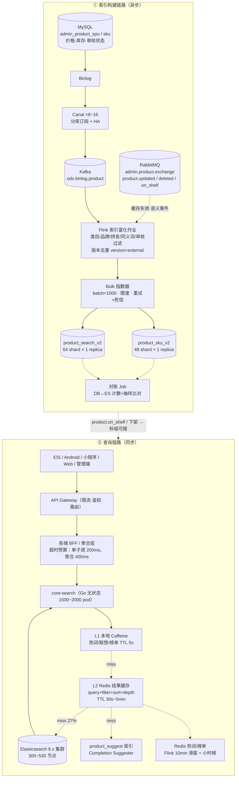
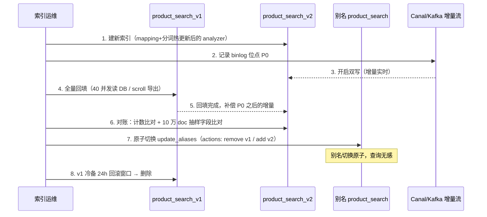
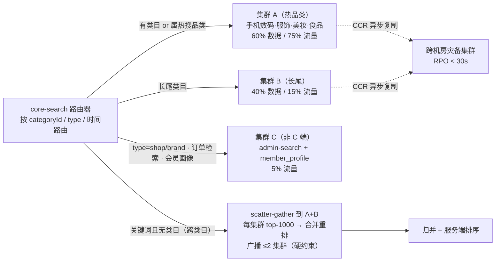
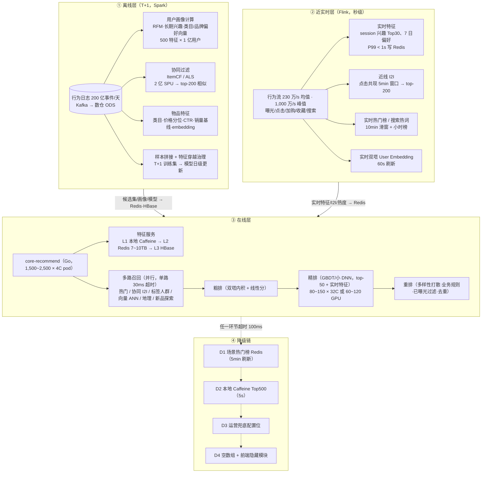

# 06 · 搜索与推荐架构

> **目标规模**：1 亿同时在线；10 亿 SKU / 2 亿 SPU；搜索应用层 QPS 100 万~200 万；推荐应用层 QPS 150 万~300 万
> **基线**：Elasticsearch 8.x（搜索） + 离线/在线分离推荐系统（Spark / Flink + 特征库 + 在线推理）
> **对接计划**：`plans/admin-backend.md` 3.3.1 / 6.3.1、`plans/ios-backend.md` 3.2.3 / 3.2.4 / 11.1、`plans/miniprogram-backend.md` 3.3
> **口径**：全文 QPS 均指**应用层入口峰值 QPS**（非均值），均值按峰值 ÷2.5~3 估算；核 = vCPU；机器默认 32C/128G 机型，另注明者除外

---

## 0. 一句话结论

| 维度 | 结论 |
|------|------|
| 索引规模 | 商品搜索索引 10 亿 SKU 磁盘 **7~8 TB**（含 1 副本与段开销），主索引 **64 主分片 × 1 副本** |
| 搜索 QPS | 150 万入口 QPS，**前置缓存必须吃掉 ~73%**，真正落到 ES 的只有 **~40 万 QPS** |
| ES 集群 | **300~530 节点 / 1.5~2 万核**；磁盘仅 8 TB 却需上万核 → **CPU 瓶颈、磁盘闲置，是路线不经济的信号** |
| 写入 | 稳态 5k docs/s、峰值 5 万 docs/s；Canal→MQ→Bulk 链路 P99 ≤ 8s |
| 推荐 QPS | 300 万入口 QPS，靠"离线/近线预算 + 在线轻算"把在线 CPU 压到 **1~1.5 万核** |
| 特征库 | Redis（热）**7~10 TB / 140~180 台** + HBase（温冷）**3~4 TB×3 副本 / 40~60 台** + 向量检索 **40~60 台** |
| 上限 | ES 单集群实用上限 **300~800 data nodes / 100~300 TB**；推荐在线 **千万级 QPS** 上限在特征存储与 GPU；再往上需要自研检索引擎与特征平台（阿里 iDragon / TPM 类） |

---

## 一、容量测算

### 1.1 搜索 QPS 分解（峰值 150 万）

按 1 亿在线用户、人均日搜索相关请求 ~15 次（含联想、翻页、筛选）估算日均 15 亿次，峰值系数 4.5~6 → 峰值 **65 万~90 万**？**不成立**——因为移动端联想输入框每敲一个键都是一次请求，人均日"搜索相关请求"实际 80~150 次。取：

```
日均搜索相关请求 = 1e8 用户 × 20% 搜索用户 × 400 次/搜索用户 ≈ 80 亿次/天
均值 ≈ 9.3 万/s × 峰值系数 16（晚高峰+大促） ≈ 150 万/s  ← 与给定口径一致
```

| 子接口 | 占比 | 峰值 QPS | 前置缓存命中率 | 打到 ES |
|---|---|---:|---:|---:|
| 关键词主搜索 `/search` | 30% | 450,000 | 55% | **202,500** |
| 联想 `/search/suggestions` | 25% | 375,000 | 90% | 37,500 |
| 分类列表 / 筛选翻页 | 15% | 225,000 | 65% | 78,750 |
| facets 聚合（品牌/价格段/属性） | 10% | 150,000 | 70% | 45,000 |
| 热词 / 搜索发现 / 历史 | 8% | 120,000 | 95% | 6,000 |
| 榜单 / 销量 / 上新排序 | 7% | 105,000 | 85% | 15,750 |
| 店铺 / 品牌 / 其他类型（`type=shop/brand`） | 5% | 75,000 | 80% | 15,000 |
| **合计** | 100% | **1,500,000** | **72.7%** | **≈ 400,000** |

**缓存命中的合理性**：关键词搜索 55% 来自——头部词与运营引导词（长尾分布下 Top 1 万词覆盖 ~60% 查询）、第 1 页结果页（TTL 30s）、筛选条件固定组合、以及**"召回结果缓存 + 个性化重排不缓存"的分层**（召回集按 query 缓存，排序在服务内本地完成，不进缓存 key）。若做不到 55%，则 ES 侧 QPS 线性上升，直接击穿上文节点数——这是本架构的**第一约束**。

**搜索服务层（无状态）**：150 万 ÷ 1000 QPS/pod（2C，含鉴权/参数解析/缓存读/回源/结果合并）→ **1,500~2,000 个 2C pod（3,000~4,000 核）**。

> **跨文档口径对齐（00-conflict-register C10-c）**：`01` 号 §1.2 读 QPS 域分解表给搜索域 45 万~75 万、首页/推荐/内容域 36 万~60 万，与本文"搜索 150 万 / 推荐 300 万（应用层入口口径）"矛盾。**裁决：搜索与推荐域容量以本文为准（150 万 / 300 万，含联想、筛选、个性化重排等子接口）**，01 号域占比表为拍脑袋 [假设]，压测回填时须按本文数值重新分配其余域或上修读 QPS 总量上限（应用层入口读上限当前取 08 号 617 万）。本文"应用层入口 QPS"与 01/09 号"应用层读 QPS"为同一口径。

### 1.2 推荐 QPS 分解（峰值 300 万）

| 场景 | 占比 | 峰值 QPS | 在线计算深度 | 单请求 CPU |
|---|---:|---:|---|---:|
| 首页"猜你喜欢" Feed | 40% | 1,200,000 | 读预计算候选 + 粗排 + 打散 | 1.5 ms |
| 详情页相似 / 搭配 / 看了又看 | 25% | 750,000 | 物品相似表点查（近线 I2I） | 0.6 ms |
| 搜索个性化重排 | 12% | 360,000 | 轻量 LTR（top-100 打分） | 1.0 ms |
| 购物车 / 结算页推荐 | 8% | 240,000 | 规则 + 类目热门 | 0.4 ms |
| 流量位 / 榜单 / Push 候选 | 15% | 450,000 | 离线预算直读 | 0.2 ms |
| **合计** | 100% | **3,000,000** | | **加权 ≈ 1.0 ms** |

```
纯业务 CPU = 3,000,000 × 1ms = 3,000 核·s
× (1/0.6 利用率) = 5,000 核
× 1.8（RPC / 序列化 / 反序列化 / 网络重传）≈ 9,000 核
→ 推荐服务层：1,500~2,500 个 4C pod（6,000~10,000 核）
```

**为什么不是 300 万 × 深度模型**：若每个请求对 top-100 候选做深度精排（单候选 0.04ms CPU），首页场景需 `1,200,000 × 4ms = 4,800 核·s → 8,000 核`；换 GPU 则 `120 万 ÷ 5,000 QPS/卡 = 240 张卡` 全量在线。因此采用**混合范式**：离线/近线预算 80% 分数，在线只对 **top-50 候选 + 实时特征**做增量打分，并对同一用户 60s 内结果做缓存（行为事件主动失效）→ 实际精排 QPS 降至 **40~60 万**：

```
精排 CPU = 500,000 × 4ms = 2,000 核·s → /0.6 ≈ 3,300 核 → 80~150 台 32C
（或 60~120 张 GPU，换取 RT 从 15ms 降到 3ms，用于大促峰值）
```

### 1.3 10 亿 SKU 的索引体积

**索引分层**：搜索结果按 SPU 展示，但价格/库存/规格筛选必须 SKU 级 → **双索引**。

#### (a) SPU 主索引 `product_search`（2 亿 doc）

| 字段组 | 内容 | 单 doc 体积 |
|---|---|---|
| 标识 | spu_id / spu_code / shop_id / category_path(3) / brand_id | ~80 B |
| 文本 | title(40字) / subtitle / 类目词 / 品牌词 / 分词+拼音扩展 | ~700 B |
| 图文 | main_image / tags[10] / 属性 K/V 约 20 项 | ~900 B |
| 交易 | price_min/max/original / sales / status / audit_status / updated_at | ~60 B |
| 内嵌 SKU 摘要 | top-20 SKU（sku_id / price / stock_status / specs） | ~1.4 KB |
| `_source` 合计（JSON） | | **~3.5 KB** |
| `_source` LZ4 压缩后 | | ~1.5 KB |
| 倒排（term ~500/doc：2-gram + 拼音 + 属性标签）+ doc values + points | | ~4~6 KB |
| **磁盘占用/doc** | | **6~10 KB，取 8 KB** |

```
2 亿 SPU × 8 KB   = 1.6 TB（primary）
× 2（1 副本）      = 3.2 TB
× 1.2（segment/merge 临时空间）≈ 3.8 TB → 记 4 TB
```

#### (b) SKU 筛选索引 `product_sku`（10 亿 doc）

精简 doc：sku_id / spu_id / specs / price / stock_status / image / sales ≈ **1.5 KB/doc**

```
10 亿 × 1.5 KB = 1.5 TB（primary）× 2 × 1.2 ≈ 3.6 TB
```

#### (c) 辅助索引

| 索引 | doc 数 | 体积（含副本） |
|---|---:|---:|
| `product_hot` 热销榜（Top 1000 万 SKU，5 分钟覆盖写） | 1,000 万 | ~0.15 TB |
| `product_suggest` 联想词（completion 字段，1,000 万词条） | 1,000 万 | ~0.3 TB（**completion 在堆内**，占 heap 2~3 GB） |
| `member_profile` 会员画像（1 亿用户，点查非 search） | 1 亿 | ~0.4 TB |
| `order_search` 订单检索（管理端/商家/客服列表查询） | 按月滚动 | ~2 TB |

**商品搜索索引合计 ≈ 7~8 TB（含 1 副本与临时空间）**；全系统检索索引 ≈ **10~12 TB**。

> 参考量级校验：淘宝级 10 亿 SKU 商品检索索引单 doc 含 2-gram 中文分词与拼音，行业经验值 5~10 KB/doc，本测算取中位，未计入用户行为日志索引（走 Kafka/数仓，不进 ES）。

### 1.4 分片数

规则：**单主分片 30~50 GB、≤5 亿 doc**（页缓存友好、恢复时间可控；>100 GB 分片 merge 与副本恢复时间不可接受）。

| 索引 | primary 体积 | 目标分片大小 | 主分片数 | 副本 | 总分片 |
|---|---:|---:|---:|---:|---:|
| `product_search` | 1.6 TB | 25 GB | **64**（取 2 的幂便于路由） | 1 | 128 |
| `product_sku` | 1.5 TB | 30 GB | **48** | 1 | 96 |
| `product_hot` | 0.07 TB | 4 GB | 16 | 1 | 32 |
| `product_suggest` | 0.15 TB | 10 GB | 16 | 1 | 32 |
| `member_profile` | 0.4 TB | 20 GB | 8 | 1 | 16 |
| `order_search`（3 个月在线） | 2 TB | 40 GB | 48 | 1 | 96 |
| **合计（在线集群）** | | | | | **≈ 400 分片** |

大促期间 `product_search` 主分片预分裂到 128（reindex 到新索引或 `split` API，需提前 7 天），避免热点分片。

### 1.5 ES 集群规模（按 CPU 反推）

**40 万真实 QPS 的复杂度加权 CPU：**

| 类别 | 占比 | QPS | 单查询平均 CPU |
|---|---:|---:|---:|
| 简单（suggest / 榜单点查 / 列表） | 45% | 180,000 | 6 ms |
| 主搜索（bool + highlight + sort + 分片广播） | 35% | 140,000 | 18 ms |
| 聚合（facets / terms / range） | 20% | 80,000 | 45 ms |

```
总 CPU = 180,000×6ms + 140,000×18ms + 80,000×45ms
      = 1,080 + 2,520 + 3,600 = 7,200 核·s
目标利用率 60%（留滚动升级与故障余量）→ 12,000 核
```

| 节点类型 | 机型 | 数量 | 说明 |
|---|---|---:|---|
| master | 8C/32G | **3~5** | 专用，不跑数据，3 节点选举 + 2 备 |
| coordinator | 16C/32G | **80~120** | scatter-gather + 聚合合并 + 结果缓存直连；单台 3,000~5,000 QPS |
| data_hot | 32C/128G/4TB NVMe | **350~400**（或 64C/256G **180~200**） | 承载 12,000 核，单台 1,000~1,600 QPS |
| data_warm | 16C/128G/SATA SSD | 30~60 | 30 天前下架/低频商品（~40% 数据） |
| data_write（专用写入） | 32C/128G/NVMe | **3~5** | 隔离 bulk 刷新抖动 |
| **合计** | | **300~530 节点 / 1.5~2 万核 / 50~80 TB 内存** | |

**必须诚实指出的不经济性**：8 TB 数据却需 350+ 台 4TB NVMe 数据节点 → **磁盘利用率 ~1%，CPU 打满**。说明 ES 在此 QPS 下是"按核采购"，磁盘配置应反向压缩（32C/128G + 2TB NVMe × 350 台 = 700TB 仍严重闲置），或改用**高核低存机型 + 冷热分层 + searchable snapshots**。若无法接受该核数，只能降低目标（减 QPS/减聚合）或换自研引擎（见第七章）。

### 1.6 写入吞吐（商品变更同步）

| 变更类型 | 日变更量 | 稳态 docs/s | 备注 |
|---|---:|---:|---|
| 价格变更 | 1 亿 | 1,160 | 进 ES |
| 上下架 / 审核状态（`product.on_shelf`） | 2,000 万 | 230 | 进 ES，**P99 < 1s**（下架必须立即可感知） |
| 标题 / 属性 / 图片 / 类目 | 5,000 万 | 580 | 进 ES |
| 库存状态翻转（0↔有货，粗粒度 `stock_status`） | 削峰前 10 亿 | 削峰前 11,600 | **不存精确库存**，只存 3 态；精确库存走 Redis |
| 销量 / 热度回写 | 10 亿 | 11,600（10s 批合并 → 1,160 批/s） | 进 ES |
| **合计（削峰后）** | | **≈ 5,000 docs/s 稳态** | **双 11 峰值 ×10~20 → 5 万 docs/s** |

**能力校核：**

- ES bulk：单节点（32C/NVMe、`refresh_interval=10s`、bulk 500~1000）稳定 **2~4 万 docs/s** → 峰值 5 万 docs/s 仅需 **3~5 台专用写节点**，写入不是瓶颈。
- **Canal**：单实例 2~5 万 binlog rows/s → 按分库部署 **8~16 实例**（2 主 + 6~14 分库，双机热备）。
- **消息通道分工**（与 `admin-backend.md` 1.4 契约兼容）：
  - `admin.product.exchange` / `product.updated`、`product.deleted`、`product.on_shelf` —— **业务事件**，驱动缓存失效与审计，量小、语义重；
  - 新增 `ods.binlog.product`（Kafka，`miniprogram-backend.md` 1.3 已登记 Kafka）—— **高频变更通道**，驱动索引构建；
  - 幂等：以 `(spu_id, source_version)` 去重（binlog 位点 + 事件 version），避免双通道重复写导致版本乱序（bulk 用 `version_type=external`）。
- **端到端延迟**：binlog 100ms + MQ 100ms + Flink 富化 200ms + `refresh_interval` 5s → **P99 ≤ 8s**；下架/审核拒绝类关键变更走 `refresh=wait_for` + 同步缓存失效 → **P99 < 1s**。

**全量重建**：10 亿 SKU（SPU 索引 2 亿 + SKU 索引 10 亿），40 并发读库（每并发 3 万行/s）+ 8 节点 bulk（40 万 docs/s）+ 富化/分词/对账 → **4~8 小时**。大促期间禁止全量重建，只做增量与滚动分片迁移。

---

## 二、搜索架构

### 2.1 全链路架构



### 2.2 分片策略与副本

| 索引 | 分片键 | 理由 |
|---|---|---|
| `product_search`（主） | 默认 `hash(_id)` | 关键词查询无类目条件，必须均匀广播到全部 64 分片 |
| `product_sku` | 默认 `hash(sku_id)` | 同上 |
| **类目浏览专用**：`product_search` 写入时同时按 `routing = categoryId` 写入 `product_category` 索引（32 分片） | `categoryId` | 类目/筛选查询只打 **1 个分片**（32→1 的扇出收敛，是分类列表 65% 缓存命中之外的第二重保障） |
| `product_hot` 16 分片 | `hash(_id)` | 小索引，榜单/兜底专用，5 分钟全量覆盖写 |
| `product_suggest` 16 分片 | 默认 | completion 字段在堆内，独立 heap 池 |

**副本**：`number_of_replicas=1`（2 副本）——副本同时承担查询吞吐，等价于把读容量翻倍；大促可临时 `replica=2`（3 副本）分摊 1.5 倍流量，代价是磁盘 ×1.5（本场景磁盘富余，**净收益为正**，是少数磁盘能换 CPU 的地方）。

**节点角色**：`data_hot` / `data_warm` / `data_cold`（searchable snapshot 到对象存储，存 90 天前下架长尾）、`master`、`coordinator`、`ingest_write` 物理隔离，避免 bulk merge 与查询争抢 page cache。

### 2.3 滚动重建（零停机 reindex）



要点：mapping 变更（分词器、字段类型、动态模板）**只能**走此流程；纯数据变更走增量。回滚 = 把别名切回 v1，耗时 < 1s。

### 2.4 搜索词 / 热词 / 联想 / 筛选

| 能力 | 方案 | 延迟/性能 | 降级 |
|---|---|---|---|
| **分词** | IK max_word + 自定义电商词典（品牌/类目/属性/别名）+ `pinyin` filter（首字母与全拼）+ 同义词热加载 | 词典本地缓存，0 网络开销 | 词典加载失败用内置词典 |
| **纠错 / 改写** | query log 离线训练（编辑距离 + 点击反馈）+ 在线查询时对低 CTR 词做改写，`corrected_query` 下发 | 本地词典 + Redis，<5ms | 关闭改写，返回原始 query |
| **联想** | **不**对 2 亿 doc 的 title 建 completion（堆内爆掉）；独立 `product_suggest` 索引：商品标题去重 top-1000 万 + 类目/品牌/属性词 100 万，`completion` + `fuzzy` | **< 50ms**（满足 `miniprogram-backend.md` 3.3.3 口径）；L1 前缀缓存命中 90% | Redis Trie（Flink 维护） → 本地最近 5 万前缀 |
| **热词** | Flink 消费 search log，10 分钟滑窗 + 小时榜 + 日榜，去噪（刷量词黑名单、敏感词过滤）→ Redis ZSET | 实时（比计划的"每小时更新"更实时，**接口契约不变**） | Redis → 本地 Top100（运营下发配置） |
| **搜索历史** | Redis List `search:history:{userId}` 保留 10 条 | <5ms | 本地（客户端已有） |
| **筛选 facets** | `filters` agg 品牌/价格段走**离线预算**（每 query 组合预算桶数）；属性 agg 走类目索引单分片；`search.max_buckets=65536` 熔断 | 见 3.4 聚合治理 | 预算缓存 → 隐藏筛选面板 |
| **排序** | relevance / price_asc/desc / sales / newest（对齐 iOS `sort` 枚举与 miniprogram `sortField`） | sort 字段全部 `doc_values` | 默认 relevance |
| **高亮** | 服务端 `highlight` 只对 title，`<em>` 标签（对齐 iOS `title_highlight`） | +2~3ms | 关闭高亮 |

---

## 三、ES 集群扩展性

### 3.1 单集群上限（诚实量化）

| 约束项 | 实用上限 | 超限症状 |
|---|---|---|
| 单主分片大小 | **30~50 GB**（官方建议 ≤20，实践可到 50） | merge 追不上、副本恢复数小时、查询 page cache 抖动 |
| 单索引主分片数 | **≤2,000** | cluster state 线性膨胀，mapping 更新广播变慢 |
| 单集群总分片 | **3~5 万**（cluster state < 200 MB） | master 提交耗时上升、节点加入/离开引发长暂停 |
| 单集群数据节点 | **300~800**（Netflix 级别 1,000+ 可运行，但故障爆炸半径不可接受） | 滚动升级需数天、故障恢复不可控 |
| 单集群数据量 | **100~300 TB** | 全量重恢复按数小时/TB 计 → 300 TB 需数天，超过 RTO |
| 持续写入 | **5~10 万 docs/s** | 段膨胀、`refresh` 追不上、查询延迟劣化 |
| 查询吞吐 | **50~100 万 QPS（含前置缓存后的回源量）** | 协调开销与 GC 主导，加机器收益递减 |

**本系统位置**：40 万回源 QPS、400 分片、8 TB —— **分片与数据量远未到上限，QPS 已逼近 ES 单集群舒适区的 50%~80%**。因此单集群可以起步，但必须在 **200 万入口 QPS 口径下预留多集群能力**。

### 3.2 多集群路由



| 路由维度 | 规则 | 收益 |
|---|---|---|
| **品类** | 运营维护 `categoryId → cluster` 映射（Top 500 二级类目占 ~75% 流量进 A 集群） | 单集群数据与流量双降一半；A/B 可独立扩容与故障隔离 |
| **时间** | 大促索引 `product_search_v{N}_{yyyyMMdd}`，别名 `search_current` 指向当期 | 双 11 全量重建不影响历史索引查询 |
| **流量类型** | C 端（A/B）与管理端/画像（C）物理隔离 | 运营聚合圈选永远打不爆买家搜索 |
| **跨集群复制** | CCR `A→灾备`、`B→灾备`，异步、延迟 <30s | 机房级容灾；灾备集群只读，接管时切 DNS+别名 |

**跨类目关键词广播的代价**：一次广播 = 2 集群 × 全分片扇出，CPU 成本 ×2，故限制 **广播 ≤2 个集群**，且结果只取各集群 top-1000 再归并（`terminate_after` + `size=1000`）。

### 3.3 深度分页治理（search_after）

**问题量化**：`from = 10,000, size = 20` 时，每个分片需在内存中取并排序 **10,020** 个 doc 再丢弃 10,000 个 → 单查询 CPU 从 18ms 涨到 **200ms+**，内存放大 500 倍。ES `index.max_result_window` 默认 10,000，是硬保护。

| 端 | 现有契约 | 治理方案 |
|---|---|---|
| iOS | `page`（兼容） + **`cursor` / `next_cursor`**（推荐） | ✅ 已按游标设计，服务端直接映射 `search_after`（`sort=[_score, spu_id]` + `search_after=[score, id]`），**cursor 编码为 base64 的 sort 数组**，天然不可枚举、防爬 |
| 小程序 | `pageNum` / `pageSize` | 服务端硬校验 `pageNum × pageSize ≤ 5,000`；超过返回 `41301 深度分页受限，请使用筛选缩小范围`，引导用类目/价格筛选 |
| 管理端 admin-search | Spring `Pageable` | 同上，且运营导出走 **异步 scroll + export 任务**（`admin-backend.md` 4.1 批量任务框架），禁止在线深分页 |
| 通用 | — | `max_result_window` 由默认 10,000 **下调到 5,000**；`search_after` 是唯一深翻页通道；`scroll`/`point_in_time` 只用于导出与对账（PIT 保留 5 分钟） |

> 契约一致性：iOS `GET /api/v1/search` 响应中的 `next_cursor` 字段即 `search_after` 的编码形态，**末页为 null**（与 `ios-backend.md` 3.2.3 注释一致）；`total` 字段用 `track_total_hits: 10000` 上界，避免全量计数（超 1 万返回 `10000+`）。

### 3.4 聚合热点治理

| 风险 | 触发场景 | 治理 |
|---|---|---|
| 高基数 terms agg | 对 `shopId`（千万级）、`skuId`、`categoryId`（20 万+）做聚合 | ① `size` + `shard_size` 显式限制；② 高基数字段**不允许出现在主查询**，拆成二次请求（`/search/facets` 独立，缓存 70%）；③ 桶数超 `search.max_buckets=65536` 直接熔断返回部分结果 |
| 全量集合上的聚合 | 无 filter 的 `terms(categoryId)` 扫 2 亿 doc | **先 `filter` 缩小候选集再聚合**；类目/品牌聚合结果按 query 组合**离线预算 + Redis**（命中 70%） |
| 聚合与查询争 CPU | 20% 流量占了 45% CPU（3,600/7,200 核·s） | ① 聚合走**独立线程池**（`search threadpool` 与 `search_throttled` 分离）+ `max_concurrent_group_by_eager`；② 聚合超时 200ms 硬超时降级为"筛选面板折叠"；③ 聚合请求降级优先级低于主搜索（Sentinel 独立阈值） |
| 大结果集 fetch | `size=200` + 高亮 | `preference=_shards:0,1,2`（3 分片取并集）做"低成本 top-N"；fetch 层 `fields` 只取白名单，禁止 `_source` 全量返回 |
| 热点词打爆 | 单个大促词瞬时 10 万 QPS | L1/L2 缓存 + `request_cache=true`（分片级结果缓存）+ 网关按 query 限流（同词 QPS 上限）+ 本地词级并发去重（in-flight 请求合并） |

**熔断与保护**（ES 侧）：`indices.breaker.total.use_real_memory=70%`、`request` breaker 60%、`search.max_buckets`、`search.default_search_timeout=3s`；服务侧 Sentinel 规则：ES P99 > 300ms → 只读缓存；错误率 > 30% → 熔断回退兜底列表。

---

## 四、推荐架构

### 4.1 三层架构总览



### 4.2 多路召回（并行，单路 30ms 超时，失败率 < 20% 不整体降级）

| 召回路 | 数据源 | 候选数 | 延迟 | 说明 |
|---|---|---:|---|---|
| 热门榜 | Redis `hot:{scene}:{category}`（Flink 10min 滑窗） | 500 | <5ms | **兜底主力**，永不为空 |
| 协同过滤 I2I | 近线（5min 共现）+ T+1 ItemCF top-200 | 300~800 | <10ms | 用户最近交互商品 → 相似集 |
| 标签/人群包 | 用户画像标签 → 人群商品池（运营配置 + 圈选） | 300 | <10ms | 含新人池、高价值池 |
| 向量 ANN（双塔） | HNSW 集群，2 亿 item embedding | 500 | 10~30ms | 用户 embedding 实时（60s）或离线 |
| 地理/同城 | 基于收货地址/定位的本地商品、同城零售 | 200 | <10ms | 无定位时跳过 |
| 新品/探索 | 7 天内上架新品池，ε=0.2 探索配额 | 100 | <5ms | 冷启动 + 防马太效应 |
| 购物车关联 | 购物车内 item 的搭配关系（规则图） | 100 | <5ms | 结算页场景 |

**召回后候选**：并集 ~2,000 → 去重/已曝光过滤（用户 30 天曝光布隆）→ 粗排 top-500 → 精排 top-50 → 重排 top-N（分页 size=20）。

### 4.3 降级策略（推荐挂了回退热门榜）

**分级熔断**：单路召回失败 → 跳过该路（部分召回）；精排超时 → 用粗排分；特征服务 miss → 用该用户缓存的"退化特征"（画像默认值 + 上次成功的会话特征）；整链 100ms 未返回 → 直接读热门榜。

| 级别 | 触发 | 返回 | 数据保鲜 |
|---|---|---|---|
| **D0 正常** | — | 个性化结果 | — |
| **D1 场景热门榜** | 推荐服务 P99 > 100ms 或错误率 > 10%（Sentinel 熔断） | Redis `hot:{scene}` top-500 | 5 min |
| **D2 本地缓存** | Redis 不可用 | 每 pod Caffeine `Top500`（启动预热 + 定时刷新） | 5 s~5 min |
| **D3 运营兜底** | 热门榜也失效 | 配置中心下发的固定推荐位（运营手工维护，静态 JSON） | 人工 |
| **D4 空** | 全部失败 | `data.sections=[]`，前端按契约隐藏模块（不留白） | — |

> 与 BFF 超时预算对齐：`ios-backend.md` 11.3 规定单子调 P99 200ms、聚合 400ms → **推荐子调用超时设 100ms**（留 100ms 给详情/评价等其他子调用），超时即降级，不阻塞首屏。

---

## 五、千人千面：特征库选型、更新延迟、冷启动

### 5.1 特征库选型

| 特征类别 | 示例 | 首选存储 | 容量 | 更新延迟 | 理由 |
|---|---|---|---:|---|---|
| **会话实时特征** | 最近 30 次曝光/点击、session 类目兴趣分布、当前 query 上下文 | **Redis** + 本地 Caffeine L1 | 1 亿 × 2 KB = **200 GB** | **P99 < 1s**（Flink 直写） | QPS 最高、key 小、TTL 短 |
| **近线特征** | 7 日类目偏好、最近购买、加购未购、7 日活跃度 | **Redis** | 1 亿 × 6 KB = **600 GB** | 5~30s | 同上 |
| **候选集 blob** | 每场景 top-500 的 `[item_id, score]` | **Redis**（`rec:cand:{uid}:{scene}`） | 1 亿 × 3 场景 × 500 × 12 B ≈ **1.8 TB** | 离线 30min / 近线 5min | 一次 GET 取全量候选，把 N 次 RPC 压成 1 次 |
| **物品特征** | 类目、品牌、价格分位、CTR、实时热度 | **Redis**（热 top 5,000 万）+ 本地 | 5,000 万 × 400 B = **20 GB** | CTR/热度 10s；基础 T+1 | 物品特征变更慢，本地命中率可到 70% |
| **离线画像（温冷）** | RFM、消费层级、长期兴趣向量、500 统计特征 | **HBase**（热字段冗余到 Redis） | 1 亿 × 30 KB = **3 TB × 3 副本 = 9 TB** | T+1 06:00（12:00 增量补算） | 列式宽表、成本只有 Redis 1/5，Redis 挡掉 95% 后 HBase 仅 15 万 QPS |
| **物品相似库** | 2 亿 SPU × top-200 相似 | **HBase**（或 RocksDB-Titan） | 480 GB | T+1 全量 4~8h + 近线增量 | 点查、按行组织，天然适合 |
| **向量** | 双塔 embedding 2 亿 × 128 维 | **专用向量库**（HNSW，Faiss/Milvus 自建） | fp16 51 GB + HNSW 图 ~640 GB ≈ **0.7~1.5 TB** | 用户向量 60s；物品向量 T+1 | Redis 存向量做 ANN 内积在 2 亿规模不成立 |
| **模型服务本地缓存** | 热 item embedding / 词表 / 分桶统计 | **RocksDB（嵌入 JVM/Go 进程）** | 每实例 2~8 GB | 随模型版本 | 零网络、微秒级读 |

**为什么不全用 Redis**：1 亿用户全量画像若都放 Redis，`1 亿 × 30 KB = 3 TB` 冷数据要占 3 TB 昂贵内存却只有 ~5% 命中率；分层后 **Redis 7~10 TB 承载 95% 读**，HBase 9 TB 承载长尾，成本下降约 60%。
**为什么不用纯 HBase 做热层**：HBase 单读 P99 3~8ms，乘上每请求 3~5 次特征读 = 15~40ms，直接吃光 100ms 预算；Redis P99 1~2ms 才能满足。

### 5.2 特征更新延迟矩阵

| 数据 | 链路 | 延迟 |
|---|---|---|
| 曝光/点击 → 会话兴趣 | 客户端埋点 → Kafka → Flink → Redis | **P99 < 1s** |
| 加购/收藏/搜索词 → 近线特征 | Kafka → Flink | P99 < 3s |
| 物品 CTR / 热度 / 实时销量 | Flink 10s 滑窗 → Redis | ≤10s |
| 近线 I2I（点击共现） | Flink 5min 窗口 → HBase/Redis | ≤5min |
| 实时 User Embedding | Flink 双塔 user 侧 → Redis | ≤60s |
| 候选集 blob | 近线作业（30min 微批） | ≤30min |
| 离线画像 / ItemCF / 物品向量 | Spark T+1，06:00 产出、07:00 全量上线 | T+1 |
| 模型 | 日级训练，大促可小时级增量 | T+1 |

### 5.3 冷启动

| 对象 | 策略 |
|---|---|
| **新用户（有账号无行为）** | ① 人群先验：渠道（微信/支付宝/抖音/iOS）、地域、设备价位段、注册场景 → 匹配人群包；② 无匹配则 D1 热门榜；③ **ε=0.2 探索**：20% 流量给多样性池，防止"新人只看爆款" |
| **游客（未登录，`anonymousId`）** | `miniprogram-backend.md` 2.1.3 的游客态：**会话内 5 次点击即生效**的实时兴趣（不依赖账号）；登录后按 2.3 合并策略把会话行为归并到 userId |
| **沉默老用户（90 天未活跃）** | 视同新用户，但保留长期画像做重排加权（不丢历史偏好） |
| **新商品（7 天内上架）** | ① 新品池配额：每个类目曝光量的 5%~10% 强制分配给新品；② 内容召回：标题/属性/图文 embedding 与用户兴趣匹配；③ 冷启动加速：小流量 A/B 测 CTR，CTR > 类目均值 1.2 倍则加大投放 |
| **新类目 / 新商家** | 运营配置兜底池 + 类目热门迁移（相似类目热门商品打散借量） |

---

## 六、与业务计划对接（契约沿用 + 降级）

### 6.1 各端接口 → 后端实现映射

**所有端不直接访问 ES**，统一走 `core-search` / `core-recommend`（Go + ES/Redis），各端 BFF 只做协议适配与聚合，**对外契约字段一个都不改**。

| 计划文档 / 章节 | 对外契约 | 后端实现 | 备注 |
|---|---|---|---|
| `ios-backend.md` 3.2.3 | `GET /api/v1/search`（q, type, sort, category_id, filters, price_min/max, page, page_size, **cursor**） | core-search：`cursor → search_after`；`page` 兼容但限深 ≤5,000 | `corrected_query` / `search_suggestions` / `related_categories` / `related_brands` / `next_cursor` 全部保留；`facets` 由主响应内联（与 3.2.3 尾注一致，不单开 `/search/filters`） |
| `ios-backend.md` 3.2.3 | `GET /api/v1/search/suggestions`（q, limit） | `product_suggest` 索引 Completion + L1 前缀缓存 | <50ms |
| `ios-backend.md` 3.2.3 | `GET /api/v1/search/hot`（hot_keywords / history / recommendations） | Redis 热词（Flink 10min+小时榜）+ 用户历史 List + 推荐词 | history 按登录态，游客返回运营词 |
| `ios-backend.md` 3.2.4 | `GET /api/v1/recommendations`（scene ∈ home/you_may_like/look_again/similar/accessory/frequently_bought, product_id, page, page_size） | core-recommend 场景路由表 | `sections[].products[].reason` 由召回路生成（如"根据你的浏览记录推荐"）；`request_id` 用于日志与 A/B 归因 |
| `ios-backend.md` 11.1.2 | `GET /api/v1/bff/ios/home` → `recommendations.products` | 内部调 `/recommendations?scene=home` | 超时 100ms → D1 热门榜，不阻塞首页 |
| `ios-backend.md` 11.1.3 | `GET /api/v1/bff/ios/product/{id}` → `recommendations.similar / accessories` | `scene=similar` / `scene=accessory` | product_id 必填，与 3.2.4 一致 |
| `miniprogram-backend.md` 3.1.2 | `GET /api/v1/miniprogram/product/search`（keyword, pageNum, pageSize, sortField, categoryId） | core-search | `sortField=price/sales/new` → ES sort 枚举 |
| `miniprogram-backend.md` 3.3.2 | `GET /api/v1/miniprogram/product/search/suggestion` | 同上 suggestions | <50ms（3.3.3 口径） |
| `miniprogram-backend.md` 3.3.2 | `GET /api/v1/miniprogram/product/recommend` | `scene=home`（或 `scene=index`） | 协同过滤 + 深度学习（3.3.3） |
| `miniprogram-backend.md` 3.1.2 | `GET /api/v1/miniprogram/product/home` → `productList` | 首页 Feed：Banner/分类走配置，`productList` 走 `scene=home` | 缓存 1 分钟（3.1.4 口径） |
| `miniprogram-backend.md` 3.1.2 | `GET /api/v1/miniprogram/product/category/list` | `routing=categoryId` 单分片查询 | 打 1 分片而非 64 |
| `admin-backend.md` 3.3.1 | `ProductSearchService.search()`（`multiMatch(name^3, subtitle^2, spuCode)`、filter `categoryId/status/priceMin-priceMax`、highlight、Pageable） | **admin-search 独立集群**（集群 C） | 字段名与 query DSL 保持一致；`ElasticsearchRestTemplate` 在 ES 8.x 需迁移 `ElasticsearchJavaClient`，`from/size` 改 `search_after` |
| `admin-backend.md` 6.3.1 | 会员画像 `term(userId) + sum(payAmount) + terms(categoryId)` | **改为点查 `member_profile` 索引（GET by id）**，画像由 Spark 每日预算 | 单用户画像不再实时聚合；见 6.2 |
| `admin-backend.md` 1.4 | `product.updated` / `product.deleted` / `product.on_shelf` | 缓存失效 + 索引增量双通道 | 契约不变 |

**iOS 缓存 TTL 口径调和**（`ios-backend.md` 1.4.2 登记"搜索结果 10 分钟、推荐结果 15 分钟"）：

| 用途 | TTL | 说明 |
|---|---|---|
| 在线个性化推荐 | **60s**，行为事件主动失效 | 15 分钟档不适用于个性化结果（会看到"上次看过的东西"） |
| 搜索召回结果（query 级） | 首屏 **30s**、第 2 页以后 **5min** | 召回集可缓存，个性化重排不进 key |
| 非个性化兜底（热门榜、运营位、降级结果） | **10~15 分钟** | ✅ 与计划登记值一致，作为**降级与兜底 TTL** |

### 6.2 管理端会员画像（ES 聚合）的改造

原方案（`admin-backend.md` 6.3.1）对每个 userId 实时做 `sum + terms` 聚合，在 10 亿级订单/行为索引上 **单查 200~500ms、占用聚合线程池**，且运营批量查看会形成热点。改造：

1. **单用户画像**：Spark 每日预计算 → 写 `member_profile` 索引（1 亿 doc，8 分片）→ 接口改 **GET by id 点查**（<10ms），或直读 Redis。
2. **群体圈选**（批量打标 `admin-member-tag/batch-tag`）：走**离线/异步任务**（提交 → 返回 taskId → 轮询），在集群 C 执行，结果写人群包存储；**禁止在线链路做 1 亿人群聚合**。
3. **实时看板聚合**：走 `admin-data`（Node.js）的 MQ 消费 + 自有 `admin_data_db` 聚合，不进 ES（与 `admin-backend.md` 1.1.1 跨语言取数约定一致）。
4. **合规**：`user.deleted` 事件（`admin.member.exchange`）必须同步清理 `member_profile` 与推荐特征库中的个人数据（PIPL，`admin-backend.md` 1.4.1 要求 30 分钟内完成）。

### 6.3 推荐位降级方案（逐位）

| 推荐位 | 主链路 | D1（服务熔断） | D2（缓存不可用） | D3（全挂） | 超时 |
|---|---|---|---|---|---|
| 首页"猜你喜欢"（iOS BFF home / 小程序 home / `product/recommend`） | 多路召回 + 粗排 + 精排 | Redis 场景热门榜（5min） | 本地 Caffeine Top500（5s） | 运营固定位 / 前端隐藏模块 | 100ms |
| 详情页"看了又看 / 相似"（`scene=similar`） | 近线 I2I + T+1 ItemCF | T+1 物品相似 top-200 | 类目热销 top-50 | 隐藏 | 80ms |
| 详情页"搭配/配件"（`scene=accessory`） | 搭配规则图 | 同店铺热销 + 同价格带 | 类目热销 | 隐藏 | 80ms |
| 购物车推荐 | 购物车 item 关联 | 购物车类目热门 | 全站热门 | 隐藏 | 80ms |
| 搜索个性化重排 | LTR top-100 | **回退 ES 默认相关性排序**（`_score`） | 同左（无感知降级） | 同左 | 30ms |
| Push / 营销人群 | 离线预算 | 同左（本就离线） | — | 不下发 | 离线 |

**搜索侧降级链**：ES 集群故障 → L2 Redis 结果缓存（30s 内仍可用）→ `product_hot` 兜底榜单 + 分类浏览（Redis 缓存列表，来源 MySQL 读库）→ 空结果页提示"搜索繁忙，为您推荐热门商品"。

**`/api/v1/bff/ios/home` 整体降级**（`ios-backend.md` 11.3 聚合 400ms 预算）：推荐子调 100ms、秒杀子调 100ms、配置子调 50ms、用户信息子调 100ms，任一超时用缓存/降级数据填充，**绝不返回整体失败**；弱网回退到 4.2 的分接口加载（前端已有该路径）。

---

## 七、技术上限：ES 与推荐系统还能撑多久

### 7.1 Elasticsearch 物理上限 vs 本系统需求

| 维度 | 本系统（1 亿在线 / 10 亿 SKU） | ES 实用上限 | 结论 |
|---|---:|---:|---|
| 数据量 | 10~12 TB | 100~300 TB/集群 | ✅ 余量 10 倍 |
| 分片数 | ~400 | 3~5 万 | ✅ 余量大 |
| 回源查询 QPS | 40 万 | 50~100 万（单集群） | ⚠️ 已占 40%~80% |
| 持续写入 | 5k 稳态 / 5 万峰值 | 5~10 万 docs/s | ⚠️ 峰值已贴上限 |
| 数据节点 | 300~400 | 300~800 | ⚠️ 处于区间下沿 |
| **成本效率** | **8 TB 数据需 1.2~1.9 万核** | — | ❌ **核/存储比严重失衡 = 路线不经济** |

**扩容边界（ES 路线的天花板）：**

1. **单集群**：加机器到 ~800 data nodes 后，cluster state 广播、滚动升级时长（>1 天）、故障恢复时间、以及"一个坏查询打爆全集群"的爆炸半径都会失控 → **必须切多集群**，本架构已在 3.2 预留。
2. **多集群**：品类路由可线性扩到 4~6 个集群（≈ 200~300 万回源 QPS）。但**跨类目关键词广播是反向力**——集群数每 +1，广播成本 +50%。当必须广播的流量 > 40% 时，多集群的边际收益归零。
3. **聚合**：facets 占 20% 流量却消耗 50% CPU；若坚持在 ES 内做实时聚合，QPS 上限卡在 ~50 万回源。解法只有**聚合离线预算化**（把 CPU 换成存储与调度复杂度）。
4. **物理硬顶**：`index.max_result_window`、`search.max_buckets`、堆内 completion 词条数（单节点 heap / 词条平均 50~100 B → 31 GB heap 约 3~5 亿词条）。

### 7.2 推荐系统物理上限

| 组件 | 本系统需求 | 上限 | 结论 |
|---|---:|---:|---|
| 在线服务 | 300 万 QPS / 6,000~10,000 核 | 单 K8s 集群 5~10 万核 | ✅ 工程可达 |
| 特征 Redis | 7~10 TB / 140~180 台 | 单集群 100~200 TB（分片数万） | ✅ 但成本主导 |
| HBase | 9 TB / 40~60 台 | 数百 TB | ✅ |
| 向量检索 | 105 万 QPS / 40~60 台 | HNSW 单机 2~5 万 QPS，扩到数百台 | ⚠️ 2 亿向量 + 100 万 QPS 已是**自建 Faiss 的舒适区上沿** |
| **精排推理** | 300 万全量在线 = **240~600 GPU** | — | ❌ **不经济，必须离线/近线预算 + 在线增量打分** |
| Flink 行为流 | 均值 230 万/s、峰值 1,000 万/s | 单集群百万级/s × 多集群 | ⚠️ 需按渠道分 Kafka topic + 独立作业隔离 |

**推荐侧真正会先撞的三堵墙：**

1. **特征存储成本**：10 TB Redis ≈ 云上 ¥150~300 万/月，随特征数与用户数线性增长；特征每 +10% → +¥15~30 万/月。
2. **GPU 推理成本**：想做"每个请求、每个候选都跑大模型"，300 万 QPS 全量在线深度排序需要 **240~600 张卡**，或转向"**大模型离线蒸馏小模型 + 在线只算增量**"的范式。
3. **样本与标签实时性**：CTR/CVR 标签延迟 >5 分钟，模型对大促瞬时热点（开抢 5 分钟内的流量结构突变）完全失效 → 需要**在线学习 / 流式样本 + 实时增量更新**，这已经超出 Spark+Flink 批流两层的表达能力。

### 7.3 超出上限需要什么（自研路线）

| 能力缺口 | 开源/商业方案的天花板 | 自研方向（参照阿里 iDragon / TPP、字节推荐中台） |
|---|---|---|
| **统一检索引擎**：10 亿级 doc、百万 QPS、倒排 + 向量 + 自定义排序一体化 | ES 分词倒排与向量（HNSW）是两套存储、两次召回、结果合并成本高；排序逻辑只能在协调层执行 | **iDragon 类分布式检索引擎**：存算分离（计算下推到分片内做 top-N 排序）、倒排/向量/列存统一存储、自定义排序 DSL、多租户隔离、分钟级弹性扩缩容（双 11 弹性） |
| **特征平台** | Redis + HBase + 手工同步，血缘缺失、在线离线不一致（训练用 T+1、推理用 1s，特征穿越/穿越 bug 难查） | **TPM 类特征平台**：特征注册与血缘、**在线离线一套计算逻辑**（批流同构）、点查 P99 <2ms 的列存 + 分层缓存、特征质量监控、变更可回溯 |
| **排序计算下推** | ES 只能按 doc value 排序，无法执行"用户 embedding × item embedding + 线性分"这类**依赖请求上下文的排序** | 排序 DSL 下推到存储层 + 预算分缓存，把"召回-粗排-精排"合并为一次扫描 |
| **样本/在线学习** | Spark 批训练 + Flink 流特征，样本拼接在离线，延迟 T+1 | 流式样本（曝光-点击 join 在 Flink 内，窗口 5min）+ 增量模型（每 10 分钟 SGD）+ 特征穿越自动校验 |
| **成本** | ES 按核采购，核/存储比失衡 | 存算分离 + 冷热分层 + 大促弹性（预留资源 <50%），预计检索侧成本下降 **40%~60%** |

**决策建议（诚实版）**：

- **当前基线（ES 8.x + Spark/Flink + Redis/HBase）在 1 亿在线 / 10 亿 SKU 下是可落地的**，代价是 **1.5~2.5 万核** 与 **¥400~800 万/月** 的搜索+推荐在线成本（不含离线与训练）。
- **需要自研的判断信号**（任一出现即启动）：① ES 回源 QPS > 60 万且多集群广播成本 > 30%；② 精排全量在线推理 GPU 需求 > 300 卡；③ 在线离线特征不一致导致的线上事故 > 2 次/季；④ 双 11 弹性无法在 1 小时内完成。
- **不要过早自研**：自研检索引擎 + 特征平台是百人年级工程（阿里 iDragon/TPM 均为数年迭代产物），在**多集群路由 + 聚合预算化 + 混合精排**三招用尽之前，开源栈的容量余量仍有 2~3 倍。

---

## 八、SLO 与关键监控

| 指标 | 目标 | 说明 |
|---|---|---|
| 搜索接口 P99 | ≤ 300ms（含缓存 miss 回源） | iOS/小程序契约未定 RT，BFF 聚合 400ms 预算倒推 |
| 联想 P99 | ≤ 50ms | `miniprogram-backend.md` 3.3.3 明确要求 |
| 推荐接口 P99 | ≤ 400ms（BFF）/ 子调用 100ms | 对齐 `ios-backend.md` 11.3 |
| 商品变更可搜延迟 | P99 ≤ 8s；下架类 ≤ 1s | 见 1.6 |
| 索引数据一致性 | DB↔ES 计数偏差 < 0.01%，每小时对账 | 抽样 10 万 doc |
| 降级可用性 | 推荐/搜索可用性 99.9%（对齐 `ios-backend.md` 16.x P2 档 99.5% 的最低承诺，目标上修） | D1~D4 链路每季度演练 |
| 缓存命中率 | 搜索 ≥ 70%、联想 ≥ 90%、热词 ≥ 95% | **低于 70% 立即告警**——这是 ES 集群容量的第一道保险丝 |

---

## 附录：关键假设与可校准项

| 假设 | 取值 | 若偏离的影响 |
|---|---|---|
| 搜索前置缓存命中率 | 72.7% | 每降 10pp → ES 回源 +4 万 QPS → +25 台数据节点 |
| 单查询平均 CPU（加权） | 18ms | 每 +2ms → +800 核 → +25 台 |
| 单 doc 磁盘（SPU） | 8 KB | 每 +2 KB → 索引 +0.4 TB（对节点数无影响，CPU 主导） |
| 商品日变更率 | 5% | 每 +5pp → 稳态写入 +1,000 docs/s（仍远低于上限） |
| 行为事件量 | 200 亿/天 | 每 ×2 → Flink 并行度 ×2（+500~1,500 核） |
| 精排在线候选数 | top-50，60s 结果缓存 | 若改为全量 top-500 无缓存 → 精排核数 ×5（+1.5 万核） |

---

## 跨文档一致性修正（2026-10-11 收敛，详见 `00-conflict-register.md`）

| # | 修正 | 位置 | 依据 |
|---|------|------|------|
| 1 | 搜索/推荐域 QPS 与 `01` 号域占比矛盾 → **以本文 150 万 / 300 万为上限口径**，01 号 §1.2 已加注回指 | §1.1/§1.2 | C10-c |
