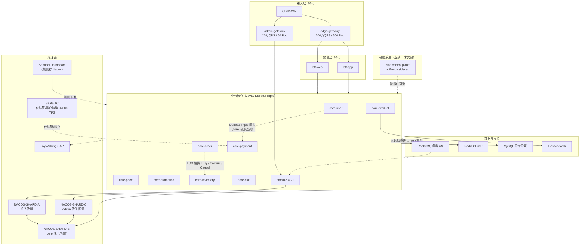
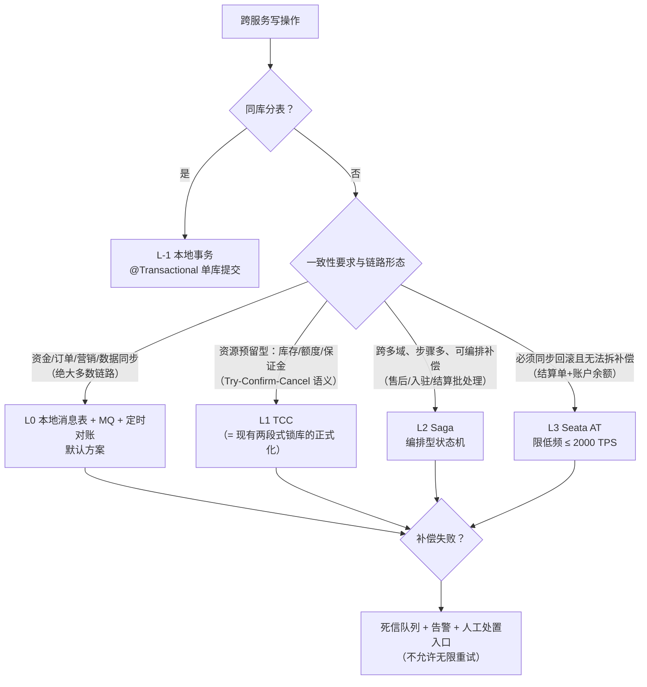
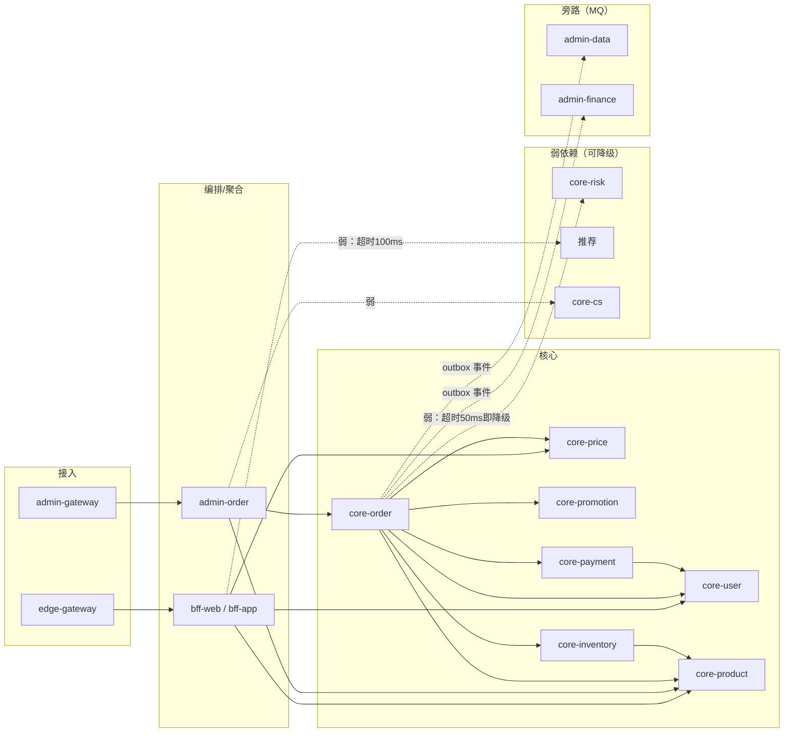

# 07 服务治理、RPC 与分布式事务架构

> **目标规模**：1 亿同时在线用户；应用层 5,000~10,000 Pod；服务间同步调用（含单元内）峰值 1,000 万次/秒
> **基线技术栈**：Spring Cloud Alibaba（Nacos 注册/配置、Sentinel 流控、Seata 事务）+ Dubbo3 / gRPC
> **演进项**：服务网格（Istio/Envoy）作为可选演进路径，非 v1 交付内容
> **对齐文档**：`plans/admin-backend.md` 1.1（20+ 服务拆分）、13.1（分布式事务）、16.1（灰度）；`plans/android-backend.md` 4.1.4/4.2.4（幂等）；`plans/pc-client-backend.md` 12.1.2（BFF 超时分级）
> **服务命名**：沿用现有计划 `admin-*` / `core-*` 服务名，不新造别名。买家端 API Gateway 在现有计划中无专名，**统一定名 `edge-gateway`**（与 `admin-gateway` 对仗；本文早期版本曾用 `buyer-gateway`，已按 01 号总纲 §0.3/§4.3 统一废弃，见 `00-conflict-register.md` C12）。

---

## 〇、本文件要回答的三个问题

1. **这套 SCA + Dubbo 的治理面，在 1,000 万内部 QPS / 10,000 Pod 下到底够不够用？** —— 逐组件给出容量算式与利用率（第 1、7 章），不做"应该够"的模糊承诺。
2. **哪些东西必须现在定死，否则后面改不动？** —— 协议收敛、超时预算、幂等键、灰度染色、依赖注册表（第 2、4、5 章）。这些都是**跨服务契约**，事后改 = 全量回归。
3. **分布式事务在亿级下哪个方案真的能跑？** —— 给出 Seata AT 的量化上限和为什么它只能覆盖 <1% 的链路（第 3 章）。

---

## 一、规模测算

### 1.1 QPS 口径推导（1,000 万内部调用 → 入口多少 QPS）

设每次外部 HTTP 请求平均产生 `F` 次服务间同步 RPC（BFF 聚合的并行分支 + 每分支的跳数 + 写链路的编排深度）。

```
内部 RPC 峰值 = 入口 QPS × F
10,000,000   = X × F
```

`F` 的取值依据（按流量加权）：

| 场景 | 占比 | 单请求 RPC 次数 | 加权贡献 |
|---|---|---|---|
| 首页/列表/详情（BFF 聚合 4~6 个并行查询） | 70% | 6 | 4.2 |
| 搜索/筛选 | 15% | 4 | 0.6 |
| 写链路（加购/下单/支付，串行 6~8 跳） | 5% | 8 | 0.4 |
| 会话/我的/消息 | 10% | 3 | 0.3 |
| 管理端操作（低频） | — | — | 合并到下方单独算 |

买家侧加权 `F ≈ 4.6`，管理侧取 `F = 4`（管理端编排更浅、以 CRUD 为主）。

```
买家侧入口 X_buyer = 920万 / 4.6 = 200 万 QPS
管理侧入口 X_admin =  80万 / 4.0 =  20 万 QPS
内部 RPC 合计       = 920万 + 80万 = 1,000 万 QPS ✓
```

**合理性校验**：200 万入口 QPS ÷ 1 亿在线 = 每个在线用户每 **50 秒**发起 1 次 API 请求。大促峰值页面停留 30~60 秒、静态资源全走 CDN 不计入 API，该量级与阿里双 11 实测形态（订单创建峰值 58.3 万笔/秒，全站 API 峰值千万级）一致。若扇出 `F` 在 4~6 之间波动，入口 QPS 区间为 **167 万 ~ 250 万**，本文按 200 万设计。

> **跨文档口径对齐（00-conflict-register C10-e/f）**：各文档"入口 QPS"存在三个口径——本文 220 万（由 1,000 万内部 RPC ÷ F=4.6 反推，**下限口径**）、`01/09` 号 350 万~600 万（读写给定口径）、`08` 号网关入口 630 万（漏斗口径）。**容量规划与压测验收取上限 630 万（08 号）**；本文的治理面测算（Nacos/Dubbo 注册、超时预算、依赖治理）在 220 万基线成立，在 630 万入口（内部 RPC ≈ 3,000 万，扇出 F≈5，09 号上限口径）下需按 §1.3/§7.1 复核 Nacos 推送与 Dubbo 服务发现余量。

> **口径边界（重要）**：本文件的 1,000 万/秒是**同步 RPC**，不含 MQ 消息。MQ 异步事件按"每 30 次 RPC 产生 1 条业务事件"估算 = **30~50 万 msg/s**，是独立的容量轴，其瓶颈见 7.1 第 6 行——它比 RPC 更早撞墙。
> **跨文档裁决（00-conflict-register C10-h）**：30~50 万 msg/s 是本文件按 RPC 漏斗反推的**业务事件下限口径**；全站 MQ 峰值（含通知扇出/缓存失效广播）以 `04-messaging.md` 双路径交叉验证的 **300 万条/s（设计值 350 万）** 为准，MQ 选型与集群规模按 04 号执行。

### 1.2 服务清单与实例分布

**服务总数 = 40**（现有计划已显式命名 33 个 + 买家端接入/BFF/推送等 7 个）：

| 分组 | 服务 | 数量 |
|---|---|---|
| 买家接入/BFF | `edge-gateway`、`bff-web`（H5/PC 聚合，Go）、`bff-app`（App/小程序聚合，Go）、`push-service`、`sync-service`、`update-service`、`client-config-service` | 7 |
| 共享业务核心 | `core-user`、`core-price`、`core-product`、`core-promotion`、`core-inventory`、`core-order`、`core-payment`、`core-risk`、`core-content`、`core-search`、`core-cs`、`core-message` | 12 |
| 管理端 | `admin-gateway`、`admin-auth`、`admin-user`、`admin-product`、`admin-category`、`admin-order`、`admin-inventory`、`admin-member`、`admin-marketing`、`admin-finance`、`admin-content`、`admin-data`、`admin-system`、`admin-store`、`admin-message`、`admin-cs`、`admin-audit`、`admin-search`、`admin-file`、`admin-warehouse`、`admin-logistics` | 21 |

> 与 `admin-backend.md` 1.1.1 的 21 个服务一一对应，无改名、无合并（1.1.1 中"warehouse/logistics/audit 可合并"的弹性保留，合并后服务数降到 37，本文件所有测算取上界 40，不受影响）。

**实例分布（中位口径 8,000 Pod）**：

> **跨文档口径对齐（00-conflict-register C10）**：本文 8,000 Pod 是按"入口 200 万 + 内部 RPC 1,000 万"的中位口径；`09` 号按入口 350 万~600 万、内部 RPC 1,500 万~3,300 万推导出 **1.04 万~2.2 万 Pod（中位 1.6 万）**。**采购与 HPA 规划以 09 号为准**，本文的治理面结论（最小副本 6、头部服务占 45%、长尾 10~40 副本）在两种口径下结构不变，仅按比例放大。

- 最小副本 **6**（3 可用区 × 2），这是硬下限——4 副本在单 AZ 故障时只剩 1 个，无法滚动发布。
- 头部 5 服务（`core-product` / `core-price` / `core-user` / `core-search` / 接入层）占 **45%** 副本数。
- 长尾 20 个 `admin-*` 服务多数在 10~40 副本（管理端 20 万入口 QPS 摊薄后每服务 <2 万 QPS）。

### 1.3 注册中心容量测算

#### 1.3.1 应用级服务发现是硬要求（先算这笔账）

Dubbo2 的**接口级**注册：每个服务暴露的 RPC 接口平均 60 个，10,000 实例 × 60 = **60 万条 URL 记录**，Nacos 内存 ≈ 60 万 × 1.5KB = **900MB**，且任一实例上下线要向订阅方推送 60 条变更，推送量放大 60 倍。

Dubbo3 **应用级**注册：只注册 `实例 IP:port + 应用名 + 元数据`，记录数 = **10,000 条**，内存 ≈ 20MB。

> **结论：Dubbo3 应用级服务发现不是"升级建议"，是 10,000 Pod 规模下的准入条件。** 未启用应用级（`register-mode: all` → 需过渡期双注册）的服务禁止扩容超过 200 副本。

#### 1.3.2 容量算式

| 指标 | 算式 | 峰值 | 单集群安全上限 | 利用率 |
|---|---|---|---|---|
| 注册实例数 | 8,000~10,000 Pod × 1 实例 | 10,000 | 50,000 | 20% |
| 心跳 QPS | 实例数 ÷ 5s（临时实例） | 2,000 | 50,000 | 4% |
| gRPC 长连接 | = 实例数 | 10,000 | 60,000（3 节点 × 2 万） | 17% |
| 服务级订阅边 | 40 服务 × 平均调用 8 个下游 | 320 条 | — | — |
| 客户端订阅组合 | 10,000 client × 平均订 26 个服务 | 26 万组 | — | 内存 52MB |
| 实例变更事件 | 滚动发布 3.3 Pod/s × 2 事件；HPA 暴涨期 42 Pod/s × 2 | 6.6 ~ 84 /s | 200/s | 42%（峰值） |
| **推送 QPS** | 变更事件 × 平均订阅扇出 800 | 5,300（常态）/ **67,000（HPA 峰值）** | 160,000（3 节点） | 42% |

**推送峰值是唯一的真瓶颈**：`core-price` 被约 3,600 个 Pod 订阅，它的一个 Pod 上线就要推 3,600 次。HPA 从 5,000 → 10,000 Pod 在 2 分钟内完成时 = 42 Pod/s × 2 × 800 = 6.7 万推送/s，会打满客户端 CPU（每个客户端要重新计算实例列表）。

**三条缓解措施（必须落地，否则扩容本身会引发雪崩）**：
1. **分批扩容**：单服务单次扩容 ≤ 20% 副本且两批间隔 ≥ 30s；双 11 用预测式扩容（提前 1 天按活动日历扩到位），HPA 只做 ±10% 微调。
2. **注册去抖**：客户端侧 1s 内合并同服务的多次推送（Nacos 2.x 默认行为，禁止关闭）。
3. **预热**：新 Pod 就绪后 60s 内只接 10% 流量（Sentinel `warm-up` + K8s `preStop` + readiness 预热窗口），避免冷缓存被瞬间打穿——这同时保护了注册推送不至于与缓存重建叠加。

#### 1.3.3 分片方案：Nacos 2.x 没有服务端分片，只能客户端分片

**事实**：Nacos 2.x 集群内每个节点持有**全量**注册数据，变更通过集群广播到所有节点；扩容节点能增加连接容量，但**不能线性提升推送吞吐**（每个节点仍要处理广播来的全量变更）。社区版本不提供按服务名的服务端分片。

因此本项目的"分片"= **按业务域拆多套 Nacos 集群 + namespace/分组做环境与租户隔离**：

```
NACOS-SHARD-A (接入/买家)   : edge-gateway, bff-*, push, sync ...   ≈ 2,500 实例
NACOS-SHARD-B (共享核心)    : core-* 12 服务                          ≈ 5,000 实例
NACOS-SHARD-C (管理端+基础设施): admin-* 21 + Seata/Sentinel/MQ 配置    ≈ 2,500 实例
```

- `core-*` 被买家端与管理端同时调用 → A/C 两个 shard 的客户端把 **B 的 server-addr 加入自己的注册中心列表**（Nacos 客户端支持 multi-registry），网络打通跨 shard 订阅。
- 环境隔离用 namespace（`prod` / `staging` / `dev` / `shadow`），业务隔离用 group，**禁止用 group 做环境隔离**（会导致灰度规则串环境）。
- 每 shard 峰值实例 < 5,000 = 单集群上限的 10%；单 shard 整体故障的爆炸半径 = 1/3 服务。

**什么时候才需要真正的服务端分片**：单集群实例 > 3 万或变更事件持续 > 150/s。本项目到不了，且到了之后社区版也没有——只能靠再拆 shard（客户端分片）或自研（见 7.3）。

### 1.4 配置中心容量测算

| 指标 | 算式 | 值 | 上限 | 利用率 |
|---|---|---|---|---|
| dataId 数 | 40 服务 × 10 个 dataId（见下） | 400 | 100,000 | 0.4% |
| 配置行数 | 400 × 平均 200 行 | 8 万行 | — | — |
| 功能开关 KV | 全局特性开关 + 实验开关 | ~2 万 | — | — |
| 合计 KV | | **10 万 KV ≈ 100~200MB 内存** | 100 万 | 10% |
| 配置推送 | 常态 1 变更/s；大促调控 10~50 变更/s × 订阅者（= 该服务 Pod 数，均值 200） | 200 ~ 10,000/s | 50,000/s | 20% |

每个服务固定 10 个 dataId 模板（**这是治理约定，不是建议**）：

```
{svc}-app.yml            # 应用主配置
{svc}-flow-rules         # Sentinel QPS/并发流控
{svc}-degrade-rules      # Sentinel 熔断降级
{svc}-hot-routes        # 热点参数限流（秒杀 SKU）
{svc}-gray               # 灰度规则（lane 选择器）
{svc}-flags              # 功能开关 / AB 实验
{svc}-mq                # MQ exchange/queue 声明
{svc}-resilience         # 超时/重试预算覆盖值
{svc}-biz-1..N           # 业务规则（限购、阈值）
{svc}-schema             # 本服务对外契约版本（供依赖方 CI 校验）
```

> 配置项本身不是瓶颈，**配置的爆炸半径才是**：一次误操作把 `{core-order}-flow-rules` 的阈值从 5,000 改成 50，会立刻压死全站下单。因此生产配置变更必须走：双人审批 → 灰度 1 个实例 60s → 观测 5 项指标 → 全量，且 Nacos 历史版本保留 90 天支持一键 revert（见 4.4）。

### 1.5 内部调用 QPS 分解（按接收方）

| 服务 | 内部峰值 QPS | 副本 | 单 Pod QPS | 前置条件（不满足则需 ×2~3 副本） |
|---|---|---|---|---|
| `core-product` | 2,000,000 | 1,200 | 1,667 | Redis 命中率 ≥ 97% + 本地 Caffeine 二级缓存 |
| `core-price` | 1,400,000 | 900 | 1,556 | 算价纯内存计算，禁止路径上直查 DB |
| `core-user` | 1,000,000 | 500 | 2,000 | 会话/资料全量走 Redis，DB 仅后台写 |
| `core-search` | 900,000 | 600 | 1,500 | ES 查询，单查询 P99 < 80ms |
| `core-promotion` | 800,000 | 500 | 1,600 | 活动规则本地缓存 + 版本号失效 |
| `core-inventory` | 600,000 | 500 | 1,200 | Redis 预扣为主，DB 扣减为异步收敛 |
| `core-order` | 500,000 | 400 | 1,250 | 读多写少，读走读模型/缓存 |
| `core-risk` | 500,000 | 300 | 1,667 | 规则引擎内存评估，超时 50ms 强熔断 |
| `core-content`/`core-cs`/`core-message` | 500,000 | 300 | 1,667 | 全弱依赖 |
| `admin-*` 内部互调 | 800,000 | 1,200 | 667 | 管理端 20 万入口 × F=4 |
| `core-payment`/`admin-file`/`core-logistics` 等 | 1,000,000 | 1,100 | 909 | 支付回调、文件签名为主 |
| **小计（被调用侧）** | **10,000,000** | **7,500** | — | |
| 接入层 `edge-gateway`/`bff-*` | 2,200,000（入口） | 500 | 4,400 | Go + 连接复用，实际可达 2 万 QPS/Pod |
| **合计** | | **8,000** | | 落在题给 5,000~10,000 区间中值 |

**单 Pod QPS 的诚实说明**：1,200~2,000 QPS/Pod 对"Redis 命中率高 + 无远程依赖的 Java 服务"是合理值；若某服务单请求要查 3 次 DB 且无缓存，单 Pod 只能撑 300~500 QPS，此时正确做法是**加缓存**而非加副本（副本 ×4 = 集群成本 ×4，且 DB 压力不变）。每个服务在注册表里登记"单 Pod 基准 QPS"，HPA 目标值由此推导（见 6.1）。

---

## 二、服务治理架构

### 2.1 总体架构



**四条架构硬约束**（与 `admin-backend.md` 1.1.2 一致，本文档加粗强调）：

1. 注册/配置统一走 Nacos，Seata 与 Sentinel 的 `registry.type`/`datasource` 必须同源，否则三套治理面各自为政。
2. 同步调用禁止成环（反向依赖一律改 MQ 事件）。
3. 只有幂等接口允许重试；资金与状态变更接口禁止降级。
4. 禁止跨语言直连数据库（`admin-data` 的例外口径见 1.1.1 附注）。

### 2.2 注册发现细则

| 项 | 值 | 理由 |
|---|---|---|
| 注册模式 | Dubbo3 `register-mode: all` → 6 个月后切 `interface` 之外仅 `application` | 见 1.3.1，60 倍差距 |
| 实例类型 | 临时实例（ephemeral） | K8s Pod 生命周期即真相，持久实例会在缩容后残留 |
| 健康检查 | 客户端心跳 5s + K8s readiness 探针 | 双重：进程活着 ≠ 能接流量（缓存未预热、依赖未连通） |
| 元数据 | `lane`（灰度泳道）、`az`、`unit`（单元化预留）、`version` | 灰度与单元化路由的唯一依据 |
| 就绪门禁 | readiness 必须包含"预热完成 + 关键依赖连通性"，而非仅 HTTP 200 | 否则扩容即雪崩（见 1.3.2） |
| 下线流程 | K8s `preStop: sleep 15` + 摘流 → Dubbo 优雅下线（等待在途请求 ≤ 超时预算）→ 停进程 | 否则每次发布都有一批请求 502 |
| Go 侧接入 | `edge-gateway`/`bff-*` 用 Nacos SDK 做 DNS-less 发现 | 与 Java 侧同一份实例列表，避免 K8s Service 与 Nacos 双真相 |

### 2.3 配置下发：灰度与降级开关

- **三层配置优先级**：`Nacos 远程配置` > `K8s ConfigMap（静态引导）` > `jar 内 application.yml（兜底）`。
- **动态生效分级**：
  - `@RefreshScope` 热生效（阈值、开关）——允许
  - 需重启生效（数据源、线程池大小）——禁止做成"看似动态"，避免运维误以为改了就生效
- **降级开关设计**：开关粒度 = `服务.接口.分支`，三态而非布尔：
  - `ON`（正常） / `DEGRADE`（返回默认值/缓存/空） / `FAIL_FAST`（立即 503）
  - 资金与状态变更接口（改价、退款、结算、打款）**永久固定为 `ON` 或 `FAIL_FAST`，不允许配置成 `DEGRADE`**（1.1.2 降级约定）。
- **开关下发通道与灰度泳道解耦**：开关按 `lane` 分组下发，但开关本身不用于灰度放量（放量用 2.2 的实例元数据 `lane`），避免"改开关"和"改版本"两套机制互相覆盖。
- **大促冻结期**：活动前 72h 起，除白名单开关外全部配置变更冻结；白名单变更需双人审批 + 灰度 1 实例 + 5 项指标观测。

### 2.4 RPC 选型：Dubbo3 vs gRPC —— 结论

**结论：Java↔Java 主链路用 Dubbo3（Triple 协议）；Go/Node↔Java 用原生 gRPC；Feign/OpenFeign 退役（存量冻结、新接口禁用）。最终只有两种协议在跑，且两者同为 HTTP/2 + Protobuf，观测与网格兼容性一致。**

| 维度 | Dubbo3（Triple） | 裸 gRPC | 判定 |
|---|---|---|---|
| 协议 | HTTP/2 + Protobuf（Triple 完全兼容 gRPC wire format） | HTTP/2 + Protobuf | 平 |
| 服务发现 | Nacos 原生、应用级注册、元数据路由 | 需自研 resolver 或上 xDS | **Dubbo** |
| 负载均衡 | 应用级 LB：一致性哈希（同用户粘性）、权重、同 AZ 优先、慢摘除 | 仅 round_robin / pick_first，其余自研 | **Dubbo** |
| 超时/重试 | 分层超时 + 重试预算 + mock + 泛化调用，框架原生 | 需 Interceptor 自研，且无泛化 | **Dubbo** |
| 限流熔断 | `sentinel-dubbo` / `sentinel-apache-dubbo3` 开箱即用 | 需 `sentinel-grpc` 或 Envoy | **Dubbo** |
| 治理面同源 | Nacos + Sentinel + Seata 同一生态，规则一份 | 需自己拼装 | **Dubbo** |
| 多语言一等公民 | Java / dubbo-go / Node（Go 侧生态弱于 Java 侧） | Go / Java / Python / Node 全一等 | **gRPC** |
| 网格可解析性 | Triple 是标准 HTTP/2 帧 + protobuf，Envoy 可解码 | 原生可解析 | 平（都可，Dubbo2 私有协议不行） |
| 运维成本 | 一套 | 一套 | 平 |

**为什么不是"全上 gRPC"**：治理面（超时预算、重试预算、熔断、泛化调用、Mock）在 gRPC 上全要自研，40 个服务 × 5 项能力 = 200 个自研点，而 Dubbo3 + Sentinel 提供了 80%。这是纯成本判断，不是技术优越性判断。
**为什么不是"全上 Dubbo"**：Go 写的 `edge-gateway`/`bff-*`/`admin-file` 用 dubbo-go 的治理能力弱于 Java 侧（尤其是 Filter 链与 Sentinel 集成），直接用 gRPC 客户端 + Nacos resolver 更省；Node 侧（`admin-data`）同理。
**为什么不是继续用 OpenFeign**：Feign 基于 HTTP/1.1 + JSON，单请求 CPU 是 Triple/Protobuf 的 3~5 倍，且超时/重试/熔断要靠 Spring Cloud 拼装，与 Dubbo 的应用级服务发现、元数据路由、灰度透传都不兼容——**同一个平台跑三种 RPC 协议，意味着超时规范、重试规范、灰度透传、监控埋点各写三遍**，这是治理成本的灾难。

**迁移路径（不搞大爆炸）**：

| 阶段 | 动作 |
|---|---|
| v1（现在） | 新增接口一律 Dubbo3 / gRPC；**Feign 接口冻结**（不删、不加）；写入 CI 门禁：新增 `@FeignClient` 构建失败 |
| v1.5 | `admin-*` 内部高频互调（order→product/member、audit→product）迁移 Dubbo3 |
| v2 | 低频管理端 CRUD 保持 Feign 或一次性迁完；Feign 依赖下线 |

> 与 `admin-backend.md` 1.1.2 的"OpenFeign（Java 内部）/ gRPC（跨语言）"口径差异说明：本文档按题给基线（Dubbo/gRPC）做了收敛，并给出上述迁移路径；1.1.2 的**超时与重试规则（连接 1s/读 3s、只有幂等可重试）本文档继续有效**，只是承载协议换了。

### 2.5 超时 / 重试 / 熔断规范（默认值表）

#### 2.5.1 超时默认值

| 场景 | connect | 单跳总超时 | 重试 | 依据 |
|---|---|---|---|---|
| **Dubbo 全局兜底（未显式配置时）** | 3,000ms | 1,000ms | 0 | 必须显式覆盖，兜底值只作为"配置漏了"的报警信号 |
| 核心写链路（下单/支付/库存/结算） | 100ms | 300ms | 0（非幂等） | 幂等键齐备的接口可 1 次 |
| 核心读链路（详情/列表/会话） | 100ms | 500ms | 1 次（仅连接失败/超时） | |
| 扇出聚合查询（BFF） | 100ms | 分支 100~200ms，总 800ms | 1 次 | 与 `pc-client-backend.md` 12.1.2 对齐 |
| 风控/推荐等强时效弱依赖 | 50ms | **50ms** | 0 | 超时即降级，绝不拖累主链路 |
| 定时任务/异步批量/MQ 消费内调用 | 1s | 30s | 2 次（退避 1s/3s） | |
| `edge-gateway` 端到端 | — | **1,500ms** | — | 见 5.4 预算表 |
| `admin-gateway` 端到端 | — | **10s**（导出/报表类接口） | — | 与 1.1.2 一致，管理端允许长请求 |
| Feign 存量（冻结中） | 1s | 3s | — | 1.1.2 原值，不再扩大使用 |

#### 2.5.2 重试规范（三条铁律）

1. **只有幂等接口允许重试**。幂等 = 有 `Idempotency-Key` 或有业务唯一键（`order_no + action`）。非幂等写接口自动重试 = 重复下单/重复扣款。
2. **单请求全程最多 1 次重试**。深度 `d` 跳、每跳重试 `r` 次的放大倍数是 `(1+r)^d`；`d=6, r=1` → **64 倍**流量放大，一次网络抖动就会演变成全站雪崩。跨服务重试用调用方级**重试预算桶**（10% 请求额度）控制，桶空则不再重试。
3. **只对可安全重试的错误重试**：连接超时、连接拒绝、HTTP 503（带 `Retry-After`）。读超时/5xx/业务异常**不重试**（服务端可能已产生副作用）。熔断器打开期间一律不重试。

退避：首次立即 + 50ms 随机抖动（禁止固定间隔，否则重试流量同步化）。

#### 2.5.3 熔断默认值（Sentinel）

| 策略 | 触发条件 | 统计窗口 | 半开恢复 | 适用 |
|---|---|---|---|---|
| 慢调用比例 | RT > 阈值（核心 500ms / 非核心 300ms）占比 > 50% | 10s / 最少 20 样本 | 5s，10 次探测 | 下游 DB/ES 压力传导 |
| 异常比例 | 5xx 占比 > 20% | 10s / 20 样本 | 5s | 下游故障 |
| 异常数 | 10s 内 > 50 次 | 10s | 5s | 低流量接口兜底 |
| 热点参数 | 单 SKU QPS > 阈值 | 1s 滑动 | — | 秒杀/爆款 |
| 系统自适应 | 入口 QPS/RT/CPU > 70% 入口保护 | 1s | — | 全局过载兜底 |

**熔断后的行为按依赖等级（见 5.3）**：弱依赖 → fallback 返回默认值/缓存/空；强依赖 → 快速失败 503 + 网关降级页。**禁止把强依赖配成"熔断后返回空数据继续走"**，那会把"商品查不到"放大成"下单成功但订单里没商品"。

**规则存放**：全部在 Nacos（`{svc}-flow-rules` / `-degrade-rules`），Sentinel Dashboard 只是编辑器与观测面，**不作为规则的持久化真相**（否则 Dashboard 挂了规则就丢）。

---

## 三、分布式事务：按场景分级

### 3.1 分级决策



**与 `admin-backend.md` 13.1 的关系**：13.1 的落地优先级（本地消息表默认 → Seata AT 少量 → TCC 仅接口约定 → 2PC 不用）**本文档完全继承**。区别只有两处：
- 题目要求"库存用 TCC"，而 13.1 说"TCC 只保留接口约定、v1.1 不实现"。**本文档的处理**：把库存现有的"Redis 预扣 → 锁库（Try）→ 出库（Confirm）→ 解锁/回补（Cancel）+ 幂等补偿"两段式，**正式命名为 TCC 三段语义并补全 Confirm/Cancel 的接口契约与空回滚/悬挂防护**——它本来就是 TCC 的等效实现，改名是为了让参与者按 TCC 的四类异常（空回滚、幂等、悬挂、资源泄漏）逐一设计，而不是靠"我记得这里要补偿"。
- 补充了 Seata AT 的**量化上限**（3.5），13.1 只说"评估锁竞争与脏回滚风险"，本文档给出为什么它只能覆盖 <1% 链路的数字。

### 3.2 L0（默认）：本地消息表 + MQ + 定时对账

**为什么是亿级下的默认**：事务边界始终是单库单事务（TPS 上限 = DB 能力，10 万+/s 量级），跨服务的一致性由"消息最终送达 + 对账兜底"保证，链路上没有任何全局锁、没有任何跨服务的事务协调者（TC 故障不影响主链路）。

**落点（沿用 13.2.1，本文档补三条亿级约束）**：

1. **消息表分片**：`outbox_msg` 必须与业务表**同分片键**（`user_id` 分库），否则"本地事务"变成跨库事务，方案就失效了。`admin-backend.md` 1.2.1 未给出分片数，本文档按吞吐倒推出**下限 32 库**（算式见下）。
2. **发送器不是 cron 扫全表**：13.2.1 的 `@Scheduled` 每 5 分钟扫全表在亿级下会扫描百万行。改为 **Canal/Debezium 订阅 binlog → 投递 outbox → 标记已发**，`@Scheduled` 仅作为 Canal 故障时的兜底（按分片分页扫，每次 ≤ 1000 行）。
3. **对账是兜底不是主通道**：对账任务按 `order_no` 哈希分片并行，每轮只处理"上一轮未闭合"的记录；对账发现的差异分三类——可自动补偿（重推）、需人工确认（金额差异）、系统性缺陷（立即停写 + 告警）。

**吞吐测算**：下单 10 万/s（入口 200 万 × 5% 下单转化）→ 每单产生 3~5 条 outbox 消息 = 30~50 万条/s 写入，分 32 库后每库 1~1.5 万/s 插入，加上业务表写入，单库总写入 3~4 万/s —— 这正是分 32 库而不是 8 库的原因（8 库时单库 12 万/s 已超 MySQL 单实例安全值 5 万/s）。

### 3.3 L1：库存 TCC

**三段职责**：

| 段 | 库存动作 | 幂等依据 | 超时 |
|---|---|---|---|
| Try | Redis 预扣（Lua 原子扣 + 过期释放）+ DB `locked_qty += n`（乐观锁 `version`） | `(order_no, sku_id)` | 250ms |
| Confirm | `locked_qty -= n` + `avail_qty -= n` + 写库存流水 | `(order_no, sku_id, action=CONFIRM)` 唯一索引 | 200ms |
| Cancel | `locked_qty -= n`（回补）+ 流水 | 同上 `action=CANCEL` | 200ms |

**四类异常必须显式处理（这是 TCC 相比"两段式口头约定"的全部增量价值）**：

| 异常 | 定义 | 处理 |
|---|---|---|
| 空回滚 | Cancel 到达但 Try 从未执行（Try 超时后发起方放弃） | Cancel 前查流水表无 Try 记录 → 写入"空回滚标记"直接返回成功 |
| 悬挂 | Cancel 先到，Try 后到（网络乱序） | Cancel 已写标记后，Try 到达时发现标记 → Try 直接丢弃，不得占用库存 |
| 幂等 | Confirm/Cancel 重复到达 | 唯一索引 `(order_no, sku_id, action)`，重复即返回首次结果 |
| 资源泄漏 | Try 成功但 Confirm/Cancel 都没来 | TCC 协调器超时扫描 + 每日对账双兜底；超时 30s 未决 → 告警 + 人工单 |

**协调器选型**：库存这个场景**不需要 Seata TC**。Try/Confirm/Cancel 的发起方 = 订单编排方（`core-order`），用本地状态机表 `tcc_txn(order_no, state, try_time, confirm_time)` 驱动即可，减少一个跨所有链路的强依赖组件。只有当同一事务需要跨 ≥3 个团队的服务时才引入 Seata TCC 模式。

**热点 SKU 的正确姿势**：TCC 的 Try 已经在 Redis 完成原子扣减，DB 只做异步收敛，因此单 SKU 10 万/s 的秒杀预占**不经过 DB 行锁**——这是库存场景不能用 Seata AT（3.5）而必须用 TCC 的根本原因。

### 3.4 L2：Saga（跨域弱一致）

**适用**：售后退款全流程（退款→库存回补→优惠券回退→积分扣回→佣金冲抵）、商家入驻全流程（店铺→资质→保证金→类目授权）、结算批处理。步骤多（≥4）、跨 ≥3 个域、每步都有可定义的补偿动作。

**编排型（Orchestration）而非协同型**：40 个服务的协同型 Saga（每步调用下一步）在排查故障时无法回答"现在卡在哪一步"。用状态机持久化：

```
saga_instance(instance_id, biz_type, current_step, state, payload, retry_cnt, ...)
saga_step_log(instance_id, step, state, request_hash, response, ts)
```

- 状态机进程崩溃可从 `current_step` 恢复（Exactly-once 不可能，做 **At-least-once + 每步幂等**）。
- 每步超时预算继承第 5.4 节规则；Saga 整体超时（如退款 24h）与业务超时分开配置。
- 补偿失败 → DLQ + 告警 + 人工处置台（13.1 第 5 条的"谁补偿、补偿失败怎么办、人工入口在哪"三问，Saga 状态机是唯一的标准答案载体）。

### 3.5 L3：Seata AT 在亿级下的问题（量化）与替代方案

**三个结构性问题**：

**① 全局锁的串行化**。AT 模式在分支提交到全局提交之间持有**全局锁**（`lock_table` 中 `xid + pk`），同一条记录的其他事务必须等待。

```
全局锁持有时长 = 分支本地提交 + TC 确认（2 次跨机网络往返 + 1 次 DB 更新）
              ≈ 3 ~ 10 ms
单热点行吞吐上限 = 1 / 0.003 ~ 1/0.010 = 100 ~ 330 次/s
```

秒杀场景需要单 SKU 10 万次预占/s → **差 300~1000 倍**。非热点行不受影响，但热点恰恰出现在大促，也就是最需要容量的时候。

**② TC 的吞吐上限**。社区压测：单 TC 节点（4C8G，DB 存储模式）约 **2,000~3,000 全局事务/s**（每事务 3~5 分支）。本平台写链路量级：

```
下单 10 万/s + 支付/退款/库存/结算 ≈ 30 万/s 全局事务需求
300,000 / 2,500 = 120 个 TC 节点 —— 且 TC 只是负载均衡，
每个 TC 都要读写同一张 global_table/lock_table，DB 成为新瓶颈
```

**③ undo_log 与连接占用**。每个分支写 undo_log（写放大 1.5~2 倍），事务期间占用 DB 连接；长事务链路（>3 步）会让锁持有时间从 10ms 涨到秒级，进而全局锁排队。

**结论与替代**：

| 链路 | 13.1 原口径 | 本文档口径 | 依据 |
|---|---|---|---|
| 下单/库存/支付主链路 | 未用 AT | **禁止用 AT** | ①②③，量化差 1~3 个数量级 |
| 结算单 + 账户余额变动 | AT 少数链路 | **保留 AT，硬上限 2,000 TPS** | 全站结算 <5,000 TPS，单 TC 集群（3 节点）可承载；且余额是低频热点 |
| 其余跨域写 | — | 一律 L0 / L1 / L2 | |

**AT 的替代方案不是"另一个全局事务框架"，而是"把强一致拆成最终一致 + 对账"**：30 万 TPS 的写链路在阿里内部也是这么做的（对账 + 幂等 + 补偿），不存在既能全局锁又能扛 30 万 TPS 的方案。若某条链路既需要同步回滚又无法拆补偿，**正确做法是重新设计数据模型让它同库**（本地事务 10 万+/s），而不是引入跨服务全局事务。

### 3.6 幂等规范（Idempotency-Key）

**与现有文档对齐**：`android-backend.md` 4.1.4/4.2.4（`X-Idempotency-Key` + `uk_idempotent_key` 兜底 + 归属校验 + 24h 缓存）、`admin-backend.md` 10.1.1。本文档把它提升为**全平台 RPC 层规范**（原来只定义在 HTTP 入口）。

**6 条规则**：

1. **覆盖范围**：所有非幂等写接口必须携带 `X-Idempotency-Key`（HTTP header）。RPC 内部同样透传：Dubbo 用隐式 attachment、gRPC 用 metadata，**透传责任在框架 Filter/Interceptor，不允许业务代码手动传递**（手动传必然漏）。
2. **键的构成**：客户端生成 UUIDv4；服务端幂等的最终真相仍是**业务唯一键**（`(order_no, action)`、`(payment_id, channel_txn_no)`）的唯一索引——幂等键是入口层防重，业务唯一键是数据层兜底，两层缺一不可。
3. **幂等表结构与流程**：
   ```
   idem_record(service, biz_type, idem_key, owner_user_id, request_hash,
               status /* 0=处理中 1=成功 2=失败 */, response_snapshot JSON, expires_at,
               PRIMARY KEY (service, biz_type, idem_key))
   ```
   - 请求到达 → `INSERT ... status=0`（靠主键冲突抢锁）→ 抢到者执行 → 完成后写 `status` + `response_snapshot`。
   - 并发同 key：抢锁失败者**轮询 ≤ 300ms**，仍未完成则返回 `202 + Retry-After`，**不得并行执行**。
   - 同 key 但 `request_hash` 不同 → `422`（防止键复用导致 A 请求拿到 B 的结果）。
   - 命中已完成 → **原样返回 `response_snapshot`，HTTP 200 + `Idempotency-Replayed: true`**，不报错（1.1/4.1.4 口径：命中后返回已创建订单，不重复建单）。
4. **归属校验**：`owner_user_id` 与请求者不一致 → 按 `1004` 处理（防止跨用户探测/覆盖他人结果，android 4.1.4 原文要求）。
5. **TTL**：支付类 **24h~72h**（至少覆盖渠道对账周期，跨日回调是常态）；普通写 1h~24h；过期后依赖业务唯一键继续兜底。
6. **MQ 消费幂等**：与 `admin-backend.md` 1.4.3 去重表一致，按 `message_id`（或业务事件唯一键）去重，重复投递不得产生二次副作用；`user.deleted` 等合规事件的去重记录保留 ≥ 180 天（审计举证需要）。

---

## 四、灰度发布

### 4.1 染色（全链路灰度的唯一依据）

**一次请求只允许有一个染色来源，优先级从高到低**：

| 优先级 | 来源 | 用途 |
|---|---|---|
| 1 | `X-Gray-Tag` 请求头（内部/压测/运维专用，需签名） | 定向验证 |
| 2 | 白名单（`gray-rules` 中的 uid 集合，≤ 1 万个） | 内部员工、VIP、客服复现 |
| 3 | `hash(uid) % 1000 < p × 10` | 放量百分比 |
| 4 | 默认 `stable` | |

染色在 `edge-gateway` / `admin-gateway` 完成，写入请求上下文；**BFF 与下游服务只读不改色**（改色 = 灰度逃逸）。

### 4.2 服务与实例灰度

```
网关染色 → 透传 → 服务端路由到同 lane 实例 → 无同 lane 实例则回落 stable
```

- **透传**：HTTP 侧 `X-Lane` header；Dubbo 侧 RpcContext attachment（框架自动隐式透传，业务无感）；gRPC 侧 metadata。**禁止业务代码显式传 lane**。
- **实例选择**：实例元数据 `lane=gray`（Nacos instance metadata，随部署注入）。消费端路由链：`GrayClusterResolver` 过滤同 lane 实例 → 空则**回落** `stable`（默认，保证灰度实例不足时服务仍可用）。
- **strict 模式例外**：写链路（下单/支付/库存）在灰度期间必须**全链路同 lane，不允许回落**——否则灰度服务写入的新字段会被 stable 服务读到并丢弃/误解，造成数据不一致。strict 模式的回落策略改为"没有同 lane 实例则直接失败"，由发布系统保证灰度实例数 ≥ 2。
- **DB 灰度**：灰度实例连**同一个库**，因此**灰度版本的表结构变更必须是"扩展-收缩"兼容式**（见 4.3），不允许灰度实例读写 stable 实例不认识的列的业务语义。

### 4.3 DB 影子：两件不同的事，别混用

| | 版本灰度（本节） | 影子库（全链路压测） |
|---|---|---|
| 目的 | 新版本代码灰度放量 | 压测流量不污染生产数据 |
| 染色 | `lane=gray` | `lane=shadow`（网关注入压测标记） |
| 数据 | 同一个生产库 | 影子库/影子表（前缀 `shadow_`），数据源按 `lane` 动态路由 |
| Schema | 扩展-收缩三步：①加可空列/新表（向后兼容）→ ②代码双读双写 → ③回填 → ④切读 → ⑤删旧列（收缩） | 影子表结构与主表 100% 一致 |
| 回滚 | 新列可空、旧逻辑保留，回滚只需回退代码版本 | 关闭影子路由 |

- **扩展-收缩是灰度与 DB 迁移的唯一合法姿势**：任何"改列类型/删列/改主键"直接发布的动作在 8,000 Pod 规模下必然出现新旧版本并存读写冲突（一次全量发布耗时 10~20 分钟，期间新旧版本同时在线）。
- **Flyway 只管 DDL 版本，不管兼容性**：16.2 的"Flyway 支持版本回退"仅适用于无状态 DDL；已删列的数据无法用 Flyway 找回来，这是必须写进发布 Checklist 的边界。

### 4.4 回滚（四层，任一层独立可用）

| 层 | 手段 | 生效时间 | 触发 |
|---|---|---|---|
| 流量回滚 | `gray-rules` 中该版本 `p → 0`，Nacos 推送 + 客户端 3s 缓存 TTL | **< 5s** | 自动（错误率 > 5% 或 P99 恶化 > 50% 持续 3min）或人工 |
| 版本回滚 | K8s 滚动回上一镜像（保留最近 3 个版本） | 3~10min | 人工 / 自动 |
| 配置回滚 | Nacos 历史版本一键 revert（保留 90 天） | < 10s | 人工 + 审批 |
| 数据回滚 | 扩展-收缩的"收缩"步骤只在发布后 7 天且无异常时执行 | 天级 | 人工 |

> **自动回滚的门槛必须高于告警阈值**：告警在错误率 1% 触发，自动回滚在 5% 触发。若在 1% 就自动回滚，一次可自愈的下游抖动会造成全站版本来回震荡（比故障本身更糟）。

### 4.5 放量节奏（与 16.1 对齐）

```
内部测试 → 1% → 5% → 20% → 50% → 100%（六周）
```

每档放量的**准入门槛**（不满足则停在当前档）：

| 指标 | 阈值 | 观测窗口 |
|---|---|---|
| 错误率 | 相对 stable 增幅 < 10% | 该档 ≥ 24h（50% 档 ≥ 48h） |
| P99 RT | 相对 stable 恶化 < 15% | 同上 |
| 下游调用 | 无新增未登记依赖（依赖注册表比对） | 全程 |
| 灰度专项 | `user.deleted` 等合规链路端到端验收（16.1 v1.2） | **100% 档前必须关闭** |
| 数据 | 扩展-收缩步骤 ②③ 已完成且回填校验通过 | 50% 档前 |

**双 11 期间禁止灰度放量**（只允许 bugfix 的紧急版本，且走"白名单 0.1% → 5% → 全量"快通道，全程 ≤ 4h）。

---

## 五、服务依赖治理

### 5.1 依赖关系图（关键路径）



**同步调用禁令（已在 1.1.2 定义，此处登记为 CI 可执行规则）**：
- `core-*` → `admin-*`：**禁止**（反向一律 MQ 事件）。
- `core-price` → `core-order`：**禁止**（算价引擎不得依赖订单）。
- `core-user` → 任何业务服务：**禁止**（用户是叶子服务）。
- 任何服务 → `admin-data`：**禁止**（它是纯消费者）。

### 5.2 循环依赖检测（三道闸门）

| 闸门 | 时机 | 工具 | 规则 |
|---|---|---|---|
| ① 构建期 | CI，每次 MR | ArchUnit：`SlicesRuleDefinition.slices().matching("com.easy.(*)..").should().beFreeOfCycles()` | 包级环 → 构建失败 |
| ② 构建期（服务级） | CI | 扫描 `@DubboReference` / `@GrpcClient` / pom 依赖 → 生成服务级有向图 → Tarjan 求 SCC | 服务级环 → 构建失败，且必须在**依赖注册表**登记豁免理由 + 到期时间 |
| ③ 运行期 | 每日离线 | SkyWalking trace 聚合 → 调用图 → Tarjan | 发现运行期才出现的环（如通过泛化调用绕过静态检查）→ 告警 + 3 个工作日内整改 |

**已知并已消除的环（对齐 1.1.2）**：`admin-order → admin-product` 是同步；`admin-product → admin-order` 必须走 MQ 事件（商品审核通过事件），不得反向同步。

### 5.3 依赖分级与弱依赖标注

每条同步调用在**依赖注册表**中必须标注等级，未标注 = 构建失败：

| 等级 | 定义 | 失败行为 | 示例 |
|---|---|---|---|
| **S 强依赖-资金** | 失败会产生资金/数据错误 | 快速失败 503，禁止降级、禁止重试 | `core-payment`、`core-inventory` Confirm |
| **S 强依赖-功能** | 失败则该功能不可用，但不产生错误数据 | 快速失败 + 业务错误码 | `core-price`（下单计价） |
| **A 弱依赖-可降级** | 降级后返回默认值/缓存/空，用户可感知但主流程继续 | fallback，超时 50~100ms | `core-risk`、推荐、通知 |
| **B 可选依赖** | 超时/失败直接丢弃，不返回给用户 | fire-and-forget 或超时即丢 | 埋点上报、日志上报 |

**强制要求**：
- A/B 级依赖必须配置 fallback 实现 + 独立熔断规则 + 降级埋点（降级也要观测，否则"降级了但没人知道"）。
- **依赖等级只能在下一个大版本提升，不能在热修中降级**（把 S 降成 A 是最快的制造数据不一致的方式）。
- 运行期校验：SkyWalking 错误传播分析，若某"A 级"下游异常导致上游 5xx 率 > 5%，说明降级没真正生效 → 告警。

### 5.4 超时预算（一个请求的总超时如何分配）

**三条分配规则**（先定规则，再填数字，避免"每个服务各拍一个 500ms"）：

1. **逐跳递减**：`T_child ≤ T_parent − M`，`M = 30~50ms`（框架开销 + 序列化 + 网络往返余量）。子调用超时不能等于父预算，否则父方必然先超时而子方还在跑，浪费的线程与连接会累积成雪崩。
2. **并行取 max，串行相加**：同一层并行分支预算 = `max(T_branch) + M`；串行链路预算 = `Σ T_child + n×M`。
3. **重试时 `T_child = 可用预算 / 2`**（首次 + 重试都要在父预算内完成）；**调用深度上限 6 跳**，超过必须异步化（改 MQ + 回调）。

**买家下单链路预算表（端到端 1,500ms）**：

| 步骤 | 组件 | 单跳预算 | 累计 | 剩余 |
|---|---|---|---|---|
| 网关（鉴权/限流/染色/路由） | `edge-gateway` | 80 | 80 | 1,420 |
| 编排层自身（参数校验、组装） | `core-order` 入口 | 60 | 140 | 1,360 |
| 并行：风控 ‖ 计价 | `core-risk` 50 / `core-price` 230 | 280（max + margin） | 420 | 1,080 |
| 促销资格与优惠锁定 | `core-promotion` | 180 | 600 | 900 |
| 库存 TCC Try | `core-inventory` | 230 | 830 | 670 |
| 订单主库写 + outbox | `core-order` | 330 | 1,160 | 340 |
| 支付预下单 | `core-payment` | 180 | 1,340 | 160 |
| 事件投递（异步，不阻塞响应） | MQ | 50 | 1,390 | 110 |
| 全局缓冲（重试/抖动/GC） | — | 110 | **1,500** | 0 |

**每跳子超时 = 该跳预算 − 30ms margin**（如 `core-price` 子超时 200ms）。缓存命中路径（约 70% 请求）走更短的预算表（端到端 500ms），只有回源路径走全表。

**为什么强制缓冲**：JVM 单次长 GC 100~300ms 是常态；无缓冲的预算表在第一次 GC 时就会出现大面积超时，进而触发重试风暴。

**管理端例外**：`admin-gateway` 端到端 10s（导出、报表、批量操作），预算表同样规则，逐跳 margin 放大到 100ms。

---

## 六、弹性与隔离

### 6.1 HPA 策略（三种指标，按优先级）

| 类型 | 指标 | 目标值 | 采样 | 说明 |
|---|---|---|---|---|
| 稳态基线 | CPU（占 request 的百分比） | 60% | 15s | 用 request 百分比而非 limit 百分比（本项目核心服务为 Guaranteed QoS，requests = limits，两者等价，但语义上应绑定 request） |
| 精确控制 | **自定义指标：每实例 RPC QPS** | 各服务在依赖注册表登记的"单 Pod 基准 QPS"（见 1.5，如 `core-product` 1,667） | 15s | 通过 prometheus-adapter 暴露 `rpc_server_qps_per_pod`；CPU 是间接指标，QPS 是直接指标 |
| 事件驱动 | KEDA：MQ 队列深度 / 消费者积压 | 积压 1,000 条/消费者，10s 内线性扩展 | 10s | 消费者扩容不能只看 CPU（消费者大部分时间在等 IO） |

**扩容速率约束（与 1.3.2 的注册推送风暴直接相关）**：
- 单服务单次扩容 ≤ **20% 副本**，两批间隔 ≥ **30s**。
- 缩容冷却期 10min，且缩到最小副本 6。
- **新 Pod 预热 60s**（10% 流量起步），否则冷缓存被瞬间打满 → 下游 DB 被击穿。
- 双 11/大促：**预测式扩容**（提前 1 天按活动日历扩到预估 2 倍），HPA 仅做 ±10% 微调；不允许在大促峰值期做 2 倍以上扩容（注册推送 + 缓存重建 + DB 连接重建三重冲击叠加）。

### 6.2 优先级调度与节点池

```
节点池 A（critical，taint: dedicated=critical）  —— 独占，30% 空余预留
  PriorityClass: platform-critical (1000000)
  core-payment, core-order, core-inventory, core-user, core-price, edge-gateway
  QoS: Guaranteed（requests = limits），禁止被抢占

节点池 B（standard）——  通用池
  PriorityClass: platform-high (500000)  core-product, core-search, core-promotion, admin-*
  PriorityClass: platform-normal (100000)  admin 长尾

节点池 C（batch）——  可被抢占
  PriorityClass: batch (-500)
  admin-data 导出、离线对账、批量结算、报表 —— 允许被驱逐与中断
```

- **为什么核心服务必须独占节点池**：大促期间批量任务（导出、对账、报表）会瞬间吃满 CPU，若与 `core-payment` 混部，一个导出任务就能拖垮支付。独占池 + `topologySpreadConstraints`（跨 AZ 均匀）+ `PriorityClass` 是三层保险。
- **突发容量**：节点池 C 复用同一批物理机但可被驱逐，成本由批任务承担；节点池 A 常驻空余 30% 是"为故障与突发预留的确定性容量"，不是浪费。
- **驱逐顺序**：内存压力时，先驱逐 batch，再 standard，永不驱逐 critical。

### 6.3 混沌工程（故障注入规范）

**原则**：每次注入必须有**明确假设 + 自动中止条件 + 可观测的验收项**。禁止"随便杀几个 Pod 看看"。

| 编号 | 假设 | 注入手段 | 爆炸半径 | 时长 | 自动中止条件 | 验收项 |
|---|---|---|---|---|---|---|
| C1 | `core-price` 单实例变慢，主链路不受影响 | tc 延迟 +200ms（1 个 Pod） | 1/900 实例 | 10min | 入口错误率 > 0.5% | 慢摘除是否生效；是否触发熔断 |
| C2 | `core-risk` 全部 5xx，下单仍可完成 | iptables DROP 下游 IP | 单服务 10% Pod | 15min | 下单成功率跌幅 > 1% | 50ms 超时 + fallback 是否按设计降级 |
| C3 | `core-inventory` 依赖 Redis 抖动 | tc 丢包 5% | 单 Pod | 10min | 库存超卖数 > 0 | TCC Cancel 是否正确回补；有无悬挂 |
| C4 | 长 GC（模拟 JVM 停顿） | arthas/ JVM 参数注入 300ms STW | 单 Pod | 10min | 入口 P99 > 3s | 超时预算缓冲（5.4 的 110ms）是否足够；重试是否被预算桶限制 |
| C5 | 单 AZ 网络分区 | 机房级断链 | 单 AZ | 30min | 全站错误率 > 2% | 流量切换、跨 AZ 依赖是否被误用、注册中心是否正常 |
| C6 | Nacos 单 shard 不可用 | 停 Nacos-SHARD-B | 1/3 服务 | 20min | 已注册服务错误率上升 | 已有实例是否仍可服务（本地缓存兜底）、配置是否回退默认值 |
| C7 | 时钟偏移 ±30s | 容器时钟注入 | 单服务 | 10min | 对账差异数 > 阈值 | 幂等 TTL、定时任务、对账逻辑是否正确 |
| C8 | 1 个 Pod 磁盘写满 | dd 写满 ephemeral | 单 Pod | 15min | 节点其他 Pod 受影响 | 日志/临时文件隔离、Pod 是否能自愈 |

**节奏**：
- 每双周：staging 全量 C1~C4、C7、C8
- 每月：生产 C1~C3（小爆炸半径）
- 每年 2 次：生产 C5、C6（大爆炸半径，需变更审批 + 备好回滚）
- **大促前 4 周**：全链路演练（C1~C6 全跑一遍），未通过的项不允许进入大促

**爆炸半径硬上限**：单次注入影响实例 ≤ 10% 或 1 个 AZ，二者取小；有 kill switch（一键恢复）；演练期间值班 SRE 必须在位。

**演练的价值判定标准**：不是"有没有挂"，而是"**熔断/降级/超时预算是否按设计生效 + 告警是否在 1min 内触发 + 人工处置是否有明确 runbook**"。发现设计与现实不符 → 修设计并复测。

---

## 七、技术上限与演进路径

### 7.1 单组件治理能力上限

| 组件 | 单实例/单集群安全上限 | 本项目峰值 | 利用率 | 超出后需要什么 |
|---|---|---|---|---|
| **Nacos 单集群**（3 节点 8C16G） | 实例 5 万；变更事件 200/s（对应 16 万推送/s）；gRPC 连接 6 万 | 实例 1 万；变更 6.6~84/s；推送 5.3~6.7 万/s | 20~42% | 客户端分片（按域拆多集群，本项目已做）→ 若单域仍超 3 万实例，需**自研分片注册中心**（社区版无服务端分片） |
| **Nacos 配置** | 100 万 KV；推送 5 万/s | 10 万 KV；1 万/s | 10~20% | 分环境+分域多集群 |
| **Sentinel Dashboard** | 单实例管理 ~2 万资源、5 万规则 | 40 服务 × 200 方法 = 8,000 资源；2.4 万规则 | 40~48% | 分域部署 Dashboard；规则真相仍在 Nacos，Dashboard 挂了不影响生效 |
| **Seata TC**（DB 存储模式） | 单节点 2,000~3,000 全局事务/s；热点行 100~330 次/s | 仅结算/账户，<2,000 TPS | ~70% | 超出即**禁止扩 AT 场景**，改 L0/L1/L2；TC 加节点只能分摊 CPU，锁表 DB 是真瓶颈 |
| **K8s 单集群** | Pod 5,000~10,000（apiserver 稳态 QPS 1.5 万、etcd 对象 <3 万） | 8,000 Pod | 高位 | **多集群**（按 AZ/单元拆 2~3 个），控制面分离；再上 Karmada/Spoke 联邦 |
| **edge-gateway（QPS 维度）** | 单 Pod Go 2 万 QPS | 4,400 QPS/Pod | 22% | 无需 |
| **edge-gateway（长连接维度）** | 单 Pod 5~10 万 WebSocket 连接 | 1 亿在线若保持长连接 → 需 **1,000~2,000 Pod 仅维持连接** | — | 推送/IM 必须独立成**长连接网关集群**，与 HTTP API 网关分离；1 亿连接 = 4,000~8,000 核，是比 QPS 大一个数量级的成本 |
| **RabbitMQ 单集群** | 5~15 万 msg/s（quorum queue 更低）；单队列单消费者 ~1 万 msg/s | **30~50 万 msg/s** | **100%+ ❌** | 见下方说明 |

**MQ 是本架构里第一个撞墙的组件**（诚实指出，尽管它不是本文件的主题）：
- 30~50 万 msg/s ÷ 1 万 msg/s（单队列单消费者上限）= 至少 **30~50 个并行消费者分片**。
- 单 RabbitMQ 集群吞吐不足以承载 → 两条路：① 按业务域拆 6~10 个集群（订单域、商品域、营销域、消息域…），每个集群 3~8 万 msg/s；② 迁移到 RocketMQ/Kafka（原生分区并行，单集群 50~100 万 msg/s）。
- **建议在 v1.5 就做①**，否则第一场大促的 MQ 堆积会以"消息延迟几分钟"的形式表现为"订单状态不更新、库存不释放"——而这两个症状恰好是本地消息表/Saga 的兜底失效，会同时触发人工对账告警风暴。

### 7.2 何时引入服务网格（Istio/Envoy）

**现在不引入**，理由是量化后的成本收益：

| 项 | 数值 |
|---|---|
| 资源开销 | 每 Pod 1 个 sidecar：0.5 core + 512MB~1GB → 8,000 Pod = **4,000 核 + 4~8TB 内存**（全局 10~15%） |
| 延迟开销 | 同 AZ 每次跳 +0.5~2ms；6 跳链路 +3~12ms —— 相当于吃掉 5.4 节预算表里 110ms 缓冲的 3~10% |
| 控制面 | istiod 单实例支持 1,000~1,500 Pod 配置下发 → 8,000 Pod 需 6+ 实例或多集群 |
| 收益 | 多语言统一治理、mTLS、按流量比例的金丝雀、无需 SDK 的可观测 |

**引入触发条件（满足任一）**：
1. 服务数 > 150（SDK 治理的一致性开始失控，多语言团队各写各的 Filter）；
2. 出现第 4 种以上语言/框架（如 GoRust/Python 服务占比 > 20%）；
3. 安全合规要求**全链路 mTLS**（自建 Dubbo/gRPC 的证书轮换成本高于 sidecar）；
4. 需要**协议无关的流量镜像/故障注入**且不想为每种 RPC 协议各写一套。

**前置条件（不满足就上网格 = 灾难）**：Dubbo 已切到 **Triple 协议**（标准 HTTP/2 + Protobuf，Envoy 可解码）——这正是 2.4 节选 Dubbo3 Triple 而非 Dubbo2 私有协议的隐藏理由。若现在跑的是 Hessian 二进制私有协议，上网格要先写 Envoy 的 Lua/WASM 协议解析插件，成本翻倍。

**演进节奏建议**：阶段 A（现在，SDK 治理）→ 阶段 B（仅接入层与 BFF 上 sidecar，验证成本）→ 阶段 C（核心服务全量，SDK 侧只保留业务逻辑，治理下沉）。

### 7.3 何时需要自研（HSF/Pandora 级）

阿里内部的 HSF + Pandora 是在**淘宝单体无法拆分、外部组件都撑不住**的背景下长出来的。触发自研的条件（本项目当前**都不满足**）：

| 触发条件 | 说明 | 本项目现状 |
|---|---|---|
| 单集群实例 > 10 万 | 注册中心、配置中心都要服务端分片 | 1 万 ✓ 不满足 |
| 服务数 > 200 | 治理规则与依赖关系无法人工管理 | 40 ✓ 不满足 |
| 需要**单元级/机房级任意路由** | 跨单元调用占比 > 5%，且需要"就近单元优先 + 单元故障自动切流" | 单元化未启动（见 7.4） |
| 全链路（跨 ≥10 服务）强隔离灰度 | SDK 灰度在深度 > 6 跳时透传不可靠 | 深度 ≤ 6 ✓ 不满足 |
| 外部开源组件无一满足，且有 > 30 人的中台团队 | 自研年成本 ≈ 25 人 × 24 月 | 无此团队 ✗ |

**结论**：本项目在 1 亿在线 / 1 万 Pod 的目标下，**开源组合 + 分片拆分足够**；自研的正确触发点是"单元化 + 10 万级实例"，那时才需要自研注册中心分片与单元路由大脑。

### 7.4 单元化：1 亿用户的最后一公里

1 亿在线、8,000 Pod 集中在一个"逻辑单元"里，意味着任何一个 AZ 故障、任何一个核心中间件故障都是**全站级**故障。演进路径是**单元化（Unit）**：

```
按 uid % 4 分到 4 个单元，每个单元 2,500 万用户、2,000~2,500 Pod、一套独立的 Nacos/DB/MQ
单元内闭环率目标 ≥ 95%（商品/价格/库存等只读与下单主链路全部单元内闭环）
跨单元调用 ≤ 5%（用户资料、跨单元库存调剂、全局计数）
```

**单元化对本文件各章测算的影响**：

| 指标 | 单单元值 | 变化 |
|---|---|---|
| 注册实例数 | 10,000 ÷ 4 = **2,500** | 单 Nacos 集群利用率从 20% 降到 5%，且故障域缩小到 1/4 |
| 内部 RPC | 单元内 `1,000万 × 95% ÷ 4` = 237.5 万 + 跨单元收发 `1,000万 × 5% ÷ 4` = 12.5 万 → **250 万/s** | 每单元 2,500 Pod，与 1.5 节单 Pod QPS 结论完全一致（容量结论可整体复用） |
| Seata TC / Sentinel / MQ | 每单元独立部署 | TC 单元内 TPS 需求降到 1/4，进一步坐实 3.5 的结论 |
| **新增难点** | 路由大脑（uid → 单元）、单元间数据同步、跨单元事务（必须 Saga + 对账，禁止 AT） | 单元化路由是自研级需求（7.3） |

**单元化的前置条件**：服务无状态、分片键统一为 `user_id`（1.2.1 已定义）、跨单元读写有明确的"就近 + 异步复制"模型。**在做单元化之前必须先把 3.2 的 outbox 与对账跑稳**，否则跨单元一致性问题会以无法定位的形式出现。

---

## 附录 A：与现有计划的对齐与冲突处理

| # | 现有文档 | 本文件处理 |
|---|---|---|
| A1 | `admin-backend.md` 1.1.2：OpenFeign（Java）+ gRPC（跨语言） | 按题给基线收敛为 **Dubbo3 Triple + gRPC**，Feign 冻结 + CI 门禁禁止新增，给出 v1/v1.5/v2 迁移路径；1.1.2 的超时/重试/降级/依赖方向规则**全部继续有效** |
| A2 | `admin-backend.md` 13.1：TCC 只保留接口约定，库存用两段式 | 库存两段式**正式命名并补全为 TCC 三段语义**（Try/Confirm/Cancel + 空回滚/幂等/悬挂/泄漏防护），不引入 Seata TC；13.1 的其他优先级结论**全部继承** |
| A3 | `admin-backend.md` 13.1：Seata AT 少数链路 | 保留并给出**量化上限：硬性 ≤ 2,000 TPS，仅结算/账户链路**；下单/库存/支付主链路明令禁止 |
| A4 | `admin-backend.md` 13.2.1：`@Scheduled` 每 5 分钟扫全表发消息 | 亿级下不可行，改为 **binlog 订阅（Canal/Debezium）为主 + 定时兜底（分片分页 ≤ 1000 行/次）** |
| A5 | `admin-backend.md` 16.1/16.2：灰度六周 + 错误率 >5% 自动回滚 + Flyway 回退 | 全部继承；补充**流量回滚 < 5s（改 `gray-rules` 比例）**、四层回滚、以及"Flyway 无法回退已删列数据"的边界 |
| A6 | `android-backend.md` 4.1.4 / `admin-backend.md` 10.1.1：`X-Idempotency-Key` | 提升为**全平台规范**（HTTP + RPC attachment/metadata 自动透传），补齐幂等表结构、归属校验、TTL、MQ 消费幂等 |
| A7 | `pc-client-backend.md` 12.1.2：BFF 分级超时（核心 200ms / 非核心 100ms / 总 800ms） | 与 5.4 的预算表兼容（BFF 聚合层就是 5.4 表中"并行分支"的具象化） |
| A8 | `admin-backend.md` 1.1.3 / 各端：共享服务命名 | 全部沿用 `core-product` / `core-price` / `core-promotion` / `core-user` / `core-inventory` / `core-order` / `core-payment` / `core-risk`，仅新增买家端接入层的统一名 `edge-gateway`（原文无专名；本文早期称 `buyer-gateway`，已统一，见 00-conflict-register C12） |

## 附录 B：关键数字速查

| 项 | 值 | 出处 |
|---|---|---|
| 入口 QPS | 买家 200 万 + 管理 20 万（下限口径；规划上限 630 万，见 §1.1 对齐注） | 1.1 |
| 服务数 / 实例数 | 40 / 8,000（中值；采购口径以 09 号 1.04 万~2.2 万为准） | 1.2 |
| 单 Pod 基准 QPS | 1,200~2,000（Java 核心）/ 4,400（Go 网关） | 1.5 |
| Nacos 单集群利用率 | 实例 20%、推送峰值 42% | 1.3 |
| Dubbo3 应用级 vs 接口级 | 注册记录 1 万 vs 60 万（60 倍） | 1.3.1 |
| 端到端超时 | 买家 1,500ms / BFF 聚合 800ms / 管理端 10s | 2.5、5.4 |
| 全程重试上限 | 1 次（6 跳 × 每跳 1 重试 = 64 倍放大） | 2.5.2 |
| Seata AT 上限 | 单 TC 2,000~3,000 全局事务/s；热点行 100~330 次/s | 3.5 |
| 本地消息表规模 | 30~50 万 outbox/s → 32 库，单库 1~1.5 万/s | 3.2 |
| 网格开销 | 8,000 Pod × sidecar = 4,000 核 + 4~8TB 内存 | 7.2 |
| MQ 缺口 | 需求 30~50 万 msg/s，RabbitMQ 单集群 5~15 万 ❌ | 7.1 |

---

## 跨文档一致性修正（2026-10-11 收敛，详见 `00-conflict-register.md`）

| # | 修正 | 位置 | 依据 |
|---|------|------|------|
| 1 | 买家端网关 `buyer-gateway` → **`edge-gateway`**（全文 15 处统一） | 文首命名说明、§1.2/§2.1/§4.1/§5.4/§7.2、附录 A8/B | 01 号总纲定名（C12） |
| 2 | 入口 QPS 220 万标注为**下限口径**，规划上限统一为 630 万（08 号） | §1.1、附录 B | C10-e |
| 3 | MQ 事件量 30~50 万 msg/s 标注为下限口径，全站峰值以 04 号 300 万条/s 为准 | §1.1 口径边界 | C10-h |
| 4 | 8,000 Pod 标注为中位口径，采购以 09 号 1.04 万~2.2 万为准 | §1.2、附录 B | C10 |
