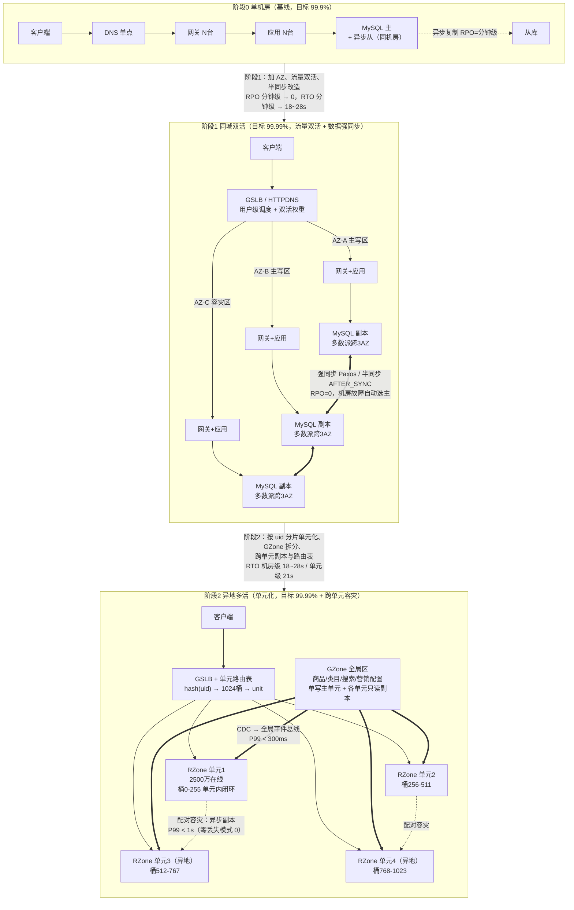
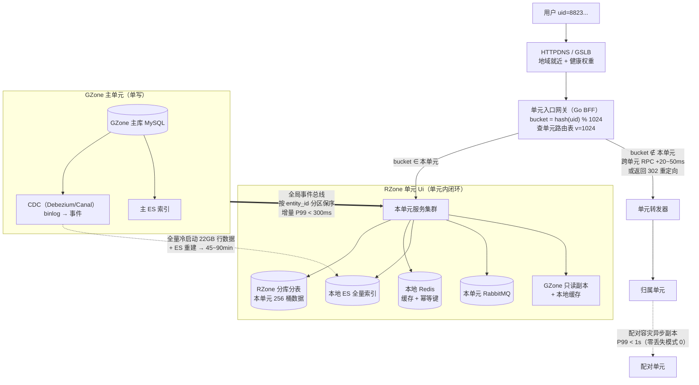
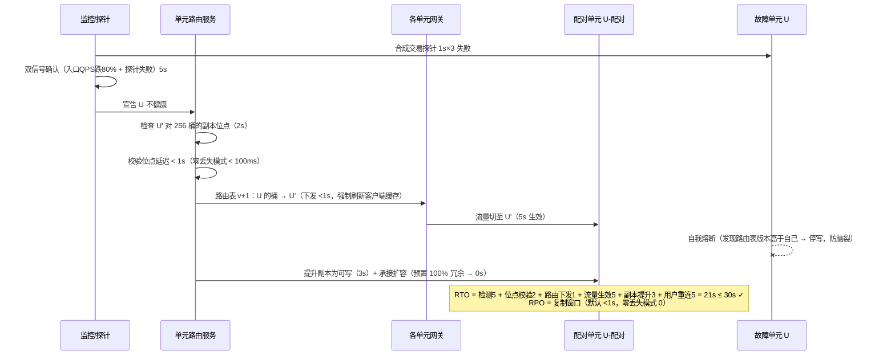

# 08 · 高可用与异地多活容灾架构

> **目标**：1 亿同时在线，可用性 99.99%（年停机 < 53 分钟），RPO=0（交易数据零丢失），RTO<30s（故障切换）。
> **基线演进**：单机房 → 同城双活（流量双活、数据强同步）→ 异地多活（单元化承载，单元内闭环，GZone 全局数据跨单元同步）。
> **文档版本**：v1.0　**最后更新**：2026-10-11　**负责人**：技术架构组

---

## 0. 口径声明与必读材料核对

| 项 | 说明 |
|---|---|
| `architecture/01-overview-unitization.md` | **已存在（2026-10-11 收敛时核实）**。本文档编写时该文件尚未落盘，曾自行建立 RZone/GZone 单元化模型（§5.1）。**收敛裁决（00-conflict-register C8）：模型真值以 01 号总纲为准**（`unit_id = hash(user_id) % N`，N 取 2 的幂；1 亿在线需 14~16 个 RZone + 1 个 GZone），本文 §5.1 的 1024 桶/N=4 作为**迁移粒度定义与 P2 最小可用形态**保留，两者关系见 §5.1 对齐注。 |
| `plans/admin-backend.md` 1.5 部署 | 已读取：容器化 + K8s（namespace `admin-prod`，HPA min2/max10~20）、CI/CD 灰度 5%→50%→全量、技术栈 MySQL 8.0 / Redis 7（**缓存实例 allkeys-lru 与数据实例 noeviction 隔离**）/ RabbitMQ / ES 8.15 / Nacos 2.3.2 / Go 网关 + Java 服务。本文所有容量与切换设计与该栈对齐。 |
| `plans/admin-backend.md`「18 监控运维」 | 该文档**无第 18 章**，对应内容实为 **「十二、监控与运维」**（Prometheus/Grafana、SkyWalking、ELK、P0~P3 告警分级、数据归档 cron）。本文按「十二」口径引用，并在 §8.1 追加多活专属监控项。 |
| `plans/ios-backend.md` 13.5 上线 Checklist | 已读取（25 条）。本文 §8.3 追加 **容灾专项 Checklist 12 条**，与之互补而非替代。 |
| **口径冲突（诚实标注）** | `plans/ios-backend.md` 11.5/13.5 的压测目标为 **QPS 10000+**，本文推导的平台级网关峰值 QPS 为 **630 万**，相差 **630×**。二者不矛盾：10000 QPS 是**单服务/单接口的验收基线**，630 万是**全站漏斗后的入口总量**。分阶段达标见 §9。 |

---

## 1. 流量与容量推导（全文数字的唯一来源）

所有可用性分解、副本数、切换耗时都建立在这组推导上，先给推导，再给结论。

### 1.1 在线 → 峰值 QPS 漏斗

| 步骤 | 参数 | 计算 | 结果 |
|---|---|---|---|
| ① 同时在线 | N | 给定 | 1×10⁸ |
| ② 峰值活跃率 a | 1 秒窗口内至少发 1 请求的用户占比；日常 5%、大促瞬时 20%+，取 **15%** | 1×10⁸ × 0.15 | 1.5×10⁷ 人 |
| ③ 活跃者请求频率 f | 浏览流混合均值（列表/详情/轮询/点击，个体峰值 5~10，混合取 **1.5 req/s**） | 1.5×10⁷ × 1.5 | **2.25×10⁷ req/s（源站前）** |
| ④ 静态/CDN/端缓存拦截 | 图片、JS/CSS、快照类，拦截 **60%** | 2.25×10⁷ × 40% | 9.0×10⁶ |
| ⑤ 应用内缓存/边缘缓存 | 进源站后再拦掉 **30%** | 9.0×10⁶ × 70% | **6.3×10⁶ QPS（网关入口）** |

**结论：全站网关入口峰值 G = 630 万 QPS**；单单元（4 单元均分）= **157.5 万 QPS**。

### 1.2 读写拆分

| 类型 | 占比 | 峰值 | 分布 |
|---|---|---|---|
| 写 | 2% | **12.6 万/s ≈ 13 万/s** | 下单 3.5 万、支付/回调 2.5 万、库存扣减与回滚 3 万、抢券/营销 1.5 万、会员积分 1.2 万、其余（购物车/地址/客服/日志）1.3 万 |
| 读 | 98% | **617 万/s** | 缓存命中 96% → miss 24.7 万/s；写伴随主库强读 1.3 万/s → **DB 读 26 万/s** |

> **跨文档口径对齐（00-conflict-register C10-b/c）**：① **写口径矛盾已裁决**——本文漏斗推导的写 12.6 万/s（2%）与 `01/04/09` 号给定的**写 50 万~100 万 QPS** 矛盾，**容量规划（Pod/分片/MQ/Redis）一律按 100 万/s 上限执行**，本文 13 万/s 仅作为可用性预算分解的中间推导值，不作容量依据。② 本文的读 617 万/s 高于 `01/03/09` 号"读 300 万~500 万"区间上限，**收敛为：应用层入口读 QPS 设计上限取 617 万（本文漏斗值，为各文档最大者）**，300 万~500 万仍作为日常缩容口径；本文缓存命中 96% / DB 读 26 万/s 取代 `01` 号"98.75% 命中率"作为读链路校验值（`03` 号收敛漏斗给出的 DB 实际承接 12 万@500 万读与本文 26 万@617 万读同量级，互为印证）。

### 1.3 各组件容量与实例数（含余量）

| 组件 | 承载量 | 单实例能力（保守实测口径） | 需求实例 | 冗余系数 | 落地配置 |
|---|---|---|---|---|---|
| 网关（Go，4C8G，含 TLS/鉴权/限流） | 630 万 QPS | 4 万 QPS | 158 | ×1.5 | **60 实例/单元**（HPA max） |
| 应用（Java，4C8G，含序列化与下游调用） | 157.5 万 QPS/单元 | 3000 QPS | 525/单元 | ×1.5 | **≈790 Pod/单元**，≈36 个 40C 计算节点/单元 |
| 缓存 Redis | 592 万 QPS 全站（617万×96%），每单元 148 万 | 6 万 QPS/主节点（4C8G 混合读写，保守取值） | **100 主节点**（592/6），即 25 主/单元 | ×1.2（failover 余量 25→30 主） | **每单元 10 组 3主3从 Cluster = 60 节点（30 主+30 从）**，全站 **240 节点**；锁/幂等用独立 `noeviction` 实例（不计入缓存 QPS） |
| DB MySQL | 读 26 万 + 写 13 万 = **39 万 QPS** | 单分片 5000~8000 QPS 混合 | ≥ 78 片 | ×2.6 安全余量 | **写分片 ≥ 200 片**（订单 64、库存 64×8 热点子片、支付 32、会员/营销/财务其余），**单片峰值 < 2000 QPS** |
| MQ RabbitMQ | 5.2 万 msg/s（13万写 × 40% 产生事件） | 3 万 msg/s/节点（镜像队列含 fsync） | 2 | ×2 | **每单元独立 Cluster 3 节点 + 跨单元桥接**（风险见 §8.2 R4） |
| 长连接网关（IM/推送/客服） | 1×10⁸ 连接，内存 1×10⁸×10KB = **1 TB** | 50 万连接/机（32C128G） | 200 | ×1 | **50 机/单元**（单元内 2500 万连接 = 250 GB） |
| ES 搜索 | 每单元全量索引 | — | — | — | 每单元独立集群，5000 万文档重建 17 min（10 节点×5000 doc/s） |

**校验**：单 MySQL 分片 2000 QPS ≈ 单片能力的 33%（余量 3×），符合「峰值不超过单片能力 40%」的红线。

> **跨文档口径对齐（00-conflict-register C5/C10）**：① 网关单实例 4 万 QPS 为本文最激进取值，`10` 号按 1.5 万~2 万 QPS（4C8G）、`05` 号按 ~3.3 万 QPS（8C16G）计——**实例数规划按保守值 1.5 万 QPS/Pod 复核**（630 万 ÷ 1.5 万 ≈ 420 Pod，本文 158 需求值偏乐观）。② MQ 5.2 万 msg/s 为本文"写 13 万 × 40%"的低值推导，与 `04` 号双路径验证的 **300 万条/s（设计 350 万）** 矛盾，**MQ 集群规模按 04 号执行**（业务域拆 4~6 个 RocketMQ 集群）；且本文基于 RabbitMQ 的 P0/P1 口径在 P2 随 01 号裁决统一迁移 RocketMQ（00-conflict-register C2）。③ 应用 Pod 790/单元 × 4 单元 ≈ 3,160 为本文低值口径，**采购按 `09` 号 1.04 万~2.2 万 Pod 上限执行**。

### 1.4 用户数据体量（决定搬家/容灾复制成本）

```
每用户在线数据 ≈ 60 KB
  = 订单主表+明细+日志 20单 × 5行 × 200B ≈ 20 KB
  + 会员/地址/积分/购物车 ≈ 10 KB
  + 售后/行为/客服会话 ≈ 30 KB
全站 RZone 用户数据 = 1×10⁸ × 60 KB = 6 TB
单元化桶粒度 = 1024 桶 → 1 桶 = 6 TB / 1024 = 5.86 GB ≈ 97.6 万用户
```

---

## 2. 可用性目标分解（99.99% → 各层故障预算）

### 2.1 总预算换算

```
1 年 = 525600 min
99.99% 不可用 = 525600 × 0.0001 = 52.56 min/年
月（30 天，43200 min）= 4.32 min
季度（90 天）= 12.96 min
微故障额度（<1s 的抖动）= 52560 次/年
```

### 2.2 两种分解法（诚实说明为何两者都用）

- **并集上界法**（不假设层间独立，层故障会级联，用它做**管理承诺**）：各层不可用分钟数之和 ≤ 总预算。
- **乘积法**（假设层间独立，用它做**工程校核**）：`A总 = ∏ A层`。

> 只用乘积法会**高估**可用性（一次 DB 主从切换同时打掉网关与应用的错误率），因此承诺用并集、校核用乘积。

### 2.3 分层预算表

| 层 | 年不可用预算 | 不可用率目标 | 乘积法贡献 | 允许的有损故障次数（按单次耗时折算） | 主要冗余手段 |
|---|---|---|---|---|---|
| 接入（GSLB/HTTPDNS/CDN/四层 LB） | **5 min** | 99.99905% | 9.5 ppm | 1 次 15s 故障 = 20 次/年 | 双机房 VIP、Anycast、客户端 IP 池兜底 |
| 网关（Go 网关 / BFF） | **7 min** | 99.99867% | 13.3 ppm | 1 次 10s 故障 = 42 次/年 | 每单元 60 实例、跨 AZ 打散、PDB minAvailable 2/3 |
| 应用（40 个微服务） | **9 min** | 99.99829% | 17.1 ppm | 1 次 30s 灰度回滚 = 18 次/年 | 3 副本起、HPA、跨 AZ 反亲和 |
| DB（订单/库存/支付/会员/营销/财务） | **10 min** | 99.99810% | 19.0 ppm | 1 次 10s 主切换 = 60 次/年 | 3 副本跨 3 AZ 强同步、MGR/OB 自动选主 |
| 中间件（Redis/MQ/ES/Nacos） | **11 min** | 99.99791% | 20.9 ppm | 1 次 5s failover = 132 次/年 | Cluster 主从、单元独立集群、本地兜底缓存 |
| **人为/跨层耦合（变更、配置、误操作）** | **5 min** | 99.99905% | 9.5 ppm | 变更导致的有损事故 ≤ 5 min/年 | 灰度、一键回滚、变更冻结、双人复核 |
| **合计（并集上界，含人为）** | **47 min**（42 + 5） | 89.4 ppm | — | — | — |
| **乘积法校核** | `1 - 8.94e-5` = **99.99106%** ≥ 99.99% ✓ | 89.4 ppm | — | — | — |
| **缓冲** | 52.56 − 47 = **5.56 min/年（10.6%）** | — | — | — | — |

> 校验：5+7+9+10+11+5 = 47 min；47/525600 = 8.94×10⁻⁵；1 − 8.94×10⁻⁵ = 99.99106% > 99.99% ✓

### 2.4 错误预算运营（Error Budget Policy）

| 触发条件 | 动作 |
|---|---|
| 月消耗 > 50%（2.16 min） | 告警到架构组；本周变更需双人复核 |
| 月消耗 > 100%（4.32 min） | **冻结功能发布**，只允许稳定性修复；强制复盘 |
| 连续 2 个月超支 | 冻结延长至 1 个迭代；L1~L2 混沌演练频率 ×2 |
| 一次同城主备切换演练（有损 60s） | 消耗 60/259.2 = **23.1% 月预算**，需提前报备 |
| 一次单元级生产切换演练（有损 5s） | 消耗 **1.9% 月预算** |
| 一次跨城链路注入（无损） | 消耗 0%，不占用预算 |

### 2.5 RTO<30s 的分段预算（设计值，须由 §7 演练实测验证）

| 阶段 | 手段 | 预算 | 累计 |
|---|---|---|---|
| ① 故障检测 | 健康检查 1s×3 + 业务合成交易探针（独立于健康检查，1s×2） | **5s** | 5s |
| ② 决策/选主 | Paxos/Raft lease 2s + 选举 1s（**全自动，禁止人工确认**） | **3s** | 8s |
| ③ 路由执行 | 单元路由表/GSLB 权重下发 + 生效（**必须走 GSLB 内置健康检查 + 客户端路由表，纯 DNS TTL 30~120s 不满足本目标**） | **5s** | 13s |
| ④ 服务就绪 | 连接池重建、限流器恢复、路由缓存刷新 | **5s** | 18s |
| ⑤ 用户侧恢复 | 客户端重连退避 0.5~2s，P95 重试 2 次 | **5s** | 23s |
| **合计** | | **23s** | **≤30s（余量 7s）** |

> **诚实标注**：人工介入的 RTO = 60~120s（电话叫醒 + 判断 + 操作），**不满足 30s**。因此核心链路（下单/支付/读商品）必须全自动切换，人工仅做兜底审批与事后确认。这也是 §7 演练必须「实测 MTTD/MTTR」的原因。

---

## 3. 容灾演进架构



### 3.1 各阶段 RPO / RTO / 成本对照

| 阶段 | 拓扑 | 流量 | 数据 | RPO | RTO | 可用性 | 关键成本 |
|---|---|---|---|---|---|---|---|
| **0** 单机房单实例 | 1 DC | 单活 | 无副本 | **= 数据丢失量**（故障时全部未备份数据） | 15~60 min（人工） | 99.9%（年停 8.76h） | 最低 |
| **0.5** 单机房主从 | 1 DC | 单活 | 异步从 | < 5s（平时）/ 故障丢最后未同步事务 | 1~5 min | 99.95% | 低 |
| **1** 同城双活 | 3 AZ（同城，AZ 间距 2~10km，RTT<1ms） | **双活**（三 AZ 都承接读写，按分片亲和） | 3 副本跨 3 AZ 强同步 | **0**（同城故障域内） | **18~28s**（需预置 ≥70% 冗余） | 99.99% | 较单机房 **+2 个 AZ 全量冗余** |
| **2** 异地多活 | 同城 3 AZ × 2 单元 + 异地 2 单元 = 4 RZone + 1 GZone | 单元化双活 | 单元内闭环 + 配对容灾副本 | 同城 **0**；跨单元 **<1s**（零丢失模式 **0**） | 机房 **18~28s** / 单元 **21s** / 城市级 **30~60s** | 99.99% | 存储 ×4（全量 GZone）+ 用户数据 ×2（配对副本）+ 跨城专线 |
| **2+** 零丢失模式（大促开关） | 同上 | 同上 | 交易核心表跨城同步提交 | **全域 0** | 30~60s（城市级） | 99.99% | **写 P99 +25ms**，跨城链路中断时该表不可写 |

### 3.2 RPO=0 的诚实边界（全文最重要的口径）

CAP 定理下不存在「全域零丢失 + 全域零延迟 + 全域可写」。本方案的 RPO=0 是**有条件承诺**：

| 故障域 | 数据类型 | 同步方案 | RPO | 说明 |
|---|---|---|---|---|
| 单机故障 | 全部 | 半同步 `AFTER_SYNC`，**禁止超时降级为异步** | **0** | 宁可写失败也不丢数据 |
| 同城机房/AZ 故障 | 交易核心 | 3 副本跨 3 AZ，多数派=2，Paxos/MGR | **0** | 任一 AZ 挂仍有 2 副本，可写可提交 |
| 同城 2 AZ 同时故障 | 交易核心 | 仍剩 1 AZ ≥ 多数派 2 | **0** | 但只剩 1 AZ，失去容错，需 P0 处置 |
| **城市级灾难** | 交易核心（默认模式） | 跨城**异步追加** | **≤ 50ms**（1 个跨城复制窗口） | 不是 0；跨城 RTT 见 §8.2 R1 |
| **城市级灾难** | 交易核心（零丢失模式） | 跨城**同步提交**（多数派同城 + 异地同步 ACK） | **0** | 代价：写 P99 +25ms，跨城链路断则阻塞写 |
| 城市级灾难 | 非核心（日志/行为/推荐埋点） | 异步 | 秒~分钟级 | 允许丢 |

> **两个必须写进 SLA 的免责**：
> 1. 「RPO=0」在**默认模式**下只覆盖**同城故障域**；跨城为 ≤50ms。
> 2. 开启**零丢失模式**可让跨城也 RPO=0，但写 P99 增加 25ms，且跨城链路中断时交易核心表进入只读——这是用可用性换零丢失，必须由业务在大促前显式决策。
>
> 若业务方坚持「城市级灾难 RPO=0 且写 P99 不劣化」，唯一数学上成立的方案是**多数派本身跨城**（3 城各 1 副本），则每次写都要等最远城市 ACK，写 RTT = 跨城 RTT = 20~30ms，**同样劣化**，且 3 城中 2 城同时故障即停写。**该方案不推荐，列为 §7 技术上限的已知不可达项。**

---

## 4. 同城双活

### 4.1 拓扑：3 AZ（流量双活 + 分片双活）

**为什么不是 2 个机房？** 这是本节最核心的量化推导：

```
设 3 副本部署在 2 个机房（A:a 副本，B:b 副本，a+b=3），多数派 m = ⌊3/2⌋+1 = 2。
要容忍 A 故障 → 需 B ≥ m = 2
要容忍 B 故障 → 需 A ≥ m = 2
→ A+B ≥ 4 > 3，矛盾。
∴ 任何 2 机房 + 3 副本（含 4、5 副本）都无法在「任一机房故障」后仍保有多数派。
```

**解法：同城 3 AZ**（每 AZ 1 副本，多数派 2；或 4 副本 A2/B1/C1，多数派 3）。任一 AZ 故障 → 剩 2 ≥ 2 ✓ **RPO=0 且可继续写**。

```
┌──────────────────────────────── 同城（RTT < 1ms）───────────────────────────────┐
│  AZ-A（主写区）          AZ-B（主写区）              AZ-C（容灾/只读+仲裁）      │
│  ┌──────────────┐       ┌──────────────┐          ┌──────────────┐              │
│  │ K8s: 网关/应用│       │ K8s: 网关/应用│          │ K8s: 网关/应用│              │
│  │ MySQL 分片组1│◀──────▶│ MySQL 分片组1│◀────────▶│ MySQL 分片组1│  3副本/分片  │
│  │ (主)          │ 强同步 │ (从)          │  强同步   │ (从)          │              │
│  │ Redis Cluster │       │ Redis Cluster │          │ Redis 只读副本│              │
│  │ RabbitMQ 集群 │       │ RabbitMQ 镜像 │          │ RabbitMQ 镜像│              │
│  └──────────────┘       └──────────────┘          └──────────────┘              │
│        └─── 分片组2 主在 AZ-B、分片组3 主在 AZ-C（分片级双活，写不跨机房）──┘     │
└──────────────────────────────────────────────────────────────────────────────┘
```

- **分片级双活**（而非「一主一备」）：按 `user_id` 分片，分片组 1 主在 A、组 2 主在 B、组 3 主在 C，三边都承接写，**写容量 ×3、读容量 ×3**，且任一 AZ 挂只丢该 AZ 的主写角色（其余 AZ 已有 ≥2 副本中的数据）。
- 与「一主一备」相比的收益：备机房不再是冷备，99.99% 预算里 DB 层的 10 min 才花得掉（否则一次主从切换就吃掉大半）。

### 4.2 流量调度

| 层 | 手段 | 生效时间 | 说明 |
|---|---|---|---|
| L1 客户端 | **HTTPDNS + 内置 IP 池**（App/小程序启动时拉取，本地缓存 60s，失败回退系统 DNS） | **<1s** | 满足 30s RTO 的主力，绕开 DNS TTL |
| L2 GSLB | 智能 DNS（地域就近 + 权重 + 健康检查 1s×3） | 3~5s | 兜底非 HTTP 流量（下载、回调） |
| L3 四层 LB | 双机房 VIP（Anycast/BGP 或云厂商跨 AZ SLB） | 1~3s | VIP 漂移 |
| L4 网关单元路由 | `hash(uid) → bucket → unit`，路由表由 **单元路由服务**（etcd 版本化）下发 | 下发 <1s，客户端缓存 60s，服务端强制刷新靠推送 + 版本号 | 保证**同一用户的请求粘在同一分片**，避免跨机房写 |
| 调度粒度 | **用户级粘性**，不是简单轮询 | — | 轮询会导致同一用户在 A、B 之间跳，读写跨机房、缓存亲和失效 |

**双活判定与摘除**：健康检查分三层——TCP → HTTP 200 → **合成交易探针**（每 AZ 每秒 1 单真实下单链路，写影子表）。只有三层全绿才纳入流量，避免「进程活着但 DB 连不上的假活」。

### 4.3 数据同步

| 数据 | 方案 | RPO | 切换耗时 | 备注 |
|---|---|---|---|---|
| MySQL（交易核心） | **方案 A（主推）**：MySQL 8.0 MGR 单主模式，3 副本跨 3 AZ，`group_replication_single_primary_mode=ON`，多数派自动选主 | 0 | 3~8s | 与 `plans/admin-backend.md` 的 MySQL 8.0 栈一致 |
| | **方案 B（同级）**：半同步 `rpl_semi_sync_master_wait_point=AFTER_SYNC` + `rpl_semi_sync_master_timeout` 设为**不降级**（宁可写失败）+ Orchestrator/Orchestrator 自动选主 + ProxySQL 路由 | 0 | 6~8s | 需严格验证超时不降级，否则静默降为异步 = **RPO≠0** |
| | **方案 C（升级路线）**：OceanBase 5 副本（3 AZ）或 TiDB（同城 3 副本） | 0 | 8~30s | 单集群 10 万+ TPS，分片扩容更平滑；迁移成本高，列为 P2 阶段选项 |
| Redis 缓存 | **单向主从**（禁止跨机房双主），Cluster 每 AZ 一组主从，`cluster-node-timeout 5000` | 无（数据源是 DB） | 3~5s | 双写会脑裂丢数据 |
| Redis 数据实例（锁/幂等/黑名单，`noeviction`） | 同上 + **双 AZ 强一致副本**（用 RedisRaft 或依赖 DB 行锁兜底） | **0（业务语义）** | 5s | 锁丢失 = 重复下单，**必须有 DB 唯一索引兜底** |
| RabbitMQ | 镜像队列/quorum queue 2/3 ACK，跨 AZ 分布 | 0 | 5~10s | 生产端必须走 **outbox 本地消息表** |
| ES | 每 AZ 独立集群 + CDC 双写 | 索引可重建 | 就地 | 搜索降级返回空列表可接受 |
| 对象存储 OSS | 跨 AZ 同步读 + 版本控制 | 15min | — | 图片可接受，不计入交易 RPO |
| Nacos 配置/注册 | **每 AZ 独立 Nacos 集群** + GZone 配置总线分发 | 配置可回滚 | 就地 | 跨城部署 Nacos 一致性差，见 §5.4 |

### 4.4 双活冲突：脑裂防护与选主

| 风险 | 防护 | 校验方式 |
|---|---|---|
| **双主写入（脑裂）** | ① 一切以**多数派**为准，少数派节点自动降只读并拒绝写（返回 503 + `Retry-After`）② **fencing token / epoch**：每次选主 epoch+1，旧主的写入带旧 epoch 被 DB 拒绝 ③ leader lease（租约 2s < 网络超时 5s），租约过期必须交权 | 演练注入 AZ 间断网，确认「只有一边能写」且另一边返回 503 |
| **Proxy/网关路由与 DB 真实主不一致** | 路由表以 etcd 版本号为准，**DB 写必须携带 epoch**，Proxy 层路由错也写不进去 | 混沌注入 Proxy 与 DB 状态不一致 |
| **缓存跨机房双写覆盖** | Redis 单向复制 + key 亲和（同分片的 key 只由本 AZ 主写）+ 版本号 | 抽样 key 版本巡检 |
| **时钟回拨 → 雪花 ID 冲突** | NTP chrony，偏移 >50ms 告警、>100ms 停发号；ID 生成器带**单元位**：41 位时间戳 + **4 位单元 ID + 6 位节点 ID** + 12 位序列 = 全局 1024 个发号器（**单元上限 16，每单元 64 个**，见 §8.2 R5） | 每日 ID 唯一性抽检（10⁷ 条无重复） |
| **重复下单** | 幂等键（`uid + biz + token`）→ Redis `noeviction` 实例 + **DB 唯一索引兜底**；网关只对幂等接口自动重试（与 `admin-backend.md` 1.1.2 一致） | 幂等测试用例 |
| **配置数据 LWW 覆盖** | LWW（最后写入获胜）**只允许用于无业务语义的展示配置**；交易/营销/库存数据一律用版本号 CAS + 按 key 分区保序 | 评审新增配置类表时逐条检查 |

---

## 5. 异地多活（单元化）

### 5.1 单元化模型定义（本文锚点；与 `01-overview-unitization.md` §3 的对齐结果见表后注）

| 概念 | 定义 | 覆盖数据 |
|---|---|---|
| **RZone（Regional Zone，单元）** | 按 `user_id` 分片的**业务闭环单元**，该桶用户的所有读写都落在归属单元 | 用户、订单、购物车、地址、积分、售后、客服会话、**库存扣减流水** |
| **GZone（Global Zone，全局区）** | 跨单元共享的**只读广播数据**，单写主单元 + 各单元只读副本 | 商品 SPU/SKU、类目树、属性模板、搜索索引、营销配置/优惠券模板、内容/Banner、商家与店铺 |
| **桶（bucket）** | `bucket = hash(uid) % 1024`，1024 是迁移粒度下限 | 1 桶 ≈ 97.6 万用户 ≈ 5.86 GB |
| **单元路由表** | `bucket → unit_id` 映射，etcd 版本化，全单元一致下发，**变更传播 <1s** | — |
| **单元内闭环** | 单元内请求**零跨单元同步调用**（GZone 读本地副本），跨单元只允许：GZone 异步同步、容灾副本、跨单元查询转发 | — |

> **与 01 号总纲的对齐裁决（00-conflict-register C8）**：① 单元划分公式、分片键以 01 号 §3.1 为真值（`unit_id = hash(user_id) % N`，Murmur3，N 取 2 的幂）；本文的 **1024 桶**与 01 号的"user_id 段路由表"兼容——桶是**用户分组/迁移的最小粒度**，多个桶聚合为一个 user_id 段即为一个单元。② **单元数分阶段取值**：P2 最小可用 N=4（本文）、P3 N≤8（本文舒适上限，与 01 号"8 单元则上限 6000 万在线"一致）、P4 达成 1 亿在线需 **N=14~16**（01 号 §5.2；同时是雪花 ID 4 位单元位的硬上限，见本文 §8.2 R5）。③ 雪花 ID 单元位 4 位 + 节点位 6 位（本文 §4.4/§8.2）与 `order_no` 编码（02 号 §3.2：时间 14 位 + 4 位槽位 + 6 位序列）分属内部 ID 与对外单号两层，槽位→单元映射可反解，不冲突。

**单元数 N 的选取**：N=4（同城 2 单元 + 异地 2 单元），每单元 2500 万在线。
- 桶分配：每单元 256 桶，迁移 1 桶 = 全站 0.098% 流量 → 粒度足够细。
- 依据：跨单元 RPC 对数 = N(N-1)/2 → N=4 时 6 对，N=8 时 28 对，N=16 时 120 对（运维复杂度非线性增长）→ **N≤8 为本方案舒适上限**（见 §8.2 R5）。

### 5.2 单元拓扑与请求路由



**路由原则**（按优先级）：
1. **未登录/浏览类请求**：任意单元可服务（读 GZone 本地副本）→ **不产生跨单元调用**，这是 1 亿在线下入口均衡的关键。
2. **登录后的 RZone 请求**：必须路由到归属单元；网关本地路由缓存 60s，缓存 miss 时问单元路由服务（<2ms）。
3. **路由错配**（请求打到非归属单元）：网关转发，**目标 KPI：错配率 <0.5%**；错配率 >2% 触发 P2 告警（通常是路由表下发或客户端缓存过期异常）。
4. **禁止**：跨单元 JOIN、跨单元分布式事务、跨单元同步读调用链 >1 跳。

### 5.3 GZone 同步链路（商品 / 类目 / 营销配置）

```
管理端 admin-* 写入（GZone 主单元 MySQL）
      │  事务提交（半同步，同城 RPO=0）
      ▼
CDC 采集 binlog（50ms）──→ 全局事件总线（Kafka/RabbitMQ 跨单元桥，按 entity_id 分区保序）
      │                        │ 跨城传输 20~30ms（同城 2ms）
      ▼                        ▼
各单元消费者（50ms）──→ ① 本地 GZone 副本 upsert
                    ├──→ ② 本地缓存失效/预热（20ms）
                    ├──→ ③ 本地 ES 索引增量（P99 < 2s）
                    └──→ ④ 版本号 version++（单调）

端到端延迟：同城 P99 ≈ 100ms ｜ 跨城 P99 ≈ 300ms（均值 120ms）
```

| 关注点 | 设计 | 量化 |
|---|---|---|
| **冲突** | GZone **单写**（只在主单元写，主单元可切），其他单元只读 → **无写冲突**；乱序靠 `version` 单调递增 + MQ 按 `entity_id` 分区保序 | 冲突率目标 0；版本巡检见 §5.6 |
| **增量带宽** | GZone 变更 1000 变更/s × 1KB × 4 单元扇出 | **4 MB/s**，跨城专线无压力 |
| **断链降级** | 单元 ↔ GZone 主单元断链 → 本地副本继续**读**（C 端不感知），**管理端写操作失败并明确报错** | C 端可用性不受影响；管理端写可用性受 GZone 主单元约束（不计入 99.99% 的 C 端预算，计入管理端 99.9%） |
| **全量冷启动** | 行数据 5000 万 SKU × 1KB = 50GB → gzip 3:1 = 17GB + 类目/营销/内容 5GB = **22GB** → 1Gbps（125MB/s）传输 **176s**；ES 索引重建 5000 万文档 ÷ (10 节点 × 5000 doc/s) = **1000s**；缓存预热 + 校验 | **新单元上线/灾备预热 45~90 min**（小时级，见 §8.2 R3） |
| **批量刷新上限** | 5000 万 SKU 全量刷新，按 1 万 SKU/s 限流（保护消费端 ES 与缓存） | **5000s ≈ 83 min**，禁止秒级全量刷新 |
| **热点保护** | 秒杀类营销配置变更走**优先级队列** + 单元内批量合并 | 单元内 1000 msg/s 消费无压力 |

### 5.4 各中间件的多活形态

| 中间件 | 多活形态 | 理由 |
|---|---|---|
| Nacos | **每单元独立集群**，配置经 GZone 总线分发；服务发现单元内闭环 | Nacos 跨城一致性与时延不可控；单元内闭环天然要求本地发现 |
| Redis | **每单元独立 Cluster**，禁止跨单元复制缓存 | 缓存可重建，跨单元复制的带宽成本远高于重建成本 |
| Redis 数据实例（锁/幂等） | 单元内 + **配对容灾单元异步副本**；丢失时降级为 DB 唯一索引 + 行锁 | 锁语义不能跨单元并发（会双持锁） |
| RabbitMQ | **每单元独立 Cluster + 跨单元桥（federation shovel）** | 避免单集群跨城镜像队列的写放大 |
| ES | 每单元**全量索引**（GZone 全量 + 本单元 RZone） | 保证搜索零跨单元调用；代价是存储 ×N |
| 对象存储 | 跨区域复制（RPO 15min）+ CDN 回源多源 | 图片类不计入交易 RPO |
| 监控（Prometheus/Grafana/SkyWalking/ELK） | **每单元本地采集 + 全局聚合视图**；单元故障时本地监控仍可读 | 单元挂了必须还能看到它的指标 |
| 时钟 | NTP chrony，偏移 <5ms，>50ms 告警，>100ms 停发号 | 影响雪花 ID 与 LWW |

### 5.5 跨单元交易

#### （1）正常交易：零跨单元
```
浏览（GZone 本地副本）→ 加购 → 下单（RZone 归属单元闭环）→ 支付（第三方回调经路由到归属单元）→ 履约
跨单元调用：0（除第三方支付回调的路由，和 GZone 异步同步）
```

#### （2）用户搬家（计划内，桶迁移）
| 步骤 | 动作 | 耗时 | RPO |
|---|---|---|---|
| 1 | 标记桶为 `MIGRATING`，路由表标记只读窗口 | 1s | — |
| 2 | 目标单元订阅源单元 binlog，拉起增量 | 2s | — |
| 3 | 追平（1 桶 5.86GB @100MB/s） | **59s** | — |
| 4 | 双写窗口（源为主，目标影子写 + 位点比对） | 30s | — |
| 5 | 切流量：路由表版本 +1，全单元下发 | **<1s** | 要求追平位点延迟 <100ms 才允许切 |
| 6 | 源侧停写、清理、全量校验 | 30s | **= 0** |
| **单桶合计** | | **≈ 2 min** | |
| **全量搬家（6TB，1024 桶）** | 单流 100MB/s → 17.5h 串行；**8 路并行 @800MB/s → 2.2h 复制** + 校验切换开销 ×1.5 | **3~4 h** | 0 |

> **结论**：搬家是**小时级计划内操作**（变更窗口、需报备），**不能**作为故障应对手段。故障时靠 §5.5(3) 的常备容灾副本。

#### （3）单元故障时的流量迁移（故障态）


**前提与代价（诚实标注）**：
- U' 必须**常备** U 的数据副本 → 用户数据需**跨单元异步复制到配对单元**，存储成本 **×2**（不 ×4，靠配对而非全量广播）。
- 复制带宽：13 万写 TPS × 1KB binlog = **130 MB/s** 出向，广播到 3 个单元 = 390 MB/s（10Gbps 网卡可承载但跨城专线成本高）→ **采用配对复制 = 130 MB/s，专线 1Gbps 起**。
- **切换单元前必须解决「是否真故障」**：否则双写。对策：故障单元发现自身路由表版本落后即**自我熔断停写**（fencing），宁可该单元短暂不可用也不双写。

#### （4）跨单元查询
- 客服/运营查异地用户：走**全局查询服务**（按 uid 路由到归属单元，超时 2s，限流），或离线数仓。
- 财务/报表跨单元统计：走离线链路（与 `admin-backend.md` 1.1「禁止无路由条件的跨片 SELECT 进入在线链路」口径一致）。

### 5.6 数据校验（对账）三级体系

| 级别 | 频率 | 手段 | 阈值 | 责任 |
|---|---|---|---|---|
| **L1 实时** | 持续 | ① GTID 位点比对（跨单元/跨副本）② 行级 CRC32 分段滚动校验 ③ 单元路由错配率 | 差异 >0 → 立即 P0；位点延迟 >1s → P1 | DBA + SRE |
| **L2 准实时** | 每 5 min | 按桶聚合**订单数 / 支付金额 / 库存扣减量 / 积分变动**，跨单元比对 | 相对差 >0.01% 或绝对差 >10 笔 → P1 | 财务 + SRE |
| **L3 全量** | 每日 02:00（与 `admin-backend.md` 12.3 归档 cron **错峰至 03:00**） | 订单—支付—退款—库存—积分 **五方核对**，输出差异工单 | 任何金额差异 → P0，当日必须闭环 | 财务 |
| **GZone 版本巡检** | 每 60s（Top 10000 热点 key）/ 每日全量 | 各单元 `version` 比对 | 热点差异 >5s → P1；全量差异率 >0.001% → P1 | 搜索 + 商品 |
| **MQ 对账** | 每小时 | 发送端 vs 消费端**条数 + 金额聚合** | 差 >0.01% → P1 | 中间件 |

> **防「双方同错」**：对账数据源必须**独立于业务链路**（独立 CDC → 数仓），否则同一条错误 binlog 会让两边"相等"而漏检。

---

## 6. 故障场景手册（检测 → 切换 → 恢复）

统一约定：**检测用双信号**（基础设施 + 业务合成探针），避免单一信号误判；**切换全自动**，人工只做兜底与事后确认。

### 6.1 场景一：机房断电 / 整机房故障（同城 AZ）

| 环节 | 动作 | 耗时 | 累计 |
|---|---|---|---|
| **检测** | ① 硬件/机房监控失联 3s ② LB 健康检查 1s×3 失败 ③ DB 多数派心跳失联 5s；**双信号确认**（机房失联 + 业务探针失败） | **5s** | 5s |
| **切换** | ① GSLB/HTTPDNS 将该 AZ 权重置 0（3s）② MGR/OceanBase 自动选主（3~8s）③ Proxy/VIP 路由更新（2s）④ 其余 AZ 承接扩容（**预置 ≥70% 冗余 → 0~5s**；未预置则 HPA 冷扩容 30~60s） | **8~18s** | 13~23s |
| **恢复** | 用户重连退避 P95 5s；缓存空值兜底防击穿 | 5s | **18~28s** |
| **RPO / RTO** | RPO=**0**（3 AZ 强同步，任一 AZ 故障剩 2 ≥ 多数派 2）｜ RTO **18~28s ≤ 30s**，**硬性前提是其余 AZ 预置 ≥70% 冗余**；若未预置，RTO = **48~83s，超标** | | |
| **事后恢复** | 故障 AZ 回来：只读追平 → GTID 校验 → 提升为可写 → 流量 5%→50%→100% 灰度回切 | 30~60 min | |
| **责任** | SRE 值班（自动切换）+ 架构师（回切审批） | | |

### 6.2 场景二：DB 主库故障（单实例/单节点）

| 环节 | 动作 | 耗时 |
|---|---|---|
| **检测** | 连接池错误率 >10% 持续 2s；TCP 探活 3 次失败（3s）；Sentinel 熔断触发（1s）→ 双信号 **3~5s** | 5s |
| **切换** | MGR/Orchestrator 自动选主 3~5s + Proxy 路由更新 1s + 连接池刷新 2s | **6~8s** |
| **RPO** | **0**（`AFTER_SYNC` 已 ACK 才返回；**禁止半同步超时降级为异步**，否则静默丢数据） | |
| **恢复** | 原主降从 → 追平 GTID → 灰度回切；根因排查（磁盘/内存/OOM/慢查询） | 30 min |
| **注意** | 若「切换失败 + 半同步不降级」→ 该分片**不可写**，网关返回明确错误并停止下单（资金类禁止降级，与 `admin-backend.md` 1.1.2 一致）；读走其余分片副本 | |

### 6.3 场景三：缓存集群故障（Redis）

> **最危险的场景**：600 万 QPS 若全部穿透 DB（39 万 QPS 承载能力），**过载 15.4×，DB 秒挂**。

| 环节 | 动作 | 耗时 |
|---|---|---|
| **检测** | 命中率跌至 <50% 或连接错误率 >5%（3s）；单实例故障由 Cluster 自动 failover | 3~5s |
| **切换** | ① **本地 Caffeine 缓存兜底**（已在，命中约 30%）② **请求合并 + 空值缓存 + 热点探测** ③ **限流放行**：放行到 DB 的流量 = 39 万 / 600 万 = **6.5%**，其余 **93.5% 返回降级数据或排队**（P0 接口排队、P1/P2 返回空/缓存过期数据）④ Redis Cluster 主从 failover 3~5s；整集群不可用 → 切单元内备用集群 | failover **5~8s**，整体 **10s** |
| **RPO / RTO** | 缓存无 RPO（数据源是 DB）；RTO **10s** | |
| **关键约束** | **锁/幂等/黑名单实例**（`noeviction`）故障时：**禁止无锁写**，降级为 DB 唯一索引 + 行锁 + 限流；若 DB 也异常 → 停写并 P0 上报 | |
| **恢复** | 缓存重建（热点 key 预热 60s）、恢复限流、命中率回到 >95% 后解除降级 | 3~5 min |

### 6.4 场景四：MQ 故障（RabbitMQ）

| 环节 | 动作 | 耗时 |
|---|---|---|
| **检测** | 堆积深度 > 阈值 / 生产端 confirm 失败率 >1%（5s）/ 消费速率跌 80% | 5s |
| **切换** | ① 生产端降级为**本地消息表（outbox）+ 定时重投**（事务内落库，不丢事件，延迟 +5s）② 消费端幂等已保证可重投 ③ 集群节点 failover 5~10s（quorum queue 2/3 ACK）④ 跨单元桥接断 → CDC 直连兜底 | **15s** |
| **RPO / RTO** | RPO=**0**（消息持久化 + 2/3 ACK）；RTO **15s** | |
| **事件分级** | 通知类（站内信/推送）：允许丢弃后补 ｜ 交易类（订单创建、支付成功）：**必须 outbox，禁止直接丢** ｜ GZone 同步类：CDC 兜底 | |
| **恢复** | 堆积消费追赶（5 万 msg/s，1 万堆积 = 0.2s 追平；100 万堆积 = 20s）；核对 L1 对账无差异 | 10 min |

### 6.5 场景五：单元故障（某 RZone 整体不可用）

| 环节 | 动作 | 耗时 | 累计 |
|---|---|---|---|
| **检测** | 单元级合成交易探针 1s×3 失败 **+** 单元入口 QPS 跌 80%（双信号） | **5s** | 5s |
| **切换** | ① 配对单元校验 256 桶副本位点（2s）② 路由表下线 U、桶 → U'，下发 + 强制刷新（<1s + 5s 生效）③ 副本提升为可写（3s）④ U' 承接扩容（**预置 100% 冗余 → 0s**；预置 40% → **+60s 冷扩容，RTO 超标**） | **11s**（2+1+5+3） | 16s |
| **脑裂防护** | 故障单元 U 发现自身路由表版本落后 → **自我熔断停写**（fencing）；U 若"假死复活"，因无路由流量 + 写被 epoch 拒绝，不会双写 | — | |
| **RPO / RTO** | RTO = 5（检测）+ 11（切换）+ 5（用户重连 P95）= **21s ≤ 30s** ✓ ｜ RPO：默认模式 **<1s**（P99 高峰 3s）；**零丢失模式 = 0** | | |
| **容量前提** | **配对单元必须预置 100% 冗余**（否则 2500 万用户涌入导致过载）→ 成本 ×2；折中方案：预置 40% + HPA 冷扩容 60s，则 **RTO=81s，不满足 30s** → 该取舍必须由业务决策（见 §8.2 R6） | | |
| **恢复** | 单元修复 → 只读追平 → 位点校验 → 桶逐个迁回（每桶 2 min × 256 桶，8 路并行 ≈ 64 min） | 1~2 h | |

### 6.6 场景六：网络分区（同城 AZ 间 / 跨城之间）

**总原则：CP 优先，拒绝脑裂。** 多数派侧继续写，少数派侧自动降只读并返回 503。

| 分区类型 | 检测 | 处理 | RPO/RTO |
|---|---|---|---|
| **跨城链路中断**（单元 ↔ 异地副本/GZone 总线） | Paxos 心跳 + **两条独立链路同时失败**才确认（10s，防误判） | 同城多数派不受影响 → **写正常**；跨城追加超时 → **自动降级为「仅同城 RPO=0」** 并 P1 告警；GZone 断链 → 各单元读本地副本，管理端写失败 | RPO 从 0 变为 ≤50ms；C 端**无感** |
| **同城 2 AZ 之间分区**（**最高风险**） | 交叉探测（不依赖单条链路）+ 2 条独立路径同时失败（10s） | 3 AZ 中 2 个互失联 → 各自只能看到 1 副本 < 多数派 2 → **两边都不能写** → **停写**！对策：① 分区时长 < lease（2s）内不切换（抗抖动）② 若确认为真分区且只剩 1 AZ，需**架构师 + DBA 双签**强制多数派重配置（有丢数据风险，需先确认 RPO）③ **该场景必须每季度演练** | 停写 10s~数分钟；RPO 取决于是否强制重配置 |
| **单元 ↔ 单元之间分区** | 路由表心跳 + 跨单元 RPC 失败率 | 本单元照常服务（单元内闭环）；仅跨单元转发的 <0.5% 请求失败 → 客户端重试到正确单元 | 影响面 ≈0.5%，RTO≈0 |

---

## 7. 故障演练（混沌工程规范）

### 7.1 工具与能力矩阵

| 类别 | 工具 | 注入能力 |
|---|---|---|
| 容器/K8s 级 | **ChaosBlade**（主）/ LitmusChades | kill 进程、Pod 驱逐、CPU/内存/磁盘 IO 压力、网络延迟/丢包/断连、文件损坏 |
| 主机级 | ChaosBlade-host / tc + iptables | 网卡延迟、端口黑洞、磁盘满 |
| 应用级 | ChaosBlade-action / JVM 故障注入 | 线程池打满、慢 SQL、依赖超时、异常抛出、时钟偏移 |
| 依赖级 | 自研故障代理 | Nacos 不可用、Redis 主切换、MQ 节点下线、DB 主从切换、DNS 故障、证书过期 |
| 单元级（自研） | 单元路由服务故障模式 | 单元入口摘除、整单元停服、跨城链路 30ms 延迟 + 5% 丢包、GZone 主单元不可用、路由表版本错乱 |

### 7.2 故障注入分级与频率

| 级别 | 注入对象 | 环境 | 频率 | 有损？ | 审批 |
|---|---|---|---|---|---|
| **L1 单点** | kill 单个 Pod/进程、驱逐 1 个节点、单实例重启 | 预发每日 / 生产每周 | 每周 | 无损（3 副本容忍） | 自动化，无需审批 |
| **L2 组件** | Redis 主节点故障、DB 主从/MGR 切换、MQ 节点下线、ES 节点下线 | 预发 / 生产低峰 | **双周** | 有损 5~10s | SRE 组长审批 |
| **L3 机房** | 整个 AZ 网络断开、全 namespace 驱逐、AZ 断电模拟 | 预发每月 / 生产低峰每季度 | **每月** | 有损 15~30s | 架构师审批 + 错误预算报备 |
| **L4 单元** | 单元入口摘除、整单元停服、配对单元接管 | 预发每季度 / 生产每半年低峰 | **每季度** | 有损 20~30s | 架构师 + DBA + 业务 双/三方签 |
| **L5 跨单元/跨城** | 跨城链路 30ms+5% 丢包、跨城全断、GZone 主单元不可用、同城 2 AZ 分区 | 预发为主，生产每年 1 次 | **每半年** | 可能停写 | CTO 级审批，需完整回滚预案 |

### 7.3 演练流程（不可跳步）

```
① 申请与影响面评估（预扣错误预算，见 §2.4）
    ↓
② 变更冻结检查（大促前 14 天禁止 L3+；演练期间禁止其他变更上线）
    ↓
③ 预案与止损确认（一键回滚可用、值班到位、业务方已知会）
    ↓
④ 注入（带 start/stop 时间戳，自动熔断：SLO 越限即自动回滚）
    ↓
⑤ 观察（SLO 仪表盘：MTTD / 切换时长 / RPO 位点 / 数据一致性）
    ↓
⑥ 自动回滚 → 恢复验证（含 L1 对账无差异）
    ↓
⑦ 复盘 72h 内完成 → 更新故障剧本（Runbook）→ 修订本文档对应章节
```

### 7.4 红线（违反即叫停演练）

1. 无止损预案、无自动回滚的注入一律不做。
2. 大促前 14 天停止 L3 及以上；大促前 72 小时停止一切有损演练。
3. **每次演练必须同时验证两件事**：① RTO 计时（从注入到恢复的真实秒数）② RPO 校验（L1 位点比对 + L2 聚合对账无差异）——只看"服务恢复"不算演练通过。
4. 生产 L3+ 需架构师 + DBA 双签，L5 需 CTO 级审批。
5. 演练导致的有损时长计入错误预算（§2.4）。
6. **目标：把 RTO 从"设计值 23s"变成"实测值"**，每季度实测 P50 RTO 必须 < 30s，否则该季度稳定性 KPI 不达标。

### 7.5 演练日历（滚动 12 个月）

| 月份 | L1 | L2 | L3 | L4 | L5 |
|---|---|---|---|---|---|
| M1 | 每周 | — | 预发 | — | — |
| M2 | 每周 | 预发 | 生产低峰 | — | — |
| M3 | 每周 | 预发+生产 | — | 预发 | — |
| M4 | 每周 | — | 预发 | — | — |
| M5 | 每周 | 预发+生产 | 生产低峰 | — | — |
| M6 | 每周 | — | — | **生产低峰** | **预发** |
| … | 每周 | 双周轮换 | 每月 | 每季度 | 每半年 |
> 大促月份：仅 L1（无损）+ L2（预发）。

---

## 8. 技术上限、已知风险与监控

### 8.1 多活专属监控项（补充 `admin-backend.md` 十二 / `ios-backend.md` 11.5）

| 指标 | 目标 | 告警级别（对齐 admin 12.2） |
|---|---|---|
| 各层可用性（滚动 30 天） | 见 §2.3 分层预算，超 50% 预算消耗 | P1 |
| **错误预算剩余** | 月 ≥ 50% | P2 / 超支 P0 |
| **RPO 位点延迟**（跨单元/跨副本） | 默认 <1s；零丢失模式 <100ms | >1s P1，>5s P0 |
| **GZone 同步延迟 P99** | <300ms（同城 <100ms） | >1s P1，>5s P0 |
| **单元路由错配率** | <0.5% | >2% P2，>5% P1 |
| 多数派健康（AZ/副本存活） | 3/3 AZ 在线 | 少 1 个 AZ P0 |
| 单元入口 QPS / 探针成功率 | 探针 100% | 连续 3 次失败 P0 |
| 雪花 ID 时钟偏移 | <50ms | >50ms P1，>100ms P0（停发号） |
| L1/L2 对账差异 | 0 | >0 P0 |
| **实测 MTTD / MTTD 切换秒数** | <30s | >30s P1 |
| 缓存命中率 | >95% | <80% P1，<50% P0 |
| MQ outbox 积压 | 0 | >1000 条 P1 |

### 8.2 技术上限（本方案的物理边界，诚实量化）

| # | 上限项 | 数字与计算 | 超出后需要什么 |
|---|---|---|---|
| **R1** | **跨城物理延迟** | 光纤 5μs/km；京沪 1218km ×1.4 路由系数 ≈ 1700km 等效 → 单程 8.5ms → **RTT 17ms + 设备路由 = 20~30ms**；京广 1900km → **40~50ms**。∴ 跨城同步提交**必然**让 DB 写 RTT 至少 +20~30ms | 要"跨城 RPO=0 且写不劣化"在物理上不可达。可行路径只有：① 接受 +25ms（零丢失模式）② 把灾难域降级为"接受 ≤50ms 丢失" ③ **跨域共识协议（EPaxos/region-locality quorum）**——需换存储引擎（OceanBase/TiDB 跨城部署），且仍受光纤限制 |
| **R2** | **同城 2 AZ 分区 → 失去多数派 → 停写** | 3 AZ 各 1 副本，多数派 2；2 AZ 互失联 → 每侧仅 1 < 2 → **停写**。这是 99.99% 的最大单点风险 | ① 强制多数派重配置（人工双签，可能丢数据）② 增加第 4 个仲裁节点（云上小实例 witness）③ 依赖 §7 每季度演练缩短停写时长。**无纯技术银弹** |
| **R3** | **GZone 冷启动/批量刷新瓶颈** | 全量 22GB 行数据传输 176s + ES 重建 1000s + 预热校验 → **45~90 min**；5000 万 SKU 批量刷新限流 1 万/s → **83 min** | 新单元上线只能是**小时级**。要分钟级需：GZone 按类目分片到多个写主单元、ES 快照跨区域恢复、预热镜像（灾备单元常备全量，代价 ×N 存储） |
| **R4** | **MQ 吞吐与顺序性** | RabbitMQ 镜像队列单节点 3 万 msg/s；单 queue 顺序性 = 分区键串行 → 秒杀热点 key 退化；当前 5.2 万 msg/s 尚可，**>20 万 msg/s 或跨单元持久化扇出时镜像写放大不可接受** | 关键链路迁 **Kafka（跨单元 MirrorMaker2）/ Pulsar（quorum replica）**；outbox 模式保留。迁移窗口 1~2 个迭代 |
| **R5** | **单元数 N 与雪花 ID** | 跨单元对 = N(N-1)/2：N=4→6，N=8→28，N=16→120（运维复杂度非线性）；雪花 ID 10 位机器位 = 1024 发号器，划分为 4 位单元(16) × 6 位节点(64) → **单元硬上限 16，舒适上限 8** | N>8 需**分层单元化**（region → zone 二级路由 + 跨 region 数据联邦）；N>16 需扩展 ID 位（改 41 位时间戳为 39 位腾 2 位，**全网 ID 格式变更，成本极高**）或中心化发号（新增 RTT） |
| **R6** | **单元切换的容量冗余成本** | RTO 21s 的前提是配对单元**预置 100% 冗余**（2500 万用户涌入）→ 计算/存储成本 **×2**；若只预置 40%，HPA 冷扩容 +60s → **RTO = 81s，不满足 30s** | 三选一（必须业务决策）：① 花 ×2 冗余买 30s ② 接受 81s ③ 弹性预留池（预留 40% + 云上突发 60s 内拉起，成本 ×1.4，RTO ≈ 45~60s） |
| **R7** | **用户搬家吞吐** | 6TB 全量 @ 单流 100MB/s = 17.5h；8 路并行 @800MB/s = **2.2h + 校验切换 ≈ 3~4h**；单桶 5.86GB = **2 min** | 搬家是计划内小时级操作。**故障时靠常备副本，不能靠搬家**；要更快需实时双写全量（存储 ×4 + 双写 RTT） |
| **R8** | **跨单元复制带宽** | 13 万写 TPS × 1KB binlog = **130 MB/s**；配对复制 ×1 = 130MB/s（1Gbps 专线够）；广播 3 单元 = 390MB/s（需 10Gbps 跨城专线，成本高） | 只复制交易核心表（约占 binlog 70% → 91MB/s），日志/行为类不跨城 |
| **R9** | **长连接规模** | 当前 4 单元 × 50 机 × 50 万 = **1 亿**；线性扩机器可到 **4 亿**（每单元 200 机）；>5 亿需长连接网关**二级分片**（接入层与业务层解耦、按连接分片再路由） | 长连接网关独立集群 + 消息扇出总线（每条广播消息 × 连接数 = 带宽上限：1 亿连接 × 100B 广播 = 10GB/次，**广播类推送必须分批**，10 万条/批 × 1000 批 = 30s 完成） |
| **R10** | **DB 分片扩展性** | 当前 ≥200 写分片、单片 <2000 QPS（能力 5000~8000）→ DB 层可扩到 **约 100 万 QPS 写**；超过则分片数翻倍（在线扩容工具 2~4h/次，期间写受限） | 写 >100 万 TPS 时换分布式数据库（OceanBase/TiDB，单集群 10 万+ TPS，扩分片在线无损），或按单元内独立库（**已经是单元内闭环，可直接加片**） |
| **R11** | **对账"双方同错"** | 若对账数据源与业务链路同源（同一份错误 binlog），差异为 0 → 漏检 | 对账必须走**独立 CDC → 数仓**链路，并定期注入"故意差异"验证对账器有效性（纳入 L2 演练） |
| **R12** | **计划与目标的量级差** | `plans/ios-backend.md` 压测目标 10000 QPS vs 本文 630 万 QPS = **630×** | 分阶段：见 §9。**不可一次性达标**，也不可用 1 万 QPS 的压测结果宣称支撑 1 亿在线 |

### 8.3 风险登记册

| ID | 风险 | 概率 | 影响 | 缓解 | 触发指标 |
|---|---|---|---|---|---|
| R-01 | 同城 2 AZ 分区导致停写（§8.2 R2） | 低 | P0 | 双链路交叉探测、季度演练、4th witness 议题 | 分区确认 >10s |
| R-02 | 零丢失模式写 P99 +25ms 破 P0 SLA（200ms） | 中 | P1 | 大促前压测；DB 写从 30ms 优化到 15ms 抵消；开关灰度 | P0 写 P99 >190ms |
| R-03 | 单元切换时配对单元容量不足（§8.2 R6） | 中 | P0 | 预置 100% 或弹性预留池；切换前容量预检（<5s） | 接入 CPU >70% |
| R-04 | RabbitMQ 跨单元扇出瓶颈（§8.2 R4） | 中 | P1 | outbox 兜底 + 迁 Kafka/Pulsar | confirm 失败率 >1% |
| R-05 | GZone 主单元成为管理端发布瓶颈 | 中 | P2 | 单写 + 优先级队列；管理端写不计入 C 端 99.99% | 管理端写 RT P99 >1s |
| R-06 | 时钟回拨导致 ID 冲突 | 低 | P0 | chrony + >100ms 停发号 + 每日唯一性抽检 | 偏移 >50ms |
| R-07 | 路由错配率飙升（路由表下发故障） | 低 | P1 | etcd 多数派 + 客户端 60s 缓存上限 + 错配率告警 | 错配 >2% |
| R-08 | 缓存全穿透打挂 DB（§6.3） | 低 | P0 | 6.5% 放行限流 + 本地缓存 + 空值缓存 | 命中率 <50% |
| R-09 | 演练导致真实事故 | 低 | P1 | 自动熔断回滚、变更冻结、错误预算预扣 | SLO 越限 |
| R-10 | 630 万 QPS 目标与现有压测基线脱节（§8.2 R12） | 高 | P1 | 分阶段验收，见 §9 | 压测覆盖率 <80% |

---

## 9. 分阶段落地与验收（对齐现有计划）

| 阶段 | 时间 | 内容 | 可用性目标 | RPO / RTO | 验收标准 |
|---|---|---|---|---|---|
| **P0 稳定性基线** | 0~3 月 | 单机房 3 AZ + MGR/半同步 3 副本、K8s HPA（admin 1.5.2）、Prometheus/SkyWalking/ELK（admin 十二）、告警分级、灰度与回滚 | 99.95% | <5s / 1~5 min | 全链路压测达 `ios 13.5`：QPS 10000+、P99<200ms、错误率<0.01% |
| **P1 同城双活** | 3~9 月 | 3 AZ 分片级双活、GSLB+HTTPDNS 用户级调度、合成交易探针、L1/L2 对账上线、L1~L3 演练常态化 | **99.99%（同城故障域）** | **0 / 18~28s** | ① AZ 级断网演练实测 RTO<30s ② 演练后 L1/L2 对账零差异 ③ 分层预算看板上线 ④ **其余 AZ 预置 ≥70% 冗余**经容量压测验证 |
| **P2 异地多活** | 9~18 月 | 单元化改造（uid 路由、桶、单元内闭环）、GZone 拆分与同步链路、配对容灾副本、单元路由服务、Nacos 每单元独立、L4 演练 | **99.99%（含单元故障）** | 同城 0 / 单元 21s / 跨单元 <1s | ① 单元级停服演练实测 RTO<30s ② 用户搬家 2min/桶、全量 3~4h 实测 ③ 路由错配率<0.5% ④ GZone P99<300ms |
| **P3 零丢失与常态化** | 18 月+ | 零丢失模式开关（跨城同步提交）、L5 演练、Kafka/Pulsar 迁移、错误预算自治 | 99.99% | 城市级 0 / 30~60s | ① 跨城断链演练：C 端无感、RPO 自动降级告警正确 ② 全年错误预算消耗 <50% ③ 季度实测 P50 RTO<30s |

### 9.1 容灾专项上线 Checklist（追加到 `ios-backend.md` 13.5）

- [ ] **99.99% 分层预算看板**上线（§2.3），各层预算消耗可见、超 50% 自动告警
- [ ] **RTO 实测**：AZ 级、单元级切换各演练 1 次，实测秒数均 **<30s**（不是设计值）
- [ ] **RPO 实测**：每次演练后 L1（GTID/CRC32）+ L2（5min 聚合对账）**零差异**
- [ ] 合成交易探针覆盖 **每个 AZ / 每个单元**，1s 频率，双信号判定
- [ ] 单元路由服务 + 路由表版本下发 **<1s**，客户端缓存 TTL ≤60s，错配率 KPI <0.5%
- [ ] GZone 同步链路延迟监控（P99 <300ms）与版本巡检上线
- [ ] **半同步 `AFTER_SYNC` 且禁止超时降级**已在生产配置并经变更验证
- [ ] **雪花 ID 单元位/节点位**与单元数规划一致（单元 ≤16、每单元发号节点 ≤64），时钟偏移告警 >50ms / 停发号 >100ms
- [ ] 缓存故障降级预案就绪：**DB 放行限流 6.5%** + 本地缓存 + 空值缓存 + 请求合并，压测验证过载 15× 不打挂 DB
- [ ] MQ outbox（本地消息表）已在下单/支付链路落地，RabbitMQ 全故障时事件不丢
- [ ] 配对单元**容量预检**与切换前冗余校验通过（对应 §8.2 R6 的容量决策已书面确认）
- [ ] 混沌演练日历（§7.5）与错误预算运营规则（§2.4）已评审，大促冻结窗口已同步至变更流程

---

## 跨文件同步记录

| 日期 | 变更 | 影响文件 | 状态 |
|---|---|---|---|
| 2026-10-11 | 建立 RZone/GZone 模型锚点（§5.1）、雪花 ID 单元位（4+6 位，单元上限 16）、Nacos 每单元独立、MQ 分单元集群 | `architecture/01-overview-unitization.md`、`plans/admin-backend.md` 1.1/1.2/1.5、`plans/ios-backend.md` 13.5 | **已收敛**：01 号已存在并核实，模型真值以 01 号 §3 为准，本文 §5.1 保留为迁移粒度 + P2 最小形态（见 §0/§5.1 对齐注，00-conflict-register C8）；plans/ 侧回写仍待执行 |
| 2026-10-11 | 引用 admin-backend「十二 监控与运维」替代任务书中的「18」章节编号 | `plans/admin-backend.md` | **已确认**：全仓核实 admin-backend 实际章节为 第十章安全 / 第十一章性能 / 第十二章监控运维 / 第十七章其余模块，**无第 18 章**；任务书"17/18 章"说法作废（00-conflict-register C9） |
| 2026-10-11 | 标注压测基线 10000 QPS 与平台目标 630 万 QPS 的 630× 差距，给出分阶段验收 | `plans/ios-backend.md` 11.5/13.5 | **架构侧已收敛**（`09` 号 §8.2 #1/#3 给出修正值：压测目标 = 120% 峰值）；plans/ 侧修订待执行 |
| 2026-10-11 | 写 QPS 13 万/s（漏斗 2%）与 01/04/09 号"50 万~100 万"矛盾 → 容量按 100 万/s 上限；网关 4 万 QPS/Pod 偏乐观 → 按 1.5 万复核；MQ 5.2 万 msg/s → 按 04 号 300 万条/s；应用 Pod 3,160 → 按 09 号 1.04 万~2.2 万 | 本文 §1.2/§1.3 | **已加注（2026-10-11 收敛）** |
